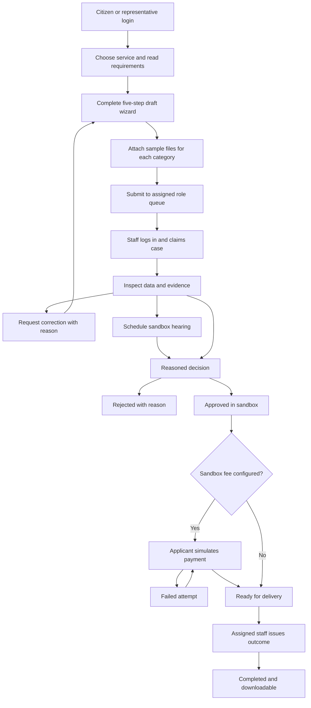
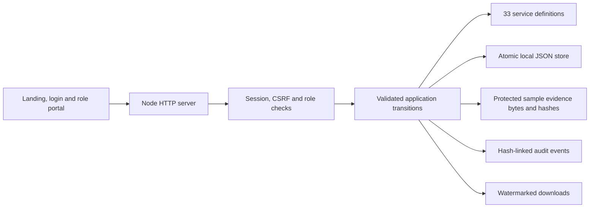

<div align="center">

# e-Bhumi · Role Platform

### বাংলাদেশের ভূমিসেবার একটি সম্পূর্ণ স্থানীয় sandbox journey

**33 service workflows · 10 separate role portals · Server-side login · Persistent applications & evidence**

[Run locally](#quick-start) · [Roles](#role-platforms) · [Services](#service-coverage) · [App flow](#application-flow) · [Screenshots](docs/SCREENSHOTS.md) · [Research](docs/BD_LAND_RESEARCH.md)

</div>


> **Local sandbox, not a government system.** You can complete the simulated application, staff review, correction/hearing, payment and outcome process. This app cannot update official records, issue legally valid certificates, register deeds, collect real tax or transfer compensation. Use sample information only.

## What changed

The former frontend-only previews now have a Node.js API, server-side accounts, role-scoped work queues, validated state transitions and file-backed storage. Selecting a role is no longer a client-side menu switch: each account opens its own `/portal/<role>` and API permissions are enforced on the server.

- 33 described services with their own fields, evidence categories, reviewing role and outcome.
- Five-step applicant wizard: eligibility, applicant/authority, land/service information, evidence, review/submit.
- Draft resume, correction/resubmission, withdrawal, staff claim, hearing, reasoned approval/rejection and outcome issuance.
- Sandbox checkout with failure/retry, duplicate-success protection, receipts and finance reconciliation.
- Actual sample-file storage, server SHA-256 hashes, ownership checks and protected download.
- Notifications and analytics derived from current local records instead of fixed dashboard totals.
- Separate citizen, representative, land-officer, records, surveyor, registration, finance, support, administrator and auditor platforms.
- Administrator account creation, role/suspension controls and intake settings; read-only auditor access.
- Sample parcel passport/timeline, schematic map, evidence discrepancy comparison, area conversion and user-proposed share worksheet.
- Official-source links and an honest separation between implemented sandbox services and the 460-item requirement registry.

## Quick start

**Requires Node.js 18+. No npm package installation, build, API key or database setup is required.**

```bash
cd e-Bhumi-Frontend
npm start
```

Open **[http://127.0.0.1:8080](http://127.0.0.1:8080)**, then choose **Open workspace**.

Windows: double-click `run_local.bat`. Linux/macOS: run `sh run_local.sh`.

**This edition needs its Node server.** Python/static-only hosting and GitHub Pages cannot run the login/API workflows. `file://` is not supported. `server.js` delegates to the same server as `server.cjs`.

If port 8080 is occupied:

```powershell
$env:PORT=8081
npm start
```

## Demo login

At `/login.html`, select a sample account and sign in. The first startup seeds local role accounts. Their shared demo password is:

```text
BhumiDemo!2026
```

| Role | Sample email | Separate portal |
| --- | --- | --- |
| Citizen | `citizen@demo.ebhumi.local` | `/portal/citizen` |
| Representative | `representative@demo.ebhumi.local` | `/portal/representative` |
| Land officer | `officer@demo.ebhumi.local` | `/portal/officer` |
| Records officer | `records@demo.ebhumi.local` | `/portal/records` |
| Surveyor | `surveyor@demo.ebhumi.local` | `/portal/surveyor` |
| Registration desk | `registrar@demo.ebhumi.local` | `/portal/registrar` |
| Finance | `finance@demo.ebhumi.local` | `/portal/finance` |
| Support | `support@demo.ebhumi.local` | `/portal/support` |
| Administrator | `admin@demo.ebhumi.local` | `/portal/admin` |
| Auditor | `auditor@demo.ebhumi.local` | `/portal/auditor` |

Citizens and representatives can self-register. Public registration cannot create staff or administrator accounts. Staff are provisioned by an administrator. These published demo credentials are for local evaluation; the app binds only to loopback and is not configured for public deployment.

## Role platforms

| Platform | Working responsibilities | Restrictions |
| --- | --- | --- |
| Citizen | Own applications, evidence, payment attempts, outcomes, notifications and account | Cannot view another applicant's private file or act as staff |
| Representative | Applicant workflows with principal/authority reference | Own account scope; no access to every citizen's records |
| Land officer | Mutation, lease, acquisition, regional and revenue-service queues | Cannot process a records, finance or surveyor queue |
| Records officer | Khatian/e-porcha, map, record correction and land-information requests | Cannot make a mutation decision |
| Surveyor | Boundary, survey objection, due diligence and zoning enquiries | No authority over unrelated queues |
| Registration desk | Deed search/copy and registration-readiness reviews | Does not register a real deed |
| Finance | Tax requests, sandbox receipts and reconciliation | Cannot decide non-finance service cases |
| Support | Grievances, assisted service and appointment requests | No live office inventory or external complaint dispatch |
| Administrator | Accounts/access, settings, read-only case oversight and audit | Cannot bypass service-role review or issue decisions |
| Auditor | Read-only case inspection, operational reports and audit-chain verification | No case, account or settings mutations |

Staff cannot see applicant drafts before submission. A reviewer must claim a submitted request before deciding it. Changing or suspending a staff account revokes its sessions and returns active assigned work to the relevant role queue.


## Service coverage

All 33 services have a described intake, service-specific questions, required sample evidence categories, assigned review role and downloadable sandbox outcome. [Detailed service handbook](docs/SERVICE_HANDBOOK.md) includes every field and evidence category.

| Area | Implemented local workflows |
| --- | --- |
| Mutation | Transfer mutation / নামজারি, inheritance mutation, partition / জমাভাগ, consolidation |
| Records | Record correction, certified e-porcha, online Khatian copy |
| Maps and survey | Mouza map, survey objection, boundary/field survey |
| Tax | Holding registration/coordination, land development tax/Dakhila, tax-demand objection |
| Lease and settlement | Khas settlement, tea-estate renewal, waterbody lease, commercial/industrial lease |
| Acquisition/requisition | Compensation claim, objection, requisition request, agency acquisition proposal |
| Revenue cases | Miscellaneous case, review, appeal preparation, rent-certificate response |
| Registration | Deed search/copy, registration readiness |
| Intelligence | Purchase due-diligence request |
| Support | Grievance, office/assisted appointment |
| Regional | Separate CHT customary-land request |
| Information | Land-information bank request, land-use/zoning enquiry |

**Important:** “Implemented” here means the local simulation can be completed. Current legal eligibility, documents, official fee schedules, deadlines and provider access require competent-authority validation. The evidence lists are prototype preparation checklists, not official exhaustive requirements.

## Application flow



Every change adds case history and an audit event. Owner notifications appear for staff actions and payment events. Read views refresh periodically; the wizard is not overwritten while being edited.

### Try a complete Namjari journey

1. Sign in as **citizen** and open **All land services → নামজারি → Start this service**.
2. Confirm sandbox eligibility and fill sample applicant, authority, division/district, Mouza, Khatian, Dag and area information.
3. Fill deed reference, transfer date and transfer type. All eight divisions and 64 district options are available; Upazila/Mouza are user-entered references.
4. Upload sample files, or use **Generate sample TXT evidence** for each category. Review and submit.
5. In another browser profile, sign in as **officer**. Open the queue, claim the request and inspect evidence.
6. Request correction, schedule a hearing or record approval/rejection with a reason. The applicant can amend a returned request and resubmit it.
7. After approval, the citizen opens **Sandbox checkout** and can test a failure followed by successful retry.
8. The officer issues the ready outcome. The citizen downloads the watermarked HTML/JSON outcome.
9. Finance can reconcile the successful sample transaction; auditor can inspect the linked history.

One browser profile shares one session cookie across tabs. Use different browser profiles/private contexts when operating different roles simultaneously, or sign out and sign in as the next role.


### Regional and lease views

| Government land lease | Chattogram Hill Tracts workspace |
| --- | --- |
|  |  |

These screens illustrate regional preparation contexts. Their labels and explanatory copy are sample sandbox representations.

## Working tools and exports

- Case export JSON with submitted fields, evidence metadata, history, payment attempts and outcome.
- Outcome HTML/JSON clearly marked **DEMO / NOT OFFICIAL / NO LEGAL EFFECT**.
- Protected sample-file download with SHA-256 metadata.
- Sandbox receipt JSON and payment-ledger CSV.
- Audit JSON with chain-verification result and computed role-visible operational reports.
- Parcel selection from map or accessible list, sample record timeline and schematic SVG export.
- Area converter, deed/record area discrepancy comparison and user-entered percentage allocation worksheet.
- Keyword-based service finder; it is not a live AI or legal adviser.

The share worksheet checks that proposed percentages total 100. It does not calculate legal inheritance entitlements. GIS is schematic and cannot verify boundaries. The land passport is sample context, not proof of ownership.

## Architecture



| Component | Location |
| --- | --- |
| Login UI | `e-Bhumi-Frontend/login.html`, `auth.js` |
| Role portal | `portal.html`, `portal.js`, `portal.css` |
| Static/API server | `server-v4.cjs`; launched by `server.cjs` |
| Domain logic and access rules | `lib/platform.cjs` |
| Service definitions and role capabilities | `lib/catalog.cjs` |
| Data store | `e-Bhumi-Frontend/.data/platform.json` created on first run |
| Requirement registry | `data/features.json` — 460 retained requirements |
| API lifecycle/security tests | `tests/platform.test.cjs` |
| Optional browser verification | `tests/browser.cjs` |

The old client-only `app.js` is retired. Existing `/workspace.html` requests enter the authenticated portal. There are no third-party runtime packages.

## Data, security and operations

- Passwords use salted Node `scrypt`; password hashes are not returned by user-list APIs.
- Random HttpOnly/SameSite session cookie; eight-hour session duration; sessions are memory-only and end on restart.
- CSRF token and origin checks on mutations; login attempts are rate limited.
- Server-side owner and role checks, claim ownership, revision checks and allowed state transitions.
- Protected evidence endpoints; uploads accept sample TXT/PDF/PNG/JPEG, with size limits and basic format checks.
- Static serving uses an allowlist; `.data`, server source and library files are not exposed.
- Atomic JSON write/rename, current-record analytics, audit history and role-change session revocation.

This is a local prototype, not a production security certification. The JSON file contains sample evidence and account hashes; it is not encrypted. There is no malware scanner, live NID/OTP verification, external signature, cloud backup, SSO, email reset or production database. It is designed for a single local server process, not multiple concurrent server instances.

To back up local records, stop the server and copy `.data` to a protected local backup. Restore the folder only while the server is stopped. Do not commit or package it with shared source. Fresh deliveries contain no generated user store. Never expose the seeded demo accounts to the public internet.

## Research and scope boundaries

The official Ministry of Land portal groups mutation, land tax, records/maps, acquisition/requisition, lease/settlement, revenue cases, land information and grievance services. This edition maps those broad categories into local workflows. See [research, sources and gap analysis](docs/BD_LAND_RESEARCH.md).

The supplied screenshots informed land timelines, evidence obligations, discrepancy review, share proposals and assisted digital access. Their style, fee figures, names and claims of official verification were not copied into the application.

The 460-item registry remains a **requirement catalogue**, not a claim that all advanced GIS, AI/OCR, government integration and production-platform capabilities are implemented. [Feature status](docs/FEATURES.md) makes the boundary explicit.

## Validation

```bash
npm run check
npm test
```

The API suite completes all 33 service types, including files, submission, correct reviewer, approval, optional payment and issued outcome. It also tests mutation correction/hearing, payment failure/retry/replay, ownership/CSRF/origin restrictions, staff registration rejection, stale revisions, account suspension, intake settings, restart persistence and audit-chain integrity.

Browser verification covers all 10 role logins, a full mutation journey through outcome download, citizen tool views, administrator access, auditor chain view and mobile service layout. [Validation report](VALIDATION.md) records the bounded results and [screenshots](docs/SCREENSHOTS.md) show the current platform.

## Troubleshooting

| Problem | Action |
| --- | --- |
| Cannot log in / API unavailable | Run `npm start`; do not use Python, static hosting or `file://` |
| Demo staff account is suspended | An active administrator must restore its access |
| Applicant sees an old status | Open the case again, wait for refresh or reload |
| Staff sees no request | Check service reviewer role and that the applicant submitted it |
| Outcome button unavailable | Staff must approve, required sandbox payment must succeed, then staff must issue |
| Another role opens in the same tab | Sign out; one browser profile shares a session cookie |
| Port conflict | Set `PORT` before starting the server |
| Store cannot be read/written | Stop the server, preserve the data file, inspect permissions and restore a known-good backup; do not delete user records |
| Missing official status or real payment | Not integrated; follow the official source links |

## Remaining production work

Authorised government integration, current legal/fee validation, real identity verification, reviewed inheritance rules, true GIS/survey data, live appointments, official certificate signatures, real payments/reconciliation callbacks, production database/storage, malware scanning, full Bangla localisation, accessibility audit, deployment hardening and operational disaster recovery remain separate work.

## Project and licensing

Based on the user-supplied `LANDFINAL` project, referencing [E-Bhumi/E-Bhumi](https://github.com/E-Bhumi/E-Bhumi). Source changes are local; no GitHub push or public deployment is included. No license grant was supplied; confirm redistribution rights with the maintainer.
