<div align="center">

# e-Bhumi

### আপনার জমি। সেবার পথে স্বচ্ছতা।

Your land. A clearer path.

A citizen-first land-service preparation workspace for Bangladesh.

**24 citizen routes (21 preserved + Law Library + Vested Property + Role Directory) · 33 service workflows · 24 role platforms · 460 tracked requirements · Local sandbox**

[Quick start](#quick-start) · [Screenshots](#screenshots) · [Features](#features-and-page-guide) · [App flow](#app-flow) · [Architecture](#architecture) · [Roadmap](#roadmap)

</div>

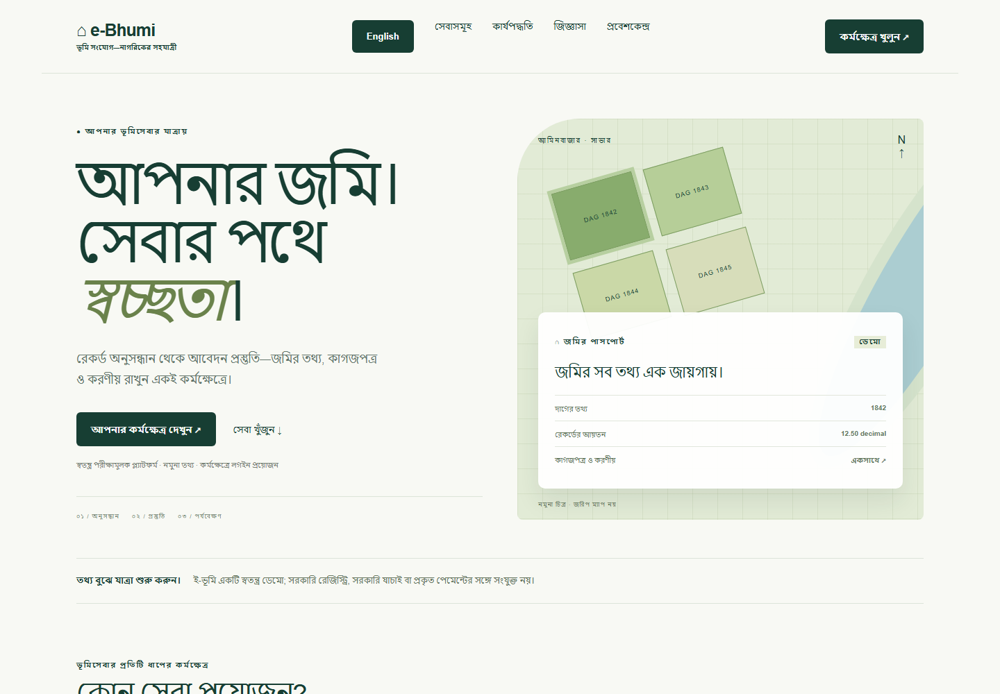

বাংলা মূল ভাষা; English বাটন থেকে অনুবাদ বেছে নেওয়া যায়। মূল font, landing composition, lease ও CHT নকশা রাখা হয়েছে। নতুন আবেদনের দপ্তরভিত্তিক কাজ জানতে [২৪টি ভূমিকার ম্যাট্রিক্স](docs/ROLE_WORKFLOWS.md) এবং [ইজারা/নিলাম/দরপত্র গবেষণা](docs/BD_LEASE_AUCTION_RESEARCH.md) দেখুন।

| নাগরিকের বাংলা কর্মক্ষেত্র | দপ্তরের যাচাই ও handoff |
| --- | --- |
| 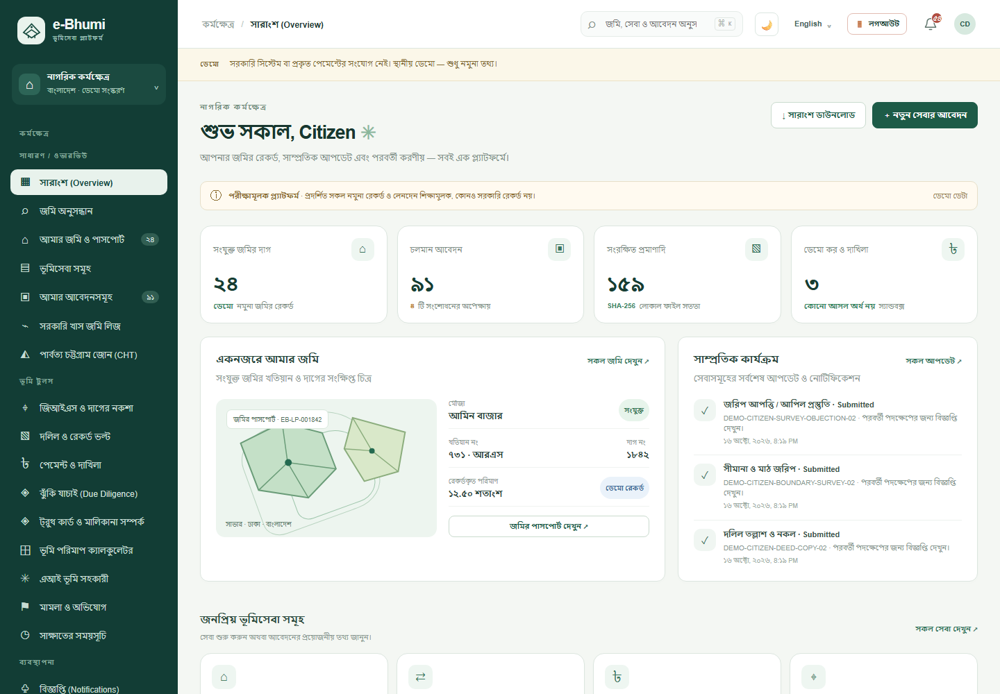 | 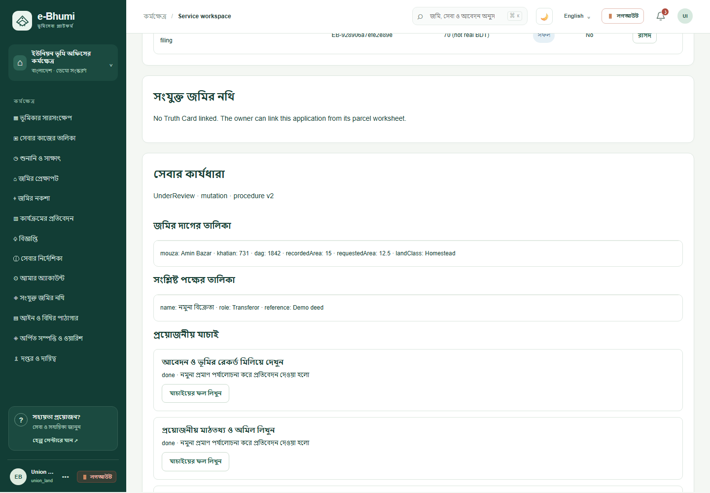 |

> **Demo status:** e-Bhumi is an independent prototype, not an official Government of Bangladesh service. Land references, geometry, statuses and amounts are illustrative. It does not establish ownership, accept real payments, submit official applications or reserve government appointments.

## আইন, গবেষণা ও দপ্তর — v5.7.0

সব রোলে **আইন ও বিধির পাঠাগার**: ৩৫ নির্বাচিত সরকারি পাঠ্যসূত্র, ১২ বিষয়, অনুসন্ধান, বুকমার্ক, ব্যক্তিগত নোট ও মূল সরকারি পূর্ণপাঠের link। [পাঠাগার ও উৎস তালিকা](docs/LAW_LIBRARY.md)। এটি সব বাংলাদেশি ভূমি আইন সম্পূর্ণ সংকলিত হওয়ার দাবি নয়।

**অর্পিত সম্পত্তি ও ওয়ারিশ ফাইল**: ঐতিহাসিক গেজেট/তালিকা, পুরোনো→নতুন দাগ, সকল ওয়ারিশ, ইজারা, মামলা, বাহ্যিক আদেশ, vault evidence ও private review। [শেয়ার করা গবেষণার বাস্তবায়ন ও সীমা](docs/LEGACY_PROPERTY_RESEARCH.md)। **২৪ রোল**, service-specific specialist routes, conditional ministry/division/legal consultations with a return to the original desk, and a role directory preserve the previous features and visual design.

| আইন-পাঠাগার | অর্পিত সম্পত্তির প্রস্তুতি |
| --- | --- |
| 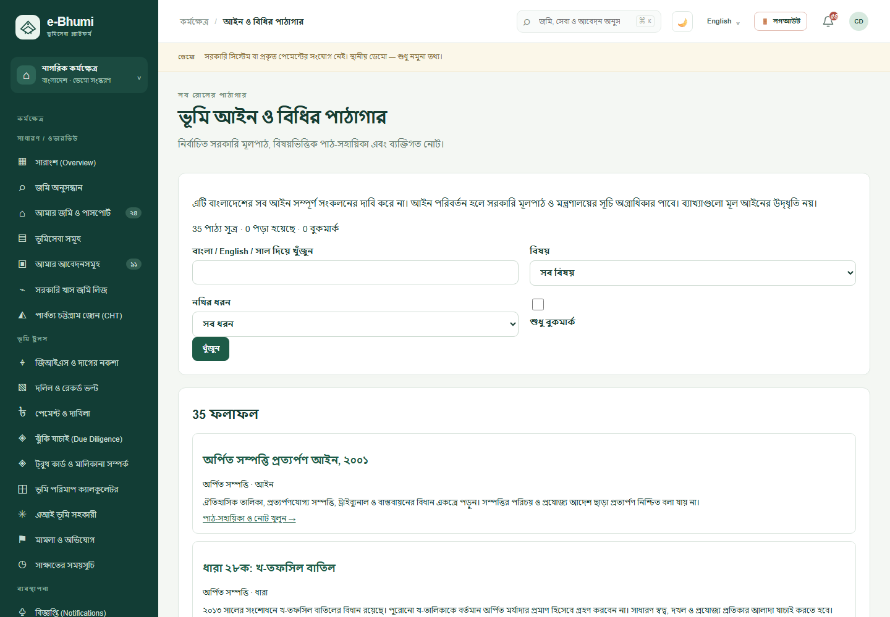 | 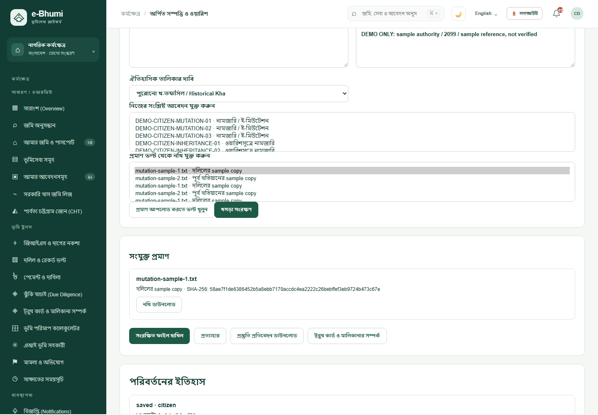 |

## বাংলা অভিজ্ঞতা — v5.7.0

আপনার ছয়টি browser মন্তব্য অনুযায়ী বাংলা landing/login copy, সবুজ headline emphasis, সোজা notification bell ও tablet header ঠিক করা হয়েছে। বাংলা menu/actions/placeholders/errors আরও বিস্তৃত; English switch-এ মূল লেখা ফিরে আসে। **২৪ role / ৩৪৩ page-view audit**, 390px/985px layout ও সম্পূর্ণ সেবার regression checks আছে। [বাংলা অভিজ্ঞতা ও screenshots](docs/LOCALIZATION_v5.7.md) · [সরকারি সূত্রে ভূমিসেবার coverage এবং বাকি সংযোগ](docs/BD_COVERAGE_AUDIT_v5.7.md)।

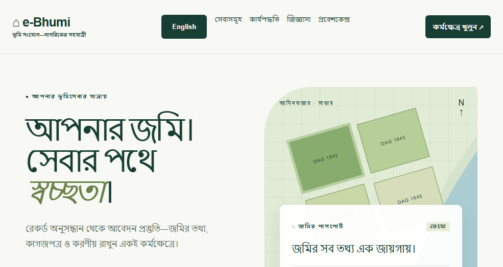

## Why e-Bhumi?

Land-service preparation involves many related details: a Dag or Khatian reference, a Mouza, supporting documents, an application, and questions that need official confirmation. e-Bhumi brings that preparation into a single browser workspace.

Citizens can explore sample records, organise drafts, review checklists and keep notes beside each task. The prototype also demonstrates lease, regional, administrative and analytics screens for future development.

### At a glance

| Item | Current delivery |
| --- | --- |
| Entry point | Public landing page with service links and FAQs |
| Navigation | 24 workspace routes with shareable hash URLs |
| Catalogue | 460 requirement entries; requirements are not implementation claims |
| Frontend | HTML, CSS and vanilla JavaScript |
| Local server | Node.js standard library; no package installation needed |
| Storage | Persistent server JSON with protected sample evidence; account-scoped preparation preferences |
| Languages | English content; partial Bangla navigation and numeral support |
| Official integrations | Not connected |

## Contents

- [Quick start](#quick-start)
- [Screenshots](#screenshots)
- [Features and page guide](#features-and-page-guide)
- [App flow](#app-flow)
- [Five-minute walkthrough](#five-minute-walkthrough)
- [Architecture](#architecture)
- [Data and persistence](#data-and-persistence)
- [Performance approach](#performance-approach)
- [Accessibility and localisation](#accessibility-and-localisation)
- [Validation](#validation)
- [Troubleshooting](#troubleshooting)
- [Roadmap](#roadmap)
- [Contributing](#contributing)
- [License and authority](#license-and-authority)

## Quick start

**Prerequisite:** Node.js 18 or newer. No API keys, database, `.env`, Docker, build step or `npm install` is needed for this frontend.

From the project directory:

```bash
cd e-Bhumi-Frontend
npm start
```

Open **[http://127.0.0.1:8080](http://127.0.0.1:8080)**.

| Destination | Local URL |
| --- | --- |
| Landing page | `http://127.0.0.1:8080/` |
| Dashboard | `http://127.0.0.1:8080/workspace.html#dashboard` |
| Applications | `http://127.0.0.1:8080/workspace.html#applications` |
| Feature catalogue | `http://127.0.0.1:8080/workspace.html#feature-catalog` |

**Windows:** double-click `e-Bhumi-Frontend/run_local.bat`. **Linux/macOS:** run `sh run_local.sh` from that folder. This authenticated edition requires Node; static-only serving cannot run the API.

Use HTTP for normal use. Opening HTML directly with `file://` may prevent the full feature JSON from loading. The included server listens on `127.0.0.1`; it is a local development server, not a production service.

## Role login and demo evaluation

Open /login.html and choose a demo role. The local demo password is `BhumiDemo!2026`. Emails follow `<role>@demo.ebhumi.local` for citizen, representative, officer, records, surveyor, registrar, finance, support, admin, auditor, union_land, ac_land, uno, dc and lease_committee.

Citizens and representatives can register; administrators provision staff. One browser profile shares one session cookie, so use separate profiles/private contexts for simultaneous role evaluation. Public registration cannot select a staff role. All original 18 citizen navigation entries remain visible, with private citizen settings under Administration.

To operate a sample process, use an editable draft or submitted case, then sign into the corresponding service reviewer. Completed outcomes are watermarked and do not update any government registry.

## Screenshots

Workspace screenshots were refreshed on 17 October 2026 from the current source. The Bangla-first landing capture is current; earlier English views are retained for translation/reference. All displayed records are demonstration sample data. For the visual gallery of the preserved 21 workspaces and the new law/research views, see [Screenshot Gallery](docs/SCREENSHOTS.md).

### Regional and lease views

| Government land lease | Chattogram Hill Tracts workspace |
| --- | --- |
| 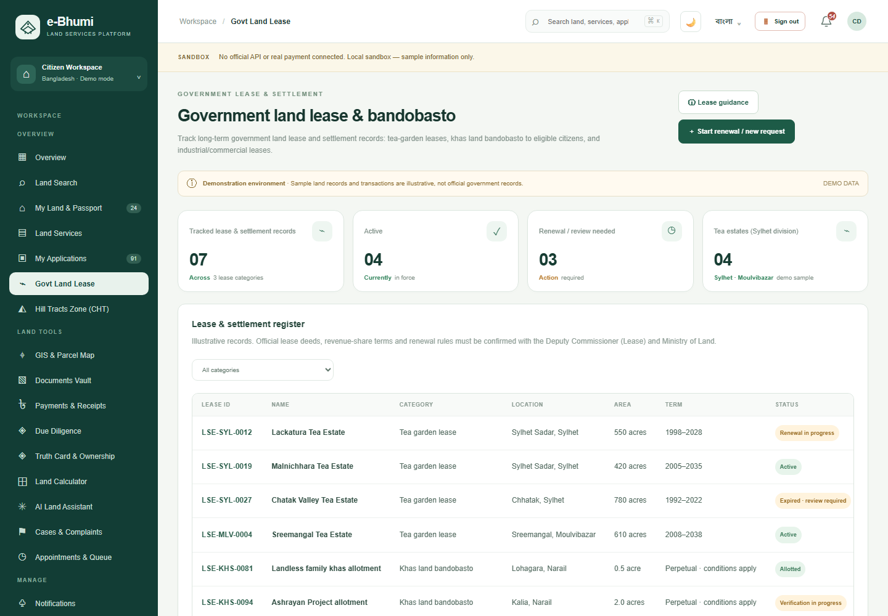 | 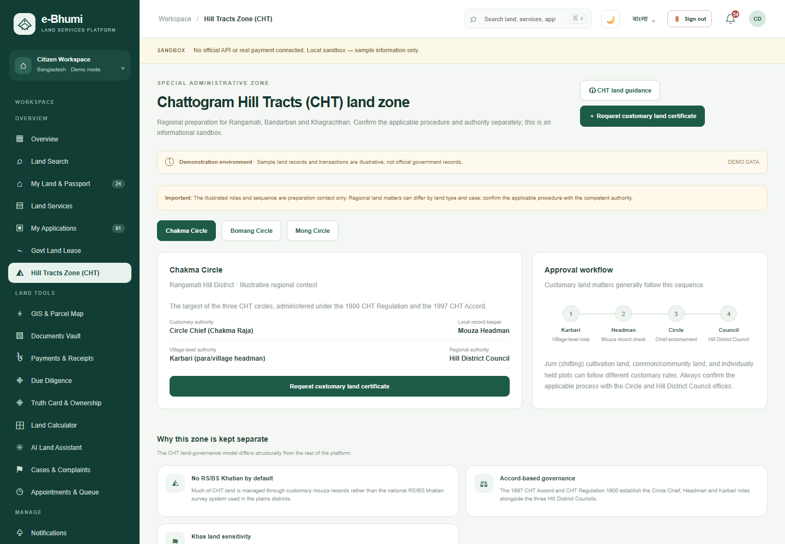 |

These screens illustrate regional preparation contexts. Their labels and explanatory copy are sample sandbox representations.

> 📷 **Full Gallery:** For all workspace captures (GIS parcel map, land search, document vault, mobile viewport, etc.), see the [Complete Screenshot Gallery](docs/SCREENSHOTS.md).


## Features and page guide

**Status key:** **Local** means a working local sandbox interaction with server persistence where applicable; **Preview** means sample data or explanatory UI; **Planned** means a backend, provider or official authorisation is required.

### Shared workspace tools

- Per-page notes with account-scoped server autosave.
- Favorite pages and dashboard shortcuts.
- Page-data JSON exports and a workspace JSON backup download.
- Area conversion for decimal, acre, hectare and square foot.
- Global search across pages, services, applications and document names.
- Dedicated feature search by ID, name, module, priority and traceability fields.
- Browser back/forward navigation, route titles and direct links.
- Partial Bangla labels, mobile navigation and keyboard dialog controls.

### Page-by-page matrix

| Workspace / route | What you can explore or do | Boundary |
| --- | --- | --- |
| Overview / `#dashboard` | Sample summary, service shortcuts, activity, saved pages and report export | Counts reflect the local sample/application store |
| Land search / `#land-search` | Filter sample Dag/Khatian/Mouza records; save searches; normalise Bengali numerals | No registry or official location query |
| My land / `#my-land` | Passport previews, record-link drafts, local watchlist preparation | No verified title or live change alerts |
| Services / `#services` | Search/category filters, comparison table and application entry | Official eligibility, fees and requirements unverified |
| Applications / `#applications` | Draft, submit, correct, review, pay and download outcomes with status/revision checks | Local staff decisions only; no government submission |
| Govt land lease / `#land-lease` | Sample lease register, category filter, details and renewal/request preparation | No actual lease grant, renewal or cancellation |
| Hill Tracts / `#ctg-zone` | Circle selection, regional information and certificate-request preparation | No customary certificate issuance or legal validation |
| GIS / `#gis` | Select sample parcels, toggle layers, export schematic SVG and print | No real survey accuracy or GIS measurement |
| Documents / `#documents` | Protected sample-file bytes, upload/download, size/signature checks and SHA-256 integrity | No malware scanning or official authenticity verification |
| Payments / `#payments` | Payable demands, failure/retry, receipt download, transaction filters, CSV export and finance reconciliation | Sandbox units only; no real collection or refund |
| Due diligence / `#due-diligence` | Persistent checklist/export, area/share comparisons and tracked review through report delivery | No ownership, encumbrance or court verification |
| Assistant / `#ai-assistant` | Predefined guidance, prompts and saved conversation | No live AI model, retrieval or OCR |
| Cases / `#casebook` | Five case/complaint routes, evidence, correction, hearings, outcome and linked review/appeal drafts | Revenue requests go to local officer; complaints to support; no legal filing |
| Appointments / `#appointments` | Local capacity checks, support confirmation, token/calendar download, owner reschedule and cancellation | No government inventory or confirmed real office visit |
| Truth Card / `#truth-card` | Private facts, proposed relationship graph, evidence, timeline/boundaries, obligations, linked desk review and saved reports | No government ownership verification or legal share determination |
| Calculator / `#calculator` | Area conversion, discrepancy, proposed shares, custom local unit and budget worksheets; JSON export | User-entered conventions/costs; no legal share or official fee calculation |
| Notifications / `#notifications` | Sample category filters and persistent mark-all-read | No SMS/email/push provider |
| Analytics / `#analytics` | Sample charts, report previews and workspace data export | Charts reflect local records, not government statistics |
| Catalogue / `#feature-catalog` | 460 requirements, filters, incremental results, details and export | Catalogue coverage does not imply implementation |
| Administration / `#admin` | Citizen account controls; separate admin portal enforces staff access and intake settings | Citizen role cannot use privileged administration |

### Truth Card & মালিকানা সম্পর্ক

Create a parcel worksheet, separate DEMO and USER_REPORTED facts, connect predecessor/party relationships and inspect proposed interests in an interactive Land DNA Graph. Compare deed/record areas, attach sample evidence, track dated events and four-sided boundaries, and manage preparation tasks.

Link the worksheet to your matching service application to share it with the eligible desk. The assigned reviewer can leave a local note; later edits mark earlier notes for re-review. Save report snapshots with integrity digests and download JSON or printable HTML. Percentages are proposed inputs, not legal inheritance shares or ownership verification.

For interactive visual previews and feature depth, see [Land Intelligence Documentation](docs/LAND_INTELLIGENCE.md). Service Guidance also includes division/district demo office routing and assisted appointment preparation.

### Requirement registry

The source of truth for catalogue entries is [`data/features.json`](e-Bhumi-Frontend/data/features.json). Preserve stable `CORE-###` and `MX-###` identifiers. The [feature inventory](docs/FEATURES.md) lists module counts calculated from the current file.

## Research-backed service procedures

The v5.4 workflow engine adds service-specific preparation schedules, required desk checks, phased payment quotes, holding demands and delivery acknowledgement for all 33 new service types. Older saved cases remain compatible. The implementation introduces structured land schedules, local holding registries, reasoned desk checks, and phased payment flows. For the full reference register and matrix, see the [Bangladesh Land Service Research Matrix](docs/BD_SERVICE_RESEARCH.md).

## App flow

The following diagram documents the retained v1 case lifecycle. New cases use the service-family diagram below.

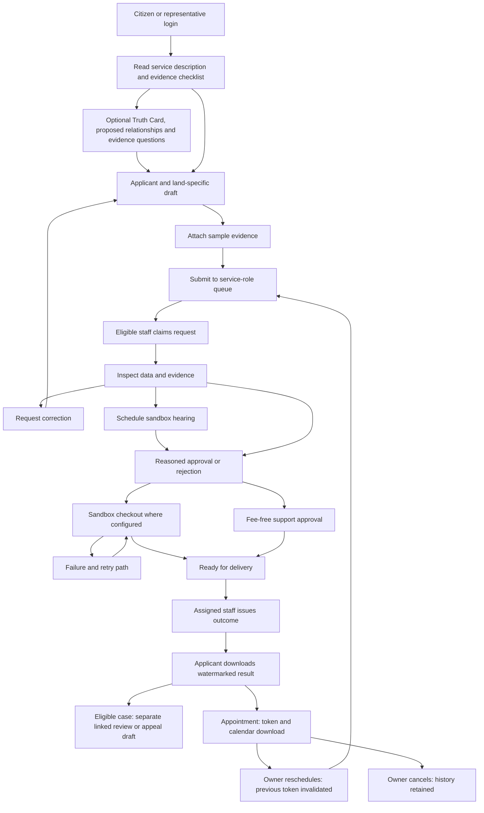

Rejection retains the reason and history. A separate review/appeal-preparation service is available. Every transition validates the actor and current state on the server. Finance reconciles sample transactions; administrators manage accounts/settings without bypassing service decisions; auditors inspect read-only. [Detailed app flow](docs/APP_FLOW.md).

## Five-minute walkthrough

1. Start the server and enter the workspace from the landing page.
2. Open **Land Search**, try sample reference `1842`, and inspect a parcel on the GIS screen.
3. Open **Land Services**, review a service, and choose **Prepare application**.
4. Create a draft using sample information. Find it in **My Applications** and reload to check persistence.
5. Open **Due Diligence**, mark the checks you have reviewed and save a page note.
6. Use **Export page data** or **Back up workspace**. These downloads remain preparation material.
7. Open **Truth Card & Ownership** to edit a sample relationship graph, evidence sources and tasks, then save a preparation report.
8. Browse the **Feature Catalogue** to inspect scope and integration dependencies.


## Researched procedure flows — v5.4

New applications use procedure v2. Existing saved/demo applications retain their v1 lifecycle. A caller cannot request v1 through the public API.

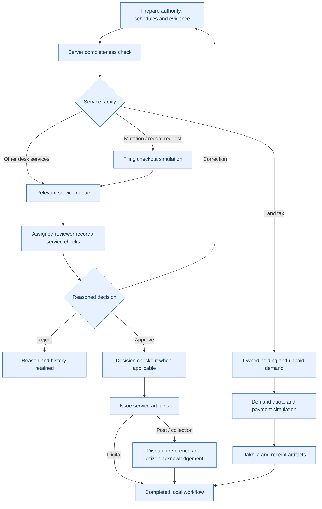

Every amount is a test fixture; there is no live government submission or payment. Hearing is conditional, not mandatory for every mutation. Digital copy release still uses the local records desk; there is no official registry lookup.

## Architecture

The V5 reference's role-based application flow and local server architecture are integrated while retaining this project's existing visual identity and explanatory README structure.

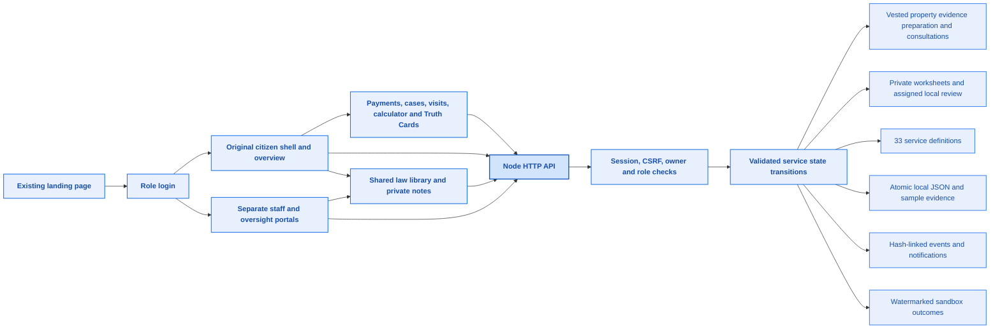

The landing design, original font stack, lease register/cards and CHT circle/workflow composition are preserved. Their controls now connect to tracked applications. [Architecture blueprint](docs/ARCHITECTURE.md) documents the actual modules and boundaries; [application flow](docs/APP_FLOW.md) describes states and role handoffs.

There is no authorised government API, real payment provider, legally valid certificate service, live GIS dataset or production identity integration. The reference's 460 entries remain a requirements catalogue rather than an implementation claim.

```text
e-Bhumi-Frontend/
├── index.html, assets/landing.css    Existing landing appearance
├── login.html, auth.js              Account login and safe route return
├── portal.html, portal.js           Role portal and workflow UI
├── land-intelligence.js/css         Truth Card, graph, timeline, tasks and reports
├── lib/land-dossiers.cjs            Worksheet validation, policy and snapshots
├── procedures-ui.js                Service schedules, checks, holdings and phased checkout
├── lib/procedures.cjs               Dated official references and 33 procedure profiles
├── lib/procedure-engine.cjs         Validated v2 workflow and holding/demand ledger
├── workflows.js                    Payments, cases, appointments and calculators
├── citizen.js, preserved.css        Original citizen/lease/CHT presentation
├── lib/catalog.cjs                 Service questions, evidence and role mapping
├── lib/platform.cjs                Sessions, access, transitions and persistence
├── lib/geography.cjs               Shared division/district validation data
├── lib/seed-demo.cjs                Additive sample scenarios
├── server-v4.cjs                   HTTP and protected static/API routing
├── server.cjs                      npm start entry point
├── data/features.json              Original 460 requirements
└── tests/                          Lifecycle, security and browser regressions
```

## Data and persistence

Version 5.3 stores accounts, application histories, uploaded sample bytes, hashes, payments and notifications in `e-Bhumi-Frontend/.data/platform.json`. Drafts and preparation preferences belong to an authenticated account. The store is created on first startup; it is excluded from Git and static file serving.

Sessions use an HttpOnly/SameSite cookie and end on server restart. Passwords use salted scrypt. Mutation APIs enforce CSRF/origin checks, object ownership, review role and revision. This is a single-process local sandbox, not a certified production platform; the JSON store is not encrypted and there is no malware scanner or external identity verification.

The demo citizen and representative each receive 99 sample requests: three per service (draft, submitted and one rotating later-stage scenario). Fresh stores contain 198 requests, 318 sample evidence files and 24 parcels. Migration removes only untouched excess generated scenarios; user-created, edited or finance-reconciled requests and saved preferences remain. Restarting does not duplicate fixtures. Demo users also have three land worksheets each, some linked to existing submitted/review cases. These do not increase the 99 service applications per demo account. Newly registered accounts have private, initially empty workspaces.

Stop the server before backing up or restoring the entire .data folder. Never commit it. Prior browser-local V3 state is not automatically imported into the account store. Use only sample personal/land information in the sandbox.

## Performance approach

- No frontend framework or runtime package installation.
- The requirements catalogue loads on demand when its route is opened.
- Catalogue search text is indexed once instead of rebuilt on every filter operation.
- Results render incrementally, initially 20 cards rather than the entire catalogue.
- Delegated actions reduce repeated per-button event bindings.
- Land worksheet lists return report summaries; full snapshots load only when needed.
- Landing artwork uses CSS geometry instead of large image assets.

These describe implementation choices. No Lighthouse score, load-time improvement percentage or production performance benchmark is claimed. Fonts follow the existing CSS stack; rendering depends on fonts available to the browser.

## Accessibility and localisation

The UI includes skip links, labelled controls, visible focus, dialog focus containment and return, Escape dismissal, reduced-motion styles and responsive layouts. Mobile tables can scroll horizontally within their containers. The workspace search shortcut is **Ctrl/Cmd + K**.

English is the primary content language. Bangla navigation labels and Bengali numeral handling are partial localisation; the entire app is not translated. A formal WCAG audit, assistive-technology review and comprehensive keyboard testing remain outstanding.

## Validation

```bash
cd e-Bhumi-Frontend
npm run check
```

The reviewed build passes API lifecycle and regression tests, the preserved citizen route checks and the added law/research checks, original font-stack checks, lease filtering/detail controls, CHT circle selection and request handoff, persistent preparation tools and mobile checks. The browser test uses a Node request bridge to the actual local server where Chromium loopback is isolated. See [validation](VALIDATION.md).

## Troubleshooting

| Symptom | What to check |
| --- | --- |
| `node` is not recognised | Install Node.js 18+ and reopen the terminal |
| Port 8080 is in use | Stop the existing server, or use `python -m http.server 8081` |
| Catalogue missing or reduced | Use HTTP, then check that `data/features.json` is served |
| Saved work seems missing | Check browser profile and hostname; private mode/site-data clearing affects storage |
| Selected document cannot be reopened | Only its metadata was saved; original file bytes are not stored |
| A button shows a demo explanation | That action is a preview or requires a future integration |
| Bangla labels change but body remains English | Detailed translation is incomplete |

## Roadmap

| Stage | Planned work |
| --- | --- |
| Frontend hardening | Split modules, regression tests, complete localisation, accessibility audit |
| Durable platform | Validated API contracts, authentication, ownership checks, database migrations |
| Document pipeline | Protected object storage, content inspection, real hashes and audit trails |
| Official integrations | Authorised registry/GIS adapters, current service requirements and provenance |
| Transaction services | Reviewed submissions, approved payments, signed callbacks and reconciliation |
| Citizen support | Provider-backed notifications, complaint delivery and appointment inventory |
| Assisted intelligence | Source-grounded AI/OCR, consent, human review and evaluation |
| Production readiness | Security review, monitoring, backup/restore drills and measured performance budgets |

React/TypeScript, PostgreSQL/PostGIS, queues and object storage are possible future architecture choices, not installed parts of this frontend.

## Contributing

1. Create a focused branch against the maintained upstream checkout.
2. Preserve stable catalogue IDs and clearly label fixtures versus working functionality.
3. Run syntax checks and exercise the affected flow in a browser.
4. Refresh screenshots when the visible UI changes; keep sample information only.
5. Update feature boundaries, app flows and validation notes with the change.

Never commit credentials, real identity files or private land records. Report security issues privately to the repository maintainer through an available private channel.

## License and authority

The project references [E-Bhumi/E-Bhumi](https://github.com/E-Bhumi/E-Bhumi). This edition builds on the supplied local project and its preserved visual design.

No license grant is included in this delivery; confirm redistribution rights with the maintainer. e-Bhumi is not affiliated with or operated by the Government of Bangladesh. Always confirm official records, current rules and legal requirements with the competent authority.
