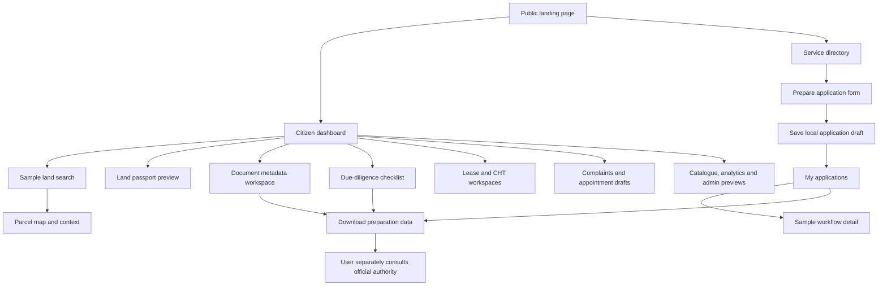
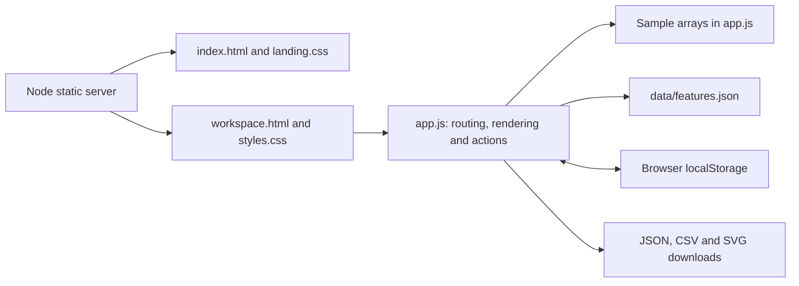

<div align="center">

# e-Bhumi

### Your land. A clearer path.

A citizen-first land-service preparation workspace for Bangladesh.

**18 workspace pages · 460 tracked requirements · Zero runtime packages · Local demo**

[Quick start](#quick-start) · [Screenshots](#screenshots) · [Features](#features-and-page-guide) · [App flow](#app-flow) · [Architecture](#architecture) · [Roadmap](#roadmap)

</div>


> **Demo status:** e-Bhumi is an independent prototype, not an official Government of Bangladesh service. Land references, geometry, statuses and amounts are illustrative. It does not establish ownership, accept real payments, submit official applications or reserve government appointments.

## Why e-Bhumi?

Land-service preparation involves many related details: a Dag or Khatian reference, a Mouza, supporting documents, an application, and questions that need official confirmation. e-Bhumi brings that preparation into a single browser workspace.

Citizens can explore sample records, organise drafts, review checklists and keep notes beside each task. The prototype also demonstrates lease, regional, administrative and analytics screens for future development.

### At a glance

| Item | Current delivery |
| --- | --- |
| Entry point | Public landing page with service links and FAQs |
| Navigation | 18 workspace routes with shareable hash URLs |
| Catalogue | 460 requirement entries; requirements are not implementation claims |
| Frontend | HTML, CSS and vanilla JavaScript |
| Local server | Node.js standard library; no package installation needed |
| Storage | Versioned browser localStorage |
| Languages | English content; partial Bangla navigation and numeral support |
| Official integrations | Not connected |

## Contents

- [Quick start](#quick-start)
- [Screenshots](#screenshots)
- [Features and page guide](#features-and-page-guide)
- [App flow](#app-flow)
- [Five-minute walkthrough](#five-minute-walkthrough)
- [Architecture](#architecture)
- [Data and persistence](#data-and-persistence)
- [Performance approach](#performance-approach)
- [Accessibility and localisation](#accessibility-and-localisation)
- [Validation](#validation)
- [Troubleshooting](#troubleshooting)
- [Roadmap](#roadmap)
- [Contributing](#contributing)
- [License and authority](#license-and-authority)

## Quick start

**Prerequisite:** Node.js 18 or newer. No API keys, database, `.env`, Docker, build step or `npm install` is needed for this frontend.

From the project directory:

```bash
cd e-Bhumi-Frontend
npm start
```

Open **[http://127.0.0.1:8080](http://127.0.0.1:8080)**.

| Destination | Local URL |
| --- | --- |
| Landing page | `http://127.0.0.1:8080/` |
| Dashboard | `http://127.0.0.1:8080/workspace.html#dashboard` |
| Applications | `http://127.0.0.1:8080/workspace.html#applications` |
| Feature catalogue | `http://127.0.0.1:8080/workspace.html#feature-catalog` |

**Windows:** double-click `e-Bhumi-Frontend/run_local.bat`. **Linux/macOS:** run `sh run_local.sh` from that folder. Alternatively, use `python -m http.server 8080` in the frontend directory.

Use HTTP for normal use. Opening HTML directly with `file://` may prevent the full feature JSON from loading. The included server listens on `127.0.0.1`; it is a local development server, not a production service.

## Screenshots

These are actual renders of the included source, captured on 16 October 2026. All displayed records are demonstration sample data. For the complete visual gallery of all 18 workspaces, see [Screenshot Gallery](docs/SCREENSHOTS.md).

### Citizen dashboard

Sample metrics, land passport, recent activity and service shortcuts in one overview.


### Application preparation

Create a local application draft, attach a land reference and manage preparation notes.


### Regional and lease views

| Government land lease | Chattogram Hill Tracts workspace |
| --- | --- |
|  |  |

These screens illustrate separate preparation contexts. Their labels and explanatory copy are not a verified statement of current legal requirements.

> 📷 **Full Gallery:** For all workspace captures (GIS parcel map, land search, document vault, mobile viewport, etc.), see the [Complete Screenshot Gallery](docs/SCREENSHOTS.md).


## Features and page guide

**Status key:** **Local** means a working browser-side interaction; **Preview** means sample data or explanatory UI; **Planned** means a backend, provider or official authorisation is required.

### Shared workspace tools

- Per-page notes with local autosave.
- Favorite pages and dashboard shortcuts.
- Page-data JSON exports and a workspace JSON backup download.
- Area conversion for decimal, acre, hectare and square foot.
- Global search across pages, services, applications and document names.
- Dedicated feature search by ID, name, module, priority and traceability fields.
- Browser back/forward navigation, route titles and direct links.
- Partial Bangla labels, mobile navigation and keyboard dialog controls.

### Page-by-page matrix

| Workspace / route | What you can explore or do | Boundary |
| --- | --- | --- |
| Overview / `#dashboard` | Sample summary, service shortcuts, activity, saved pages and report export | Summary totals remain fixtures |
| Land search / `#land-search` | Filter sample Dag/Khatian/Mouza records; save searches; normalise Bengali numerals | No registry or official location query |
| My land / `#my-land` | Passport previews, record-link drafts, local watchlist preparation | No verified title or live change alerts |
| Services / `#services` | Search/category filters, comparison table and application entry | Official eligibility, fees and requirements unverified |
| Applications / `#applications` | Create, filter and view persistent local drafts | No government submission or officer decision |
| Govt land lease / `#land-lease` | Sample lease register, category filter, details and renewal/request preparation | No actual lease grant, renewal or cancellation |
| Hill Tracts / `#ctg-zone` | Circle selection, regional information and certificate-request preparation | No customary certificate issuance or legal validation |
| GIS / `#gis` | Select sample parcels, toggle layers, export schematic SVG and print | No real survey accuracy or GIS measurement |
| Documents / `#documents` | File metadata intake, extension/size checks, filtering and detail previews | No stored file bytes, malware scan, secure vault or official verification |
| Payments / `#payments` | Sample transaction filters, receipt previews and CSV export | No real charge, refund or reconciliation |
| Due diligence / `#due-diligence` | Persistent eight-item checklist and export | No ownership, encumbrance or court verification |
| Assistant / `#ai-assistant` | Predefined guidance, prompts and saved conversation | No live AI model, retrieval or OCR |
| Cases / `#casebook` | Complaint preparation and reviewable local drafts | Sample register is separate; no complaint is delivered |
| Appointments / `#appointments` | Preferred-date preparation and local booking drafts | No live slots or confirmed office visit |
| Notifications / `#notifications` | Sample category filters and persistent mark-all-read | No SMS/email/push provider |
| Analytics / `#analytics` | Sample charts, report previews and workspace data export | Charts are not live operational statistics |
| Catalogue / `#feature-catalog` | 460 requirements, filters, incremental results, details and export | Catalogue coverage does not imply implementation |
| Administration / `#admin` | Operational fixtures and configuration preparation | No authentication, RBAC enforcement or production administration |

### Requirement registry

The source of truth for catalogue entries is [`data/features.json`](e-Bhumi-Frontend/data/features.json). Preserve stable `CORE-###` and `MX-###` identifiers. The [feature inventory](docs/FEATURES.md) lists module counts calculated from the current file.

## App flow



Official consultation is a next step outside this app. The diagram does not imply an integrated official submission or verification service.

For detailed application, document, review and regional journeys, see [App flows](docs/APP_FLOW.md).

## Five-minute walkthrough

1. Start the server and enter the workspace from the landing page.
2. Open **Land Search**, try sample reference `1842`, and inspect a parcel on the GIS screen.
3. Open **Land Services**, review a service, and choose **Prepare application**.
4. Create a draft using sample information. Find it in **My Applications** and reload to check persistence.
5. Open **Due Diligence**, mark the checks you have reviewed and save a page note.
6. Use **Export page data** or **Back up workspace**. These downloads remain preparation material.
7. Browse the **Feature Catalogue** to inspect scope and integration dependencies.

## Architecture

### What runs today



There is no production API, database, job queue or identity provider in this delivery. The Node server serves files; it does not implement land-service business operations. The architecture diagram describes the present app, not the production roadmap.

### Repository layout

```text
E-Bhumi/
├── README.md
├── VALIDATION.md
├── docs/
│   ├── APP_FLOW.md
│   ├── FEATURES.md
│   ├── SCREENSHOTS.md
│   ├── SCREENSHOT_CAPTURE.md
│   └── screenshots/              22 actual page captures
└── e-Bhumi-Frontend/
    ├── index.html                Landing page
    ├── workspace.html            Workspace shell
    ├── app.js                    Routes, fixtures, UI and local persistence
    ├── assets/                   Landing and workspace CSS
    ├── data/features.json        Requirement registry
    ├── server.cjs                npm start entry point
    ├── server.js                 Alternative server retained in source
    ├── package.json              Start and syntax-check commands
    ├── run_local.bat
    ├── run_local.sh
    └── FEATURE_COVERAGE.md
```

## Data and persistence

State is stored in localStorage under `ebhumi.workspace.v3`. It can include notes, favorites, workflow drafts, application records, document metadata, diligence checks, saved searches, language, chat and map preferences.

| Data | Behavior |
| --- | --- |
| Browser state | Local to one browser profile and origin |
| `localhost` versus `127.0.0.1` | Separate storage; use one hostname consistently |
| Uploaded document | Filename/category metadata only; file contents are not retained |
| Workspace backup | JSON download; backup import is not implemented |
| Clear site data | Resets saved work; keep an export first if needed |
| Role switch/share draft | Demo preparation, not a security or sharing boundary |

No cloud synchronisation, encryption at rest, account recovery or server authorisation is provided. Use sample information. A selected file is not a verified document, and a local status change is not an official decision.

## Performance approach

- No frontend framework or runtime package installation.
- Workspace renders before the catalogue request completes.
- Catalogue search text is indexed once instead of rebuilt on every filter operation.
- Results render incrementally, initially 20 cards rather than the entire catalogue.
- Delegated actions reduce repeated per-button event bindings.
- Landing artwork uses CSS geometry instead of large image assets.

These describe implementation choices. No Lighthouse score, load-time improvement percentage or production performance benchmark is claimed. Fonts follow the existing CSS stack; rendering depends on fonts available to the browser.

## Accessibility and localisation

The UI includes skip links, labelled controls, visible focus, dialog focus containment and return, Escape dismissal, reduced-motion styles and responsive layouts. Mobile tables can scroll horizontally within their containers. The workspace search shortcut is **Ctrl/Cmd + K**.

English is the primary content language. Bangla navigation labels and Bengali numeral handling are partial localisation; the entire app is not translated. A formal WCAG audit, assistive-technology review and comprehensive keyboard testing remain outstanding.

## Validation

```bash
cd e-Bhumi-Frontend
npm run check
```

The documentation refresh captured the landing page, all 18 workspace routes, mobile views and an application form using installed Chromium. All 18 routes displayed headings, with no uncaught page errors observed during capture. Notes survived a reload; the catalogue displayed 460 entries and an ID filter returned one result. No horizontal page overflow was detected in the two captured mobile entry views.

**Capture boundary:** screenshots were rendered from local files; the browser received the unchanged feature JSON through a local fetch shim because loopback HTTP access was blocked in this tool environment. This validates those renders, not HTTP deployment, production APIs, legal copy or every workflow. See [capture notes](docs/SCREENSHOT_CAPTURE.md) and [validation report](VALIDATION.md).

## Troubleshooting

| Symptom | What to check |
| --- | --- |
| `node` is not recognised | Install Node.js 18+ and reopen the terminal |
| Port 8080 is in use | Stop the existing server, or use `python -m http.server 8081` |
| Catalogue missing or reduced | Use HTTP, then check that `data/features.json` is served |
| Saved work seems missing | Check browser profile and hostname; private mode/site-data clearing affects storage |
| Selected document cannot be reopened | Only its metadata was saved; original file bytes are not stored |
| A button shows a demo explanation | That action is a preview or requires a future integration |
| Bangla labels change but body remains English | Detailed translation is incomplete |

## Roadmap

| Stage | Planned work |
| --- | --- |
| Frontend hardening | Split modules, regression tests, complete localisation, accessibility audit |
| Durable platform | Validated API contracts, authentication, ownership checks, database migrations |
| Document pipeline | Protected object storage, content inspection, real hashes and audit trails |
| Official integrations | Authorised registry/GIS adapters, current service requirements and provenance |
| Transaction services | Reviewed submissions, approved payments, signed callbacks and reconciliation |
| Citizen support | Provider-backed notifications, complaint delivery and appointment inventory |
| Assisted intelligence | Source-grounded AI/OCR, consent, human review and evaluation |
| Production readiness | Security review, monitoring, backup/restore drills and measured performance budgets |

React/TypeScript, PostgreSQL/PostGIS, queues and object storage are possible future architecture choices, not installed parts of this frontend.

## Contributing

1. Create a focused branch against the maintained upstream checkout.
2. Preserve stable catalogue IDs and clearly label fixtures versus working functionality.
3. Run syntax checks and exercise the affected flow in a browser.
4. Refresh screenshots when the visible UI changes; keep sample information only.
5. Update feature boundaries, app flows and validation notes with the change.

Never commit credentials, real identity files or private land records. Report security issues privately to the repository maintainer through an available private channel.

## License and authority

The project references [E-Bhumi/E-Bhumi](https://github.com/E-Bhumi/E-Bhumi). This local edition originated from the supplied ZIP and subsequent local edits; it does not claim to match the latest remote branch. This README update does not push changes to GitHub.

No license grant is included in this delivery; confirm redistribution rights with the maintainer. e-Bhumi is not affiliated with or operated by the Government of Bangladesh. Always confirm official records, current rules and legal requirements with the competent authority.
