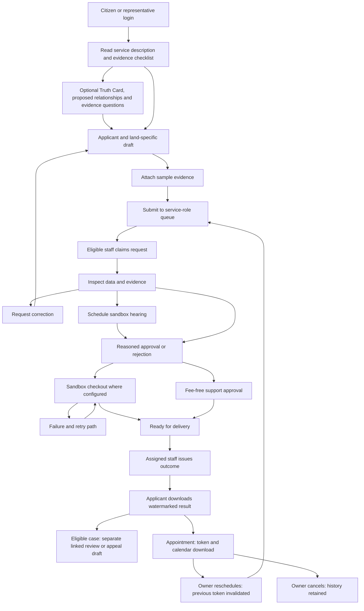
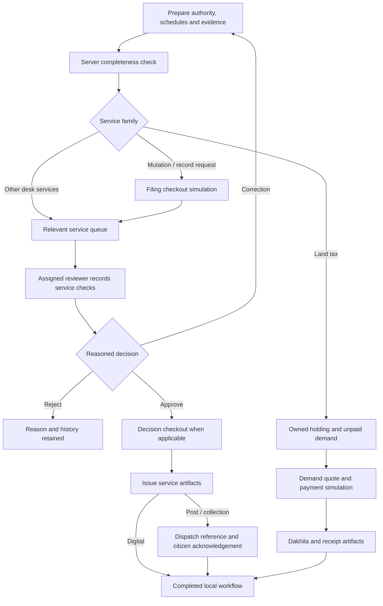
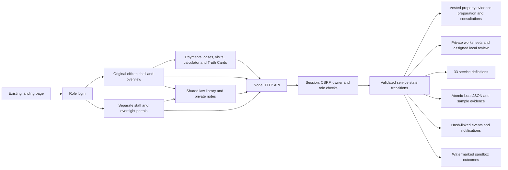

<div align="center">

# e-Bhumi

### Your Land. A Clearer Path.
*(আপনার জমি। সেবার পথে স্বচ্ছতা।)*

A citizen-first land-service preparation workspace for Bangladesh.

**24 citizen routes (21 preserved + Law Library + Vested Property + Role Directory) · 33 service workflows · 24 role platforms · 460 tracked requirements · Local & Cloud sandbox**

[Quick start](#quick-start) · [Live Deployment](#live-deployment) · [Screenshots](#screenshots) · [Features](#features-and-page-guide) · [App flow](#app-flow) · [Architecture](#architecture) · [Roadmap](#roadmap)

</div>


Primary interface defaults to Bangla, with seamless bilingual toggle to English. The preserved typography (`'DM Sans', 'Hind Siliguri', sans-serif`), landing composition, regional lease register, and CHT workflow layouts remain intact. For desk routing and specialized land administration, see the [24-Role Matrix](docs/ROLE_WORKFLOWS.md) and [Lease/Auction/Tender Research](docs/BD_LEASE_AUCTION_RESEARCH.md).

> **Demo status:** e-Bhumi is an independent prototype, not an official Government of Bangladesh service. Land references, geometry, statuses and amounts are illustrative. It does not establish ownership, accept real payments, submit official applications or reserve government appointments.

## Statutory Law Library, Research & Role Desks — v5.7.0

- **Integrated Statutory Law Library**: Available across all 24 roles with 35 curated statutory references, 12 thematic subjects, search, bookmarking, private case annotations, and links to official government full texts. See [Law Library & Source Register](docs/LAW_LIBRARY.md).
- **Vested Property & Heirship Dossiers**: Historical gazette listings, legacy-to-modern RS/BS Dag correlations, multi-branch heirship genealogical graphs, lease history, court cases, external orders, secure vault evidence, and private desk reviews. See [Legacy Property Research Implementation](docs/LEGACY_PROPERTY_RESEARCH.md).
- **24 Specialized Roles**: 33 full service-specific specialist workflows, conditional ministry/divisional/legal referrals with guaranteed return handoffs, and a consolidated role directory preserving complete visual and operational identity.

## Bilingual Experience & Localization — v5.7.0

- **Bangla-First Interface**: Complete native Bangla copywriting across Landing, Role Login, Citizen Workspace, and Desk Portals, with instantaneous English switching via the header language selector.
- **Visual Polish**: Verified green headline accents, aligned notifications, responsive mobile/tablet breakpoints (390px and 985px), and error messaging.
- **Audit & Coverage**: Audited across 24 roles and 343 distinct page states with zero regressions. See [Localization Overview & Screenshots](docs/LOCALIZATION_v5.7.md) and [Bangladesh Land Service Coverage Audit](docs/BD_COVERAGE_AUDIT_v5.7.md).

## Why e-Bhumi?

Land-service preparation involves many related details: a Dag or Khatian reference, a Mouza, supporting documents, an application, and questions that need official confirmation. e-Bhumi brings that preparation into a single browser workspace.

Citizens can explore sample records, organise drafts, review checklists and keep notes beside each task. The prototype also demonstrates lease, regional, administrative and analytics screens for future development.

### At a glance

| Item | Current delivery |
| --- | --- |
| Entry point | Public landing page with service links, law library, and FAQs |
| Navigation | 24 workspace routes with shareable hash URLs |
| Catalogue | 460 requirement entries; requirements are not implementation claims |
| Frontend | HTML, CSS and vanilla JavaScript |
| Local server | Node.js standard library; no third-party package installation needed |
| Cloud deployment | Vercel Serverless Function deployment with `/tmp` data sandbox |
| Storage | Persistent server JSON with protected sample evidence; account-scoped preparation preferences |
| Languages | Native Bangla primary default; interactive English toggle across all pages |
| Official integrations | Not connected (isolated sandbox prototype) |

## Contents

- [Quick start](#quick-start)
- [Live Deployment](#live-deployment)
- [Screenshots](#screenshots)
- [Features and page guide](#features-and-page-guide)
- [App flow](#app-flow)
- [Five-minute walkthrough](#five-minute-walkthrough)
- [Architecture](#architecture)
- [Data and persistence](#data-and-persistence)
- [Performance approach](#performance-approach)
- [Accessibility and localisation](#accessibility-and-localisation)
- [Validation](#validation)
- [Troubleshooting](#troubleshooting)
- [Roadmap](#roadmap)
- [Contributing](#contributing)
- [License and authority](#license-and-authority)

## Quick start

**Prerequisite:** Node.js 18 or newer. No API keys, database, `.env`, Docker, build step or `npm install` is needed for this frontend.

From the project root directory:

```bash
node server.cjs
```

Or from the frontend directory:

```bash
cd ebhumi-platform
npm start
```

Open **[http://127.0.0.1:8080](http://127.0.0.1:8080)**.

| Destination | Local URL |
| --- | --- |
| Landing page | `http://127.0.0.1:8080/` |
| Citizen Workspace | `http://127.0.0.1:8080/workspace.html#dashboard` |
| My Applications | `http://127.0.0.1:8080/workspace.html#applications` |
| Feature Catalogue | `http://127.0.0.1:8080/workspace.html#feature-catalog` |
| Role Portals & Desks | `http://127.0.0.1:8080/login.html` |

**Windows:** double-click `ebhumi-platform/run_local.bat`. **Linux/macOS:** run `sh run_local.sh` from that folder. This authenticated edition requires Node; static-only serving cannot run the API.

Use HTTP for normal use. Opening HTML directly with `file://` may prevent the full feature JSON from loading. The included server listens on `127.0.0.1`; it is a local development server, not a production service.

## Live Deployment

The system is deployed and accessible on Vercel:

- **Production URL**: [https://e-bhumi-xi.vercel.app](https://e-bhumi-xi.vercel.app)

*(Note: Custom domains can be attached at any time in the Vercel dashboard under Project Settings $\rightarrow$ Domains).*

## Role login and demo evaluation

Open `/login.html` and choose a demo role. The local demo password is `BhumiDemo!2026`. Emails follow `<role>@demo.ebhumi.local` for citizen, representative, officer, records, surveyor, registrar, finance, support, admin, auditor, union_land, ac_land, uno, dc and lease_committee.

Citizens and representatives can register; administrators provision staff. One browser profile shares one session cookie, so use separate profiles/private contexts for simultaneous role evaluation. Public registration cannot select a staff role. All original 18 citizen navigation entries remain visible, with private citizen settings under Administration.

To operate a sample process, use an editable draft or submitted case, then sign into the corresponding service reviewer. Completed outcomes are watermarked and do not update any government registry.

## Screenshots

Workspace screenshots were refreshed on 17 October 2026 from the current source. The Bangla-first landing capture is current; earlier English views are retained for translation/reference. All displayed records are demonstration sample data. For the visual gallery of the preserved 21 workspaces and the new law/research views, see [Screenshot Gallery](docs/SCREENSHOTS.md).

### Regional and lease views

| Government land lease | Chattogram Hill Tracts workspace |
| --- | --- |
|  |  |

These screens illustrate regional preparation contexts. Their labels and explanatory copy are sample sandbox representations.

> 📷 **Full Gallery:** For all workspace captures (GIS parcel map, land search, document vault, mobile viewport, etc.), see the [Complete Screenshot Gallery](docs/SCREENSHOTS.md).

## Features and page guide

**Status key:** **Local** means a working local sandbox interaction with server persistence where applicable; **Preview** means sample data or explanatory UI; **Planned** means a backend, provider or official authorisation is required.

### Shared workspace tools (সার্বজনীন কর্মক্ষেত্র সুবিধাসমূহ)

- **Per-page notes / পৃষ্ঠাভিত্তিক নোট**: Account-scoped autosave for personal notes on each workspace page *(প্রতিটি পৃষ্ঠায় ব্যক্তিগত নোট তৈরি ও স্বয়ংক্রিয় সংরক্ষণ)*.
- **Favorites & shortcuts / দ্রুত অ্যাক্সেস**: Bookmark frequently visited pages directly to your dashboard *(ঘন ঘন ব্যবহৃত পেজ সহজে বুকমার্ক ও শর্টকাট হিসেবে পিন করার সুবিধা)*.
- **JSON Export & Backup / ব্যাকআপ ডাউনলোড**: Export page data or download a full workspace JSON backup *(পৃষ্ঠার তথ্য বা সম্পূর্ণ ওয়ার্কস্পেসের ব্যাকআপ নিরাপদে ডাউনলোড)*.
- **Land Area Conversion / জমির পরিমাপ রূপান্তর**: Convert between decimal (শতক), acre (একর), hectare (হেক্টর), katha (কাঠা), and square feet (বর্গফুট).
- **Global & Feature Search / সার্বজনীন অনুসন্ধান**: Instant search across services, documents, applications, and requirements *(সার্ভিস, আবেদন এবং নথিপত্র দ্রুত খোঁজার সুবিধা)*.
- **Bilingual & Responsive / দ্বিভাষিক ও মোবাইল বান্ধব**: Seamless Bangla & English switching with responsive layouts for mobile, tablet, and desktop *(বাংলা ও ইংরেজি উভয় ভাষায় স্বাচ্ছন্দ্যে ব্যবহারের সুযোগ)*.

### Page-by-page matrix (পৃষ্ঠাভিত্তিক ফিচার ও কার্যপরিধি)

| Workspace / Route | Feature Description & Bangla Guide (বিবরণ ও কার্যপ্রণালী) | Operational Boundary |
| --- | --- | --- |
| Overview / `#dashboard` | **Dashboard Summary & Quick Actions**<br>ড্যাশবোর্ড সারসংক্ষেপ, সেবার শর্টকাট, সাম্প্রতিক কার্যক্রমের সময়রেখা ও রিপোর্ট এক্সপোর্ট। | Counts reflect local sample/application store |
| Land search / `#land-search` | **Search by Dag, Khatian & Mouza**<br>দাগ, খতিয়ান ও মৌজা নম্বর দিয়ে জমি অনুসন্ধান; বাংলা সংখ্যা সমর্থন ও অনুসন্ধান সংরক্ষণ। | Local sample data query; no live land registry access |
| My land / `#my-land` | **Digital Land Passport & Holdings**<br>ডিজিটাল ল্যান্ড পাসপোর্ট প্রিভিউ, খতিয়ান লিঙ্ক খসড়া এবং স্থানীয় ওয়াচলিস্ট প্রস্তুতি। | User-reported data; does not confer legal ownership |
| Services / `#services` | **33 Land Service Portals**<br>৩৩টি সরকারি ভূমিসেবার বিবরণ, প্রয়োজনীয় কাগজপত্রের চেকলিস্ট, তুলনামূলক নিয়মাবলী ও আবেদন শুরুর গাইড। | Official eligibility, statutory fees and requirements unverified |
| Applications / `#applications` | **End-to-End Application Tracking**<br>আবেদন খসড়া তৈরি, দাখিল, সংশোধন, ট্র্যাকিং, ফি প্রদান, শুনানির প্রস্তুতি এবং ফলাফল ডাউনলোড। | Local staff decisions only; no government submission |
| Govt land lease / `#land-lease` | **Government Khas & Commercial Lease**<br>খাস জমি, চা-বাগান, জলমহাল ও বাণিজ্যিক ইজারার রেজিস্টার এবং নবায়ন/বরাদ্দ আবেদন প্রস্তুতি। | Demonstration records; no actual lease grant or renewal |
| Hill Tracts / `#ctg-zone` | **CHT Customary Land Governance**<br>পার্বত্য চট্টগ্রাম তিন সার্কেলের (চাকমা, বোমাং, মং) প্রথাগত ভূমি ব্যবস্থাপনা, হেডম্যান রিপোর্ট ও প্রত্যয়ন আবেদন। | No customary certificate issuance or legal validation |
| GIS / `#gis` | **Interactive Cadastral / Mouza Map**<br>ইন্টারেক্টিভ নকশা/মৌজা ম্যাপ প্রদর্শন, প্লট নির্বাচন, স্তর পরিবর্তন ও স্কেমেটিক এসভিজি ম্যাপ প্রিন্ট সুবিধা। | Illustrative vectors; no real geodetic survey precision |
| Documents / `#documents` | **Secure Document Vault**<br>প্রয়োজনীয় দলিল, পরচা ও প্রমাণপত্র আপলোড, সাইজ/সিগনেচার যাচাই ও SHA-256 ইন্টিগ্রিটি চেক। | Protected sandbox bytes; no official authenticity check |
| Payments / `#payments` | **Land Development Tax & Fee Checkout**<br>ভূমির উন্নয়ন কর (দাখিলা) ও আবেদন ফি পরিশোধের সিমুলেশন, রশিদ ডাউনলোড ও ট্রানজেকশন হিস্ট্রি। | Sandbox payment simulation; no live banking transactions |
| Due diligence / `#due-diligence` | **Property Purchase Verification Checklist**<br>জমি ক্রয়ের পূর্বে মালিকানা ধারাবাহিকতা, রেকর্ড ও বায়া দলিল যাচাইয়ের স্বয়ংক্রিয় চেকলিস্ট। | Preparation audit only; no court or registry validation |
| Assistant / `#ai-assistant` | **Land Service Guidance & Routing**<br>ভূমির জটিল নিয়মাবলী সহজভাবে বোঝাতে এআই সহায়িকা ও প্রাসঙ্গিক সেবা নির্দেশিকা। | Predefined heuristic rules; no external unvetted LLM calls |
| Cases / `#casebook` | **Revenue, Mutation & Appeal Cases**<br>রেকর্ড সংশোধন (মিস কেস), জমা-খারিজ আপিল, সীমানা বিরোধ ও শুনানির নোটিশ ট্র্যাকিং। | Internal simulation; no judicial or official court filings |
| Appointments / `#appointments` | **AC Land & Sub-Registry Slot Booking**<br>সহকারী কমিশনার (ভূমি) ও সাব-রেজিস্ট্রার অফিসে শুনানির অ্যাপয়েন্টমেন্ট শিডিউলিং ও টোকেন ডাউনলোড। | Local booking simulator; no live government calendar slot |
| Truth Card / `#truth-card` | **Land DNA Worksheet & Ownership Graph**<br>জমির মালিকানা সম্পর্ক, উত্তরাধিকার বণ্টন বিশ্লেষণ, দলিল বনাম খতিয়ান তথ্যের ফারাক এবং ট্রুথ কার্ড রিপোর্ট। | Analytical proposed input; no statutory title determination |
| Calculator / `#calculator` | **Area, Faraiz & Stamp Duty Calculator**<br>শতক-কাঠা-বিঘা রূপান্তর, মুসলিম ফারায়েজ অনুযায়ী অংশ বণ্টন এবং জমি রেজিস্ট্রেশন খরচ ক্যালকুলেটর। | Algorithmic estimation; verify with sub-registry office |
| Notifications / `#notifications` | **Alerts & Status Updates**<br>আবেদনের সর্বশেষ অগ্রগতি, শুনানির তারিখ ও নোটিশ সম্পর্কিত বার্তা। | In-app alerts; no live SMS/push gateway connected |
| Analytics / `#analytics` | **Service Delivery & Workload Metrics**<br>ভূমিসেবা নিষ্পত্তি, গড় সময় ও আঞ্চলিক কেস ব্যবস্থাপনার ভিজ্যুয়াল অ্যানালিটিক্স। | Based on local store records, not national statistics |
| Catalogue / `#feature-catalog` | **460 Land Service Requirements**<br>৪৬০টি ভূমি ব্যবস্থার বিস্তারিত কারিগরি ও সেবামূলক রিকোয়ারমেন্ট ক্যাটালগ ও ফিল্টারিং। | Functional requirements specification; not implementation claim |
| Law Library / `#law-library` | **35 Statutory Enactments & Gazette Acts**<br>৩৫টি সরকারি ভূমি আইন, বিধিমালা ও গেজেটের ডিজিটাল পাঠাগার, সার্চ ও ব্যক্তিগত নোট। | Curated research references; not an exhaustive legal gazette |
| Administration / `#admin` | **User Profile & System Preferences**<br>ইউজার প্রোফাইল, সেশন নিয়ন্ত্রণ, ইনটেক স্যুইচ এবং প্ল্যাটফর্ম কনফিগারেশন। | Citizen profile settings; staff admin portal separated |

### Truth Card & Ownership Relationship Graph (ট্রুথ কার্ড ও মালিকানা সম্পর্ক)

- **Interactive Land DNA Graph**: Visualizes the chain of ownership from original CS/SA/RS predecessors down to current heirs and purchasers *(মূল সিএস/এসএ রেকর্ড থেকে শুরু করে বর্তমান ওয়ারিশ ও ক্রেতা পর্যন্ত মালিকানার ধারাবাহিকতা চিত্রায়ন)*.
- **Discrepancy Detection**: Highlights mismatches between deed area, khatian recorded area, and physical survey findings *(দলিল, খতিয়ান ও বাস্তবিক পরিমাপের মধ্যকার ফারাক ও গরমিল চিহ্নিতকরণ)*.
- **Faraiz & Share Calculation**: Models proposed inheritance distribution shares based on statutory personal laws *(উত্তরাধিকার আইন অনুযায়ী প্রস্তাবিত হিস্যা ও অংশ নির্ধারণ)*.
- **Evidence Dossier Linking**: Direct association with active mutation, partition, or inheritance service applications for desk review *(সংশ্লিষ্ট নামজারি বা বণ্টন আবেদনের সাথে প্রমাণপত্র সরাসরি যুক্ত করে পর্যালোচনায় প্রেরণ)*.

For interactive visual previews and feature depth, see [Land Intelligence Documentation](docs/LAND_INTELLIGENCE.md).

### Requirement registry

The source of truth for catalogue entries is [`data/features.json`](ebhumi-platform/data/features.json). Preserve stable `CORE-###` and `MX-###` identifiers. The [feature inventory](docs/FEATURES.md) lists module counts calculated from the current file.

## Research-backed service procedures

The v5.4 workflow engine adds service-specific preparation schedules, required desk checks, phased payment quotes, holding demands and delivery acknowledgement for all 33 new service types. Older saved cases remain compatible. The implementation introduces structured land schedules, local holding registries, reasoned desk checks, and phased payment flows. For the full reference register and matrix, see the [Bangladesh Land Service Research Matrix](docs/BD_SERVICE_RESEARCH.md).

## App flow

The following diagram documents the retained v1 case lifecycle. New cases use the service-family diagram below.



Rejection retains the reason and history. A separate review/appeal-preparation service is available. Every transition validates the actor and current state on the server. Finance reconciles sample transactions; administrators manage accounts/settings without bypassing service decisions; auditors inspect read-only. [Detailed app flow](docs/APP_FLOW.md).

## Five-minute walkthrough

1. Start the server and enter the workspace from the landing page.
2. Open **Land Search**, try sample reference `1842`, and inspect a parcel on the GIS screen.
3. Open **Land Services**, review a service, and choose **Prepare application**.
4. Create a draft using sample information. Find it in **My Applications** and reload to check persistence.
5. Open **Due Diligence**, mark the checks you have reviewed and save a page note.
6. Use **Export page data** or **Back up workspace**. These downloads remain preparation material.
7. Open **Truth Card & Ownership** to edit a sample relationship graph, evidence sources and tasks, then save a preparation report.
8. Browse the **Feature Catalogue** to inspect scope and integration dependencies.

## Researched procedure flows — v5.4

New applications use procedure v2. Existing saved/demo applications retain their v1 lifecycle. A caller cannot request v1 through the public API.



Every amount is a test fixture; there is no live government submission or payment. Hearing is conditional, not mandatory for every mutation. Digital copy release still uses the local records desk; there is no official registry lookup.

## Architecture

The V5 reference's role-based application flow and local server architecture are integrated while retaining this project's existing visual identity and explanatory README structure.



The landing design, original font stack, lease register/cards and CHT circle/workflow composition are preserved. Their controls now connect to tracked applications. [Architecture blueprint](docs/ARCHITECTURE.md) documents the actual modules and boundaries; [application flow](docs/APP_FLOW.md) describes states and role handoffs.

There is no authorised government API, real payment provider, legally valid certificate service, live GIS dataset or production identity integration. The reference's 460 entries remain a requirements catalogue rather than an implementation claim.

```text
ebhumi-platform/
├── index.html, assets/landing.css    Existing landing appearance
├── login.html, auth.js              Account login and safe route return
├── portal.html, portal.js           Role portal and workflow UI
├── land-intelligence.js/css         Truth Card, graph, timeline, tasks and reports
├── lib/land-dossiers.cjs            Worksheet validation, policy and snapshots
├── procedures-ui.js                Service schedules, checks, holdings and phased checkout
├── lib/procedures.cjs               Dated official references and 33 procedure profiles
├── lib/procedure-engine.cjs         Validated v2 workflow and holding/demand ledger
├── workflows.js                    Payments, cases, appointments and calculators
├── citizen.js, preserved.css        Original citizen/lease/CHT presentation
├── lib/catalog.cjs                 Service questions, evidence and role mapping
├── lib/platform.cjs                Sessions, access, transitions and persistence
├── lib/geography.cjs               Shared division/district validation data
├── lib/seed-demo.cjs                Additive sample scenarios
├── server-v4.cjs                   HTTP and protected static/API routing
├── server.cjs                      npm start entry point
├── data/features.json              Original 460 requirements
└── tests/                          Lifecycle, security and browser regressions
```

## Data and persistence

Locally, accounts, application histories, uploaded sample bytes, hashes, payments and notifications are stored in `ebhumi-platform/.data/platform.json`. On Vercel, the hosted demo uses shared **private Vercel Blob storage**, with separate preview and production state. Local private data is excluded from deployment and is never automatically imported. Drafts and preparation preferences belong to an authenticated account. See [deployment and persistence](docs/VERCEL_DEPLOYMENT.md) for configuration, commands and operating limits.

Sessions use an HttpOnly/SameSite cookie, with Secure enabled on hosted HTTPS. Local sessions end on server restart; hosted sessions persist across workers and redeployments until expiry or logout. Passwords use salted scrypt. Mutation APIs enforce CSRF/origin checks, object ownership, review role and revision. This remains a sandbox: the shared JSON adapter is not a transactional database for substantial traffic, and there is no malware scanner or external identity verification.

The demo citizen and representative each receive sample requests per service. Fresh stores contain pre-configured demo scenarios, sample evidence files and parcels. User-created, edited or finance-reconciled requests and saved preferences remain persistent. Restarting does not duplicate fixtures. Newly registered accounts have private, initially empty workspaces.

Stop the server before backing up or restoring the data folder. Never commit it. Prior browser-local V3 state is not automatically imported into the account store. Use only sample personal/land information in the sandbox.

## Performance approach

- No frontend framework or runtime package installation.
- The requirements catalogue loads on demand when its route is opened.
- Catalogue search text is indexed once instead of rebuilt on every filter operation.
- Results render incrementally, initially 20 cards rather than the entire catalogue.
- Delegated actions reduce repeated per-button event bindings.
- Land worksheet lists return report summaries; full snapshots load only when needed.
- Landing artwork uses CSS geometry instead of large image assets.

These describe implementation choices. No Lighthouse score, load-time improvement percentage or production performance benchmark is claimed. Fonts follow the existing CSS stack; rendering depends on fonts available to the browser.

## Accessibility and localisation

The UI includes skip links, labelled controls, visible focus, dialog focus containment and return, Escape dismissal, reduced-motion styles and responsive layouts. Mobile tables can scroll horizontally within their containers. The workspace search shortcut is **Ctrl/Cmd + K**.

Native Bangla is the primary default interface, with comprehensive English localization available across all 24 routes via an interactive toggle. A formal WCAG audit, assistive-technology review and comprehensive keyboard testing remain ongoing.

## Validation

```bash
cd ebhumi-platform
npm run check
npm test
```

The reviewed build passes API lifecycle and regression tests, the preserved citizen route checks and the added law/research checks, original font-stack checks, lease filtering/detail controls, CHT circle selection and request handoff, persistent preparation tools and mobile checks. The browser test uses a Node request bridge to the actual local server where Chromium loopback is isolated. See [validation](VALIDATION.md).

## Troubleshooting

| Symptom | What to check |
| --- | --- |
| `node` is not recognised | Install Node.js 24 and reopen the terminal |
| Port 8080 is in use | Stop the existing server, or start with `PORT=8081 node server.cjs` |
| Catalogue missing or reduced | Use HTTP, then check that `data/features.json` is served |
| Saved work seems missing | Confirm the account and environment: local, preview and production stores are separate |
| Hosted login or save returns 503 | Check the private Blob connection/token, account quota and Vercel runtime logs; retry after the storage issue is resolved |
| Selected document cannot be reopened | Check its owner and evidence-vault entry; uploaded sample bytes are stored privately |
| A button shows a demo explanation | That action is a preview or requires a future integration |
| Interface language does not switch | Ensure JavaScript is enabled and check the top language selector toggle |

## Roadmap

| Stage | Planned work |
| --- | --- |
| Frontend hardening | Split modules, regression tests, complete localisation, accessibility audit |
| Durable platform | Validated API contracts, authentication, ownership checks, database migrations |
| Document pipeline | Protected object storage, content inspection, real hashes and audit trails |
| Official integrations | Authorised registry/GIS adapters, current service requirements and provenance |
| Transaction services | Reviewed submissions, approved payments, signed callbacks and reconciliation |
| Citizen support | Provider-backed notifications, complaint delivery and appointment inventory |
| Assisted intelligence | Source-grounded AI/OCR, consent, human review and evaluation |
| Production readiness | Security review, monitoring, backup/restore drills and measured performance budgets |

React/TypeScript, PostgreSQL/PostGIS, queues and object storage are possible future architecture choices, not installed parts of this frontend.

## Contributing

1. Create a focused branch against the maintained upstream checkout.
2. Preserve stable catalogue IDs and clearly label fixtures versus working functionality.
3. Run syntax checks and exercise the affected flow in a browser.
4. Refresh screenshots when the visible UI changes; keep sample information only.
5. Update feature boundaries, app flows and validation notes with the change.

Never commit credentials, real identity files or private land records. Report security issues privately to the repository maintainer through an available private channel.

## License and authority

This project is licensed under the [MIT License](LICENSE). Copyright (c) 2026 **LandLords**.

**Project contributors**
- Pronob Das ([`@Pronob155`](https://github.com/Pronob155))
- Shreya Golder ([`@Shreyalien`](https://github.com/Shreyalien))

Third-party libraries and assets remain subject to their own license terms. e-Bhumi is not affiliated with or operated by the Government of Bangladesh. Always confirm official records, current rules and legal requirements with the competent authority.
