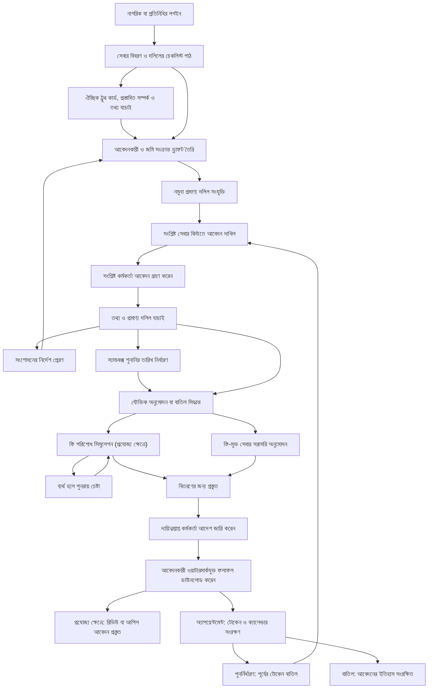
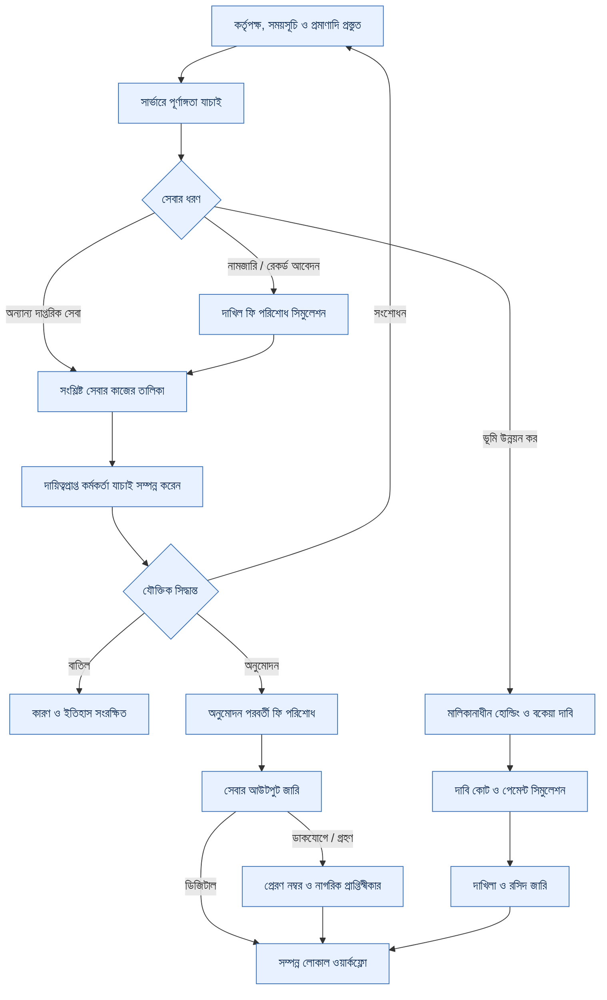
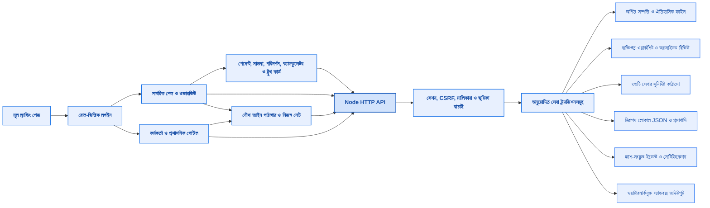

<div align="center">

# ই-ভূমি (e-Bhumi)

### আপনার জমি। সেবার পথে স্বচ্ছতা।

নাগরিক-বান্ধব ভূমিসেবা প্রস্তুতি ও ওয়ার্কস্পেস প্ল্যাটফর্ম (বাংলাদেশ)

**২৪টি নাগরিক রুট (২১টি সংরক্ষিত + আইন পাঠাগার + অর্পিত সম্পত্তি + ভূমিকা ডিরেক্টরি) · ৩৩টি সেবা কর্মপ্রবাহ · ২৪টি অফিসিয়াল ভূমিকা প্ল্যাটফর্ম · ৪৬০টি নিরীক্ষিত সেবার চাহিদা · লোকাল স্যান্ডবক্স**

[দ্রুত শুরু](#দ্রুত-শুরু-quick-start) · [স্ক্রিনশট](#স্ক্রিনশট-screenshots) · [বৈশিষ্ট্য ও পৃষ্ঠা নির্দেশিকা](#বৈশিষ্ট্য-ও-পৃষ্ঠা-নির্দেশিকা) · [অ্যাপ প্রবাহ](#অ্যাপ-প্রবাহ-app-flow) · [সিস্টেম আর্কিটেকচার](#সিস্টেম-আর্কিটেকচার-architecture) · [ভবিষ্যৎ পরিকল্পনা](#ভবিষ্যৎ-পরিকল্পনা-roadmap)

</div>


বাংলা মূল ও প্রধান ভাষা; উপরের হেডার থেকে এক ক্লিকে ইংরেজি (English) অনুবাদ নির্বাচন করা যায়। মূল ফন্ট, ল্যান্ডিং পেজের নান্দনিকতা, খাসজমি ইজারা ও পার্বত্য চট্টগ্রাম (CHT) জোন সম্পূর্ণ অপরিবর্তিত রাখা হয়েছে। নতুন আবেদনের দপ্তরভিত্তিক কাজ জানতে [২৪টি ভূমিকার ম্যাট্রিক্স](docs/ROLE_WORKFLOWS.md) এবং [ইজারা/নিলাম/দরপত্র গবেষণা](docs/BD_LEASE_AUCTION_RESEARCH.md) দেখুন।


> **ডেমো স্ট্যাটাস সতর্কতা:** ই-ভূমি একটি স্বাধীন প্রোটোটাইপ স্যান্ডবক্স, এটি গণপ্রজাতন্ত্রী বাংলাদেশ সরকারের কোনো আনুষ্ঠানিক বা দাপ্তরিক প্ল্যাটফর্ম নয়। প্রদর্শিত দাগ, খতিয়ান, ম্যাপ, অবস্থা ও আর্থিক ফি নমুনাভিত্তিক। এটি চূড়ান্ত মালিকানা প্রতিষ্ঠা করে না, বাস্তব অর্থ লেনদেন করে না এবং সরকারি রেকর্ডরুমে কোনো আবেদন জমা দেয় না।

## আইন, গবেষণা ও দপ্তর — v5.7.0

সব রোলে **আইন ও বিধির পাঠাগার**: ৩৫টি নির্বাচিত সরকারি পাঠ্যসূত্র, ১২টি বিষয়ভিত্তিক শ্রেণিবিভাগ, শক্তিশালী অনুসন্ধান, বুকমার্ক, ব্যক্তিগত নোট ও মূল সরকারি পূর্ণপাঠের লিংক। বিস্তারিত দেখুন [পাঠাগার ও উৎস তালিকা](docs/LAW_LIBRARY.md)। এটি সব বাংলাদেশি ভূমি আইনের সম্পূর্ণ সংকলিত হওয়ার দাবি করে না।

**অর্পিত সম্পত্তি ও ওয়ারিশ ফাইল**: ঐতিহাসিক গেজেট/তালিকা, পুরোনো→নতুন দাগের ম্যাপিং, সকল ওয়ারিশের হিস্যা, ইজারা, মামলা, বাহ্যিক আদেশ, ভল্ট প্রমাণাদি ও সংরক্ষিত রিভিউ। বিস্তারিত দেখুন [শেয়ার করা গবেষণার বাস্তবায়ন ও সীমা](docs/LEGACY_PROPERTY_RESEARCH.md)। **২৪টি রোল**, সেবানির্দিষ্ট বিশেষজ্ঞ রুট, মন্ত্রণালয়/বিভাগ/আইনি পরামর্শের কন্ডিশনাল ফ্লো এবং ভূমিকা ডিরেক্টরি পূর্বের সমস্ত ফিচার ও নকশাকে সম্পূর্ণ অক্ষুণ্ণ রেখেছে।


## বাংলা অভিজ্ঞতা — v5.7.0

ব্রাউজার পর্যবেক্ষণ অনুযায়ী বাংলা ল্যান্ডিং ও লগইন টেক্সট, সবুজ হেডলাইন এমফাসিস, সরাসরি নোটিফিকেশন বেল এবং ট্যাবলেট হেডারের নকশা নিখুঁত করা হয়েছে। বাংলা মেনু, অ্যাকশন বোতাম, প্লেসহোল্ডার এবং এরর মেসেজ সম্পূর্ণ রূপান্তর করা হয়েছে; ইংরেজি সুইচে যেকোনো সময় মূল ইংরেজি লেখা ফিরে আসে। **২৪টি রোল এবং ৩৪৩টি পেজ-ভিউ অডিট**, ৩৯০ পিক্সেল ও ৯৮৫ পিক্সেল রেসপনসিভ লেআউট এবং সম্পূর্ণ সেবার রিগ্রেশন টেস্ট অন্তর্ভুক্ত রয়েছে। বিস্তারিত দেখুন [বাংলা অভিজ্ঞতা ও স্ক্রিনশট](docs/LOCALIZATION_v5.7.md) এবং [সরকারি সূত্রে ভূমিসেবার কভারেজ ও বাকি সংযোগ](docs/BD_COVERAGE_AUDIT_v5.7.md)।


## কেন ই-ভূমি? (Why e-Bhumi?)

বাংলাদেশের ভূমিসেবা প্রস্তুত করা একটি বহুস্তরীয় ও তথ্যনির্ভর প্রক্রিয়া: দাগ বা খতিয়ান নম্বর নিশ্চিতকরণ, মৌজা শনাক্তকরণ, প্রমাণ্য দলিল প্রস্তুত, আবেদন পূরণ এবং সংশ্লিষ্ট নিয়মকানুন যাচাই। ই-ভূমি এই সম্পূর্ণ প্রস্তুতি প্রক্রিয়াকে একটি একক ওয়েব ব্রাউজার ওয়ার্কস্পেসে নিয়ে এসেছে।

নাগরিকরা নমুনা রেকর্ড বিশ্লেষণ করতে পারেন, ড্রাফট সাজাতে পারেন, প্রয়োজনীয় দলিলের চেকলিস্ট যাচাই করতে পারেন এবং প্রতিটি কাজের সাথে নিজস্ব নোট রাখতে পারেন। প্ল্যাটফর্মটিতে সরকারি খাসজমি ইজারা, আঞ্চলিক প্রশাসন, বিশ্লেষণ ও তদারকির স্ক্রিনসমূহ অন্তর্ভুক্ত রয়েছে।

### এক নজরে (At a Glance)

| বিষয় | বর্তমান অবস্থা |
| --- | --- |
| মূল প্রবেশদ্বার | উন্মুক্ত ল্যান্ডিং পেজ (সেবার বিবরণ ও সাধারণ জিজ্ঞাসাসহ) |
| নেভিগেশন | শেয়ারযোগ্য হ্যাশ URL সহ ২৪টি ওয়ার্কস্পেস রুট |
| সেবার চাহিদা ক্যাটালগ | ৪৬০টি সুনির্দিষ্ট সেবার চাহিদালিপি |
| ফ্রন্টএন্ড | আধুনিক HTML, CSS এবং ভ্যানিলা জাভাস্ক্রিপ্ট (কোনো ফ্রেমওয়ার্ক ডিপেনডেন্সি ছাড়া) |
| লোকাল সার্ভার | Node.js স্ট্যান্ডার্ড লাইব্রেরি (কোনো প্যাকেজ ইন্সটলেশন ছাড়াই চলে) |
| ডেটা সংরক্ষণ | সুরক্ষিত নমুনা প্রমাণসহ স্থায়ী সার্ভার JSON এবং অ্যাকাউন্ট-ভিত্তিক সেশন |
| ভাষা সমর্থন | বাংলা মূল ও প্রধান ভাষা; সাথে ইংরেজি অনুবাদ সুইচ সুবিধা |
| সরকারি ডাটাবেজ ইন্টিগ্রেশন | সরাসরি সংযুক্ত নয় (লোকাল স্যান্ডবক্স ও সিমুলেশন) |

## সূচিপত্র

- [দ্রুত শুরু (Quick Start)](#দ্রুত-শুরু-quick-start)
- [রোল লগইন ও ডেমো মূল্যায়ন](#রোল-লগইন-ও-ডেমো-মূল্যায়ন)
- [স্ক্রিনশট (Screenshots)](#স্ক্রিনশট-screenshots)
- [বৈশিষ্ট্য ও পৃষ্ঠা নির্দেশিকা](#বৈশিষ্ট্য-ও-পৃষ্ঠা-নির্দেশিকা)
- [অ্যাপ প্রবাহ (App Flow)](#অ্যাপ-প্রবাহ-app-flow)
- [পাঁচ মিনিটের সংক্ষিপ্ত পরিচিতি](#পাঁচ-মিনিটের-সংক্ষিপ্ত-পরিচিতি)
- [গবেষণালব্ধ সেবাপদ্ধতি কর্মপ্রবাহ — v5.4](#গবেষণালব্ধ-সেবাপদ্ধতি-কর্মপ্রবাহ--v54)
- [সিস্টেম আর্কিটেকচার (Architecture)](#সিস্টেম-আর্কিটেকচার-architecture)
- [ডেটা সংরক্ষণ ও নিরাপত্তা](#ডেটা-সংরক্ষণ-ও-নিরাপত্তা)
- [পারফরম্যান্স ও গতি](#পারফরম্যান্স-ও-গতি)
- [অ্যাক্সেসিবিলিটি ও স্থানীয়করণ](#অ্যাক্সেসিবিলিটি-ও-স্থানীয়করণ)
- [যাচাই ও পরীক্ষা (Validation)](#যাচাই-ও-পরীক্ষা-validation)
- [সমস্যা সমাধান (Troubleshooting)](#সমস্যা-সমাধান-troubleshooting)
- [ভবিষ্যৎ পরিকল্পনা (Roadmap)](#ভবিষ্যৎ-পরিকল্পনা-roadmap)
- [অবদান ও অংশগ্রহণ (Contributing)](#অবদান-ও-অংশগ্রহণ-contributing)
- [লাইসেন্স ও কর্তৃত্ব (License and Authority)](#লাইসেন্স-ও-কর্তৃত্ব-license-and-authority)

## দ্রুত শুরু (Quick Start)

**পূর্বশর্ত:** Node.js ১৮ বা তার পরবর্তী সংস্করণ। এই ফ্রন্টএন্ড চালুর জন্য কোনো বাহ্যিক API কী, ডাটাবেজ সেটআপ, `.env`, Docker বা বিল্ড স্টেপের প্রয়োজন নেই।

প্রজেক্ট ডিরেক্টরি থেকে:

```bash
cd e-Bhumi-Frontend
npm start
```

ব্রাউজারে খুলুন: **[http://127.0.0.1:8080](http://127.0.0.1:8080)**

| গন্তব্য | লোকাল ঠিকানা (URL) |
| --- | --- |
| মূল ল্যান্ডিং পেজ | `http://127.0.0.1:8080/` |
| নাগরিক ড্যাশবোর্ড | `http://127.0.0.1:8080/workspace.html#dashboard` |
| আবেদনসমূহ | `http://127.0.0.1:8080/workspace.html#applications` |
| বৈশিষ্ট্য ও সেবার ক্যাটালগ | `http://127.0.0.1:8080/workspace.html#feature-catalog` |

**উইন্ডোজ (Windows):** সরাসরি `e-Bhumi-Frontend/run_local.bat`-এ ডাবল ক্লিক করুন। **লিনাক্স/ম্যাক (Linux/macOS):** টার্মিনালে `sh run_local.sh` রান করুন।

প্রোটোটাইপটি স্বাভাবিক ব্যবহারের জন্য HTTP প্রোটোকল ব্যবহার করুন। সরাসরি `file://` দিয়ে HTML ফাইল খুললে ডেটা JSON সঠিকভাবে লোড নাও হতে পারে। অন্তর্ভুক্ত সার্ভারটি `127.0.0.1`-এ চালিত হয়; এটি লোকাল ডেভেলপমেন্ট ও সিমুলেশন সার্ভার।

## রোল লগইন ও ডেমো মূল্যায়ন

`/login.html` পেজটি খুলে যেকোনো ডেমো রোল নির্বাচন করুন। স্থানীয় ডেমো পাসওয়ার্ড: `BhumiDemo!2026`।
ইমেইল অ্যাড্রেসের ফরম্যাট: `<role>@demo.ebhumi.local` (যেমন: citizen, representative, officer, records, surveyor, registrar, finance, support, admin, auditor, union_land, ac_land, uno, dc, lease_committee ইত্যাদি)।

নাগরিক ও প্রতিনিধিরা নতুন অ্যাকাউন্ট নিবন্ধন করতে পারেন; প্রশাসকগণ কর্মকর্তা ও কর্মচারীদের প্রোফাইল প্রদান করেন। ব্রাউজার প্রোফাইল সেশন কুকি শেয়ার করে, তাই একই সাথে একাধিক ভূমিকা পরীক্ষার জন্য আলাদা ব্রাউজার প্রোফাইল বা ইনকগনিটো উইন্ডো ব্যবহার করুন। সাধারণ নাগরিক রেজিস্ট্রেশনের মাধ্যমে কর্মকর্তা রোল নির্বাচন করা যায় না।

যেকোনো নমুনা আবেদন সম্পন্ন করতে ড্রাফট বা দাখিলকৃত কেস ব্যবহার করে সংশ্লিষ্ট সেবার রিভিউয়ার অ্যাকাউন্টে প্রবেশ করুন। নিষ্পত্তিকৃত ফলাফলে ডিজিটাল ওয়াটারমার্ক থাকে এবং এটি কোনো সরকারি ডাটাবেজে প্রভাব ফেলে না।

## স্ক্রিনশট (Screenshots)

ওয়ার্কস্পেসের স্ক্রিনশটসমূহ বর্তমান সোর্সকোড থেকে সংগ্রহ করা হয়েছে। বাংলা প্রধান ল্যান্ডিং পেজটি বর্তমান ইন্টারফেসের সাথে সামঞ্জস্যপূর্ণ। প্রদর্শিত সকল রেকর্ডই নমুনা বা ডেমো ডেটা।

### আঞ্চলিক ও ইজারা ইন্টারফেস

| সরকারি খাসজমি ইজারা রেজিস্টার | পার্বত্য চট্টগ্রাম বিশেষ অঞ্চল ওয়ার্কস্পেস |
| --- | --- |
|  |  |

এই স্ক্রিনগুলো আঞ্চলিক ভূমি ব্যবস্থাপনা এবং বিশেষ সেবার প্রস্তুতি নির্দেশ করে। এর সকল বিবরণ ও নির্দেশিকা স্যান্ডবক্স পরিবেশের নমুনা মাত্র।

> 📷 **সম্পূর্ণ গ্যালারি:** জিআইএস পার্সেল ম্যাপ, ভূমি অনুসন্ধান, ডকুমেন্ট ভল্ট, মোবাইল ভিউ ইত্যাদিসহ সকল স্ক্রিনশট দেখতে [সম্পূর্ণ স্ক্রিনশট গ্যালারি (Screenshot Gallery)](docs/SCREENSHOTS.md) দেখুন।


## বৈশিষ্ট্য ও পৃষ্ঠা নির্দেশিকা

**স্ট্যাটাস নির্দেশিকা:** **লোকাল (Local)** = কার্যকর লোকাল স্যান্ডবক্স ও সার্ভার ডেটা সংরক্ষণ; **প্রিভিউ (Preview)** = নমুনা ডেটা বা ব্যাখ্যামূলক ইন্টারফেস; **পরিকল্পিত (Planned)** = ভবিষ্যৎ ব্যাকএন্ড বা সরকারি সংযোগের জন্য প্রস্তাবিত।

### যৌথ ওয়ার্কস্পেস টুলস

- প্রতি পৃষ্ঠায় নিজস্ব নোট এবং স্বয়ংক্রিয় সার্ভার সেভ সুবিধা।
- পছন্দের পৃষ্ঠা চিহ্নিতকরণ এবং ড্যাশবোর্ড শর্টকাট।
- পৃষ্ঠা ডেটা JSON এক্সপোর্ট এবং ওয়ার্কস্পেসের পূর্ণাঙ্গ JSON ব্যাকআপ ডাউনলোড।
- শতাংশ, একর, হেক্টর ও বর্গফুটের স্বয়ংক্রিয় রূপান্তর ক্যালকুলেটর।
- পৃষ্ঠা, সেবা, আবেদন ও দলিলের শিরোনাম জুড়ে গ্লোবাল সার্চ।
- আইডি, নাম, মডিউল ও প্রায়োরিটি দিয়ে ফিচার সার্চ।
- ব্রাউজারের ব্যাক/ফরোয়ার্ড নেভিগেশন এবং সরাসরি লিংক সমর্থন।
- বাংলা ও ইংরেজি দ্বিভাষিক ইন্টারফেস, মোবাইল নেভিগেশন ও কীবোর্ড অ্যাক্সেস।

### পৃষ্ঠাভিত্তিক নির্দেশিকা ম্যাট্রিক্স

| ওয়ার্কস্পেস / রুট | যা দেখতে বা করতে পারবেন | সীমাবদ্ধতা / সীমানা |
| --- | --- | --- |
| সার্বিক ড্যাশবোর্ড / `#dashboard` | সারসংক্ষেপ, সেবার শর্টকাট, সাম্প্রতিক কার্যক্রম ও রিপোর্ট এক্সপোর্ট | সংখ্যাগুলো লোকাল স্যান্ডবক্সের নমুনা নির্দেশ করে |
| ভূমি অনুসন্ধান / `#land-search` | নমুনা দাগ/খতিয়ান/মৌজা ফিল্টার, অনুসন্ধান সংরক্ষণ ও বাংলা সংখ্যা সমর্থন | কোনো সরকারি সেন্ট্রাল রেজিস্ট্রি কুয়েরি করে না |
| আমার জমি / `#my-land` | ল্যান্ড পাসপোর্ট প্রিভিউ, রেকর্ডের ড্রাফট ও নিজস্ব ওয়াচলিস্ট | কোনো আইনি সত্যতা বা লাইভ পরিবর্তনের দাবি করে না |
| সেবাসমূহ / `#services` | সার্চ ও ক্যাটাগরি ফিল্টার, তুলনামূলক তালিকা ও আবেদন প্রবেশদ্বার | সরকারি ফি বা যোগ্যতার চূড়ান্ত অনুমোদন নয় |
| আবেদনসমূহ / `#applications` | ড্রাফট, দাখিল, সংশোধন, রিভিউ, ফি পরিশোধ ও ফলাফল ডাউনলোড | কেবলমাত্র লোকাল স্টাফ সিদ্ধান্তের সিমুলেশন |
| খাসজমি ইজারা / `#land-lease` | নমুনা ইজারা রেজিস্টার, ক্যাটাগরি ফিল্টার ও নবায়ন/আবেদনের প্রস্তুতি | কোনো বাস্তব ইজারা প্রদান বা বাতিল করে না |
| পার্বত্য চট্টগ্রাম / `#ctg-zone` | সার্কেল নির্বাচন, প্রথাগত ভূমি সারসংক্ষেপ ও সনদ আবেদনের প্রস্তুতি | কোনো বাস্তব প্রথাগত সনদ ইস্যু বা যাচাই করে না |
| জিআইএস ম্যাপ / `#gis` | নমুনা পার্সেল নির্বাচন, লেয়ার পরিবর্তন ও স্কেমেটিক SVG এক্সপোর্ট | কোনো বাস্তব স্যাটেলাইট বা অফিশিয়াল জিআইএস নয় |
| ডকুমেন্ট ভল্ট / `#documents` | নমুনা ফাইল আপলোড/ডাউনলোড, সাইজ ও টাইপ চেক, SHA-256 ইন্টিগ্রিটি | কোনো অ্যান্টিভাইরাস স্ক্যান বা আইনি দলিল যাচাই নয় |
| ফি ও পেমেন্ট / `#payments` | পেমেন্ট ডিমান্ড, রসিদ ডাউনলোড, ট্রানজ্যাকশন ফিল্টার ও CSV এক্সপোর্ট | স্যান্ডবক্স ট্রায়াল; কোনো বাস্তব অর্থ লেনদেন নয় |
| ডিউ ডিলিজেন্স / `#due-diligence` | চেকলিস্ট এক্সপোর্ট, হিস্যা তুলনা ও ট্র্যাকড রিপোর্ট সরবরাহ | কোনো স্বত্ব, দায়মুক্ত সনদ বা আদালতের ভেরিফিকেশন নয় |
| সেবা সহকারী / `#ai-assistant` | নির্ধারিত গাইডলাইন, প্রম্পট ও সংরক্ষিত বার্তালাপ | কোনো লাইভ এআই মডেল, আরএজি বা ওসিআর নয় |
| মামলা ও অভিযোগ / `#casebook` | ৫টি কেস/অভিযোগ রুট, প্রমাণাদি, শুনানি ও রিভিউ/আপিল ড্রাফট | কর্মকর্তা বরাবর সিমুলেশন; আদালতে কোনো মামলা দাখিল নয় |
| অ্যাপয়েন্টমেন্ট / `#appointments` | লোকাল শিডিউল চেক, টোকেন ও ক্যালেন্ডার ডাউনলোড, পুনর্নির্ধারণ ও বাতিল | কোনো সরকারি দপ্তরের আসন সংরক্ষণ নয় |
| ট্রুথ কার্ড / `#truth-card` | নিজস্ব তথ্য, প্রস্তাবিত সম্পর্ক গ্রাফ, প্রমাণাদি, টাইমলাইন ও সংরক্ষিত রিপোর্ট | কোনো সরকারি স্বত্ব বা উত্তরাধিকার নির্ধারণ নয় |
| ক্যালকুলেটর / `#calculator` | জমির রূপান্তর, ফারায়েজ হিস্যা, স্থানীয় পরিমাপ ও বাজেট হিসাব | ব্যবহারকারীর দেওয়া তথ্য; কোনো আইনি হিসাব নয় |
| নোটিফিকেশন / `#notifications` | ক্যাটাগরি ফিল্টার ও মার্ক-অল-রিড সুবিধা | কোনো বাস্তব SMS বা ইমেইল গেটওয়ে সংযুক্ত নয় |
| এনালিটিক্স / `#analytics` | নমুনা চার্ট, রিপোর্ট প্রিভিউ ও ওয়ার্কস্পেস ডেটা এক্সপোর্ট | চার্টগুলো লোকাল রেকর্ড দেখায়, জাতীয় পরিসংখ্যান নয় |
| সেবার ক্যাটালগ / `#feature-catalog` | ৪৬০টি সুনির্দিষ্ট সেবার চাহিদালিপি, ফিল্টার ও এক্সপোর্ট | ক্যাটালগে থাকা মানেই বাস্তবায়ন দাবি করা নয় |
| প্রশাসন ও সেটিংস / `#admin` | নাগরিক প্রোফাইল নিয়ন্ত্রণ; পৃথক অ্যাডমিন পোর্টালে স্টাফ কন্ট্রোল | সাধারণ নাগরিক ভূমিকা প্রশাসনিক সেটিংসে প্রবেশ করতে পারে না |

### ট্রুথ কার্ড ও মালিকানা সম্পর্ক (Truth Card)

একটি জমির খসড়া তৈরি করুন, ডেমো এবং ব্যবহারকারীর দেওয়া তথ্যের পার্থক্য করুন, পূর্বসূরি ও অংশীদারদের সম্পর্ক যুক্ত করুন এবং ল্যান্ড ডিএনএ গ্রাফে তা পর্যবেক্ষণ করুন। দলিলের জমির পরিমাণ যাচাই করুন, প্রমাণ্য দলিল যুক্ত করুন এবং চারদিকের সীমানা লিপিবদ্ধ করুন।

এই খসড়াটি আপনার দাখিলকৃত আবেদনের সাথে লিঙ্ক করে সংশ্লিষ্ট কর্মকর্তার সাথে শেয়ার করা যায়। দায়িত্বপ্রাপ্ত কর্মকর্তা নিজস্ব মতামত লিপিবদ্ধ করতে পারেন। পরবর্তীতে কোনো পরিবর্তন হলে পুনরায় পর্যালোচনার নির্দেশনা তৈরি হয়। সত্যতা যাচাই ডাইজেস্টসহ পূর্ণাঙ্গ রিপোর্ট সংরক্ষণ এবং প্রিন্টযোগ্য HTML ডাউনলোড করা যায়।

বিস্তারিত জানতে [ল্যান্ড ইন্টেলিজেন্স ডকুমেন্টেশন](docs/LAND_INTELLIGENCE.md) দেখুন।


### সেবার ক্যাটালগ রেজিস্ট্রি

ক্যাটালগের মূল তথ্যের উৎস [`data/features.json`](e-Bhumi-Frontend/data/features.json)। এতে `CORE-###` এবং `MX-###` সনাক্তকারী আইডি ব্যবহার করা হয়েছে। [ফিচার ইনভেন্টরি](docs/FEATURES.md)-তে মডিউলভিত্তিক সংখ্যা দেওয়া আছে।

## গবেষণালব্ধ সেবাপদ্ধতি কর্মপ্রবাহ — v5.4

v5.4 ইঞ্জিনটি সকল ৩৩টি সেবার জন্য নির্ধারিত সময়সূচি, প্রয়োজনীয় দাপ্তরিক যাচাই, পর্যায়ক্রমিক ফি হিসাব, হোল্ডিং দাবি এবং ডেলিভারি প্রাপ্তিস্বীকার ব্যবস্থা যুক্ত করেছে। পুরনো সংরক্ষিত কেসগুলোও সমর্থিত। বিস্তারিত জানতে [বাংলাদেশ ভূমিসেবা গবেষণা ম্যাট্রিক্স](docs/BD_SERVICE_RESEARCH.md) দেখুন।

## অ্যাপ প্রবাহ (App Flow)

নিচের ডায়াগ্রামটি প্রাথমিক v1 কেস লাইফসাইকেল প্রদর্শন করে। নতুন আবেদনসমূহ নিচের সার্ভিস-ফ্যামিলি ডায়াগ্রাম ব্যবহার করে।



আবেদন বাতিল হলে কারণ ও ইতিহাস সংরক্ষিত থাকে। আলাদা রিভিউ ও আপিল প্রস্তুতির সুযোগ রয়েছে। প্রতিটি ধাপে সার্ভারে অ্যাক্টর এবং বর্তমান স্টেট ভ্যালিডেশন করা হয়। বিস্তারিত দেখুন [অ্যাপ প্রবাহের বিশদ বিবরণ](docs/APP_FLOW.md)।

## পাঁচ মিনিটের সংক্ষিপ্ত পরিচিতি

1. সার্ভার চালু করে ল্যান্ডিং পেজ থেকে ওয়ার্কস্পেসে প্রবেশ করুন।
2. **ভূমি অনুসন্ধান** খুলুন, নমুনা রেফারেন্স `1842` দিন এবং জিআইএস স্ক্রিনে পার্সেলটি পরীক্ষা করুন।
3. **ভূমিসেবাসমূহ** পেজে গিয়ে যেকোনো সেবা বেছে নিয়ে **আবেদন প্রস্তুত করুন** ক্লিক করুন।
4. নমুনা তথ্য দিয়ে একটি ড্রাফট তৈরি করুন। এটি **আমার আবেদনসমূহ**-তে দেখতে পাবেন।
5. **ডিউ ডিলিজেন্স** খুলুন, প্রয়োজনীয় চেকলিস্ট যাচাই করুন এবং নিজস্ব নোট সংরক্ষণ করুন।
6. **পৃষ্ঠা ডেটা এক্সপোর্ট** অথবা **ওয়ার্কস্পেস ব্যাকআপ** দিয়ে প্রস্তুতিমূলক ফাইল ডাউনলোড করুন।
7. **ট্রুথ কার্ড ও মালিকানা** পেজে গিয়ে সম্পর্কের গ্রাফ ও প্রমাণাদি যাচাই করে রিপোর্ট তৈরি করুন।
8. **সেবার ক্যাটালগ** ব্রাউজ করে সিস্টেমের পরিধি ও রূপরেখা পর্যবেক্ষণ করুন।


## গবেষণালব্ধ সেবাপদ্ধতি কর্মপ্রবাহ — v5.4

নতুন আবেদনগুলো v2 পদ্ধতি অনুসরণ করে। পূর্ববর্তী সংরক্ষিত আবেদনগুলো v1 পদ্ধতি অনুযায়ী চালু থাকে।



এখানে প্রতিটি ফি ও আর্থিক পরিমাণ কেবলই টেস্ট ডেটা; কোনো বাস্তব সরকারি অর্থ লেনদেন ঘটে না। শুনানি বাধ্যতামূলক নয় বরং পরিস্থিতি সাপেক্ষে নির্ধারিত হয়।

## সিস্টেম আর্কিটেকচার (Architecture)

প্রকল্পটির মূল ল্যান্ডিং পেজের রূপ ও নান্দনিকতা সম্পূর্ণ অক্ষুণ্ণ রেখে ভূমিকা-ভিত্তিক কর্মপ্রবাহ এবং লোকাল সার্ভার আর্কিটেকচার সমন্বয় করা হয়েছে।



মূল ফন্ট স্ট্যাক (`'DM Sans', 'Hind Siliguri', sans-serif`), ল্যান্ডিং পেজের গ্রাফিক নকশা, ইজারা রেজিস্টার এবং সিএইচটি সার্কেল পুরোপুরি সংরক্ষিত রয়েছে। বিস্তারিত জানতে [আর্কিটেকচার ব্লুপ্রিন্ট](docs/ARCHITECTURE.md) এবং [অ্যাপ প্রবাহের বিশদ বিবরণ](docs/APP_FLOW.md) দেখুন।

```text
e-Bhumi-Frontend/
├── index.html, assets/landing.css    মূল ল্যান্ডিং পেজের ডিজাইন ও বিন্যাস
├── login.html, auth.js              অ্যাকাউন্ট লগইন ও সুরক্ষিত রিডাইরেকশন
├── portal.html, portal.js           ভূমিকা পোর্টাল ও কর্মকর্তা ওয়ার্কফ্লো
├── land-intelligence.js/css         ট্রুথ কার্ড, গ্রাফ, টাইমলাইন ও রিপোর্ট
├── lib/land-dossiers.cjs            ওয়ার্কশিট ভ্যালিডেশন ও স্ন্যাপশট
├── procedures-ui.js                সেবার তফসিল, চেকলিস্ট ও পর্যায়ক্রমিক ফি
├── lib/procedures.cjs               অফিশিয়াল রেফারেন্স ও ৩৩টি সেবার প্রোফাইল
├── lib/procedure-engine.cjs         যাচাইকৃত v2 ওয়ার্কফ্লো ও হোল্ডিং লেজার
├── workflows.js                    পেমেন্ট, কেস, অ্যাপয়েন্টমেন্ট ও ক্যালকুলেটর
├── citizen.js, preserved.css        মূল সংরক্ষিত নাগরিক/ইজারা/সিএইচটি ডিসপ্লে
├── lib/catalog.cjs                 সেবার প্রশ্নমালা, প্রমাণাদি ও ভূমিকা ম্যাপিং
├── lib/platform.cjs                সেশন, পারমিশন, ট্রানজিশন ও ডেটা স্টোর
├── lib/geography.cjs               বিভাগ ও জেলাভিত্তিক সমন্বিত ভৌগোলিক ডেটা
├── lib/seed-demo.cjs                ডেমো টেস্ট ডেটা জেনারেটর
├── server-v4.cjs                   HTTP এবং সুরক্ষিত স্ট্যাটিক/API রাউটিং
├── server.cjs                      npm start এর মূল সার্ভার এন্ট্রি পয়েন্ট
├── data/features.json              মূল ৪৬০টি চাহিদার ক্যাটালগ
└── tests/                          লাইফসাইকেল, নিরাপত্তা ও ব্রাউজার টেস্ট
```

## ডেটা সংরক্ষণ ও নিরাপত্তা

ভার্সন ৫.৩ অ্যাকাউন্ট, আবেদনের ইতিহাস, আপলোডকৃত ফাইলের বাইট, হ্যাশ, পেমেন্ট এবং নোটিফিকেশনসমূহ `e-Bhumi-Frontend/.data/platform.json` ফাইলে সংরক্ষণ করে। সকল ড্রাফট ও প্রস্তুতি তথ্য ব্যবহারকারীর অ্যাকাউন্টের সাথে সুরক্ষিত থাকে। প্রথমবার সার্ভার চালু হলে স্বয়ংক্রিয়ভাবে এই ফোল্ডার তৈরি হয় এবং গিট রিপোজিটরি থেকে এটিকে সম্পূর্ণ বাদ রাখা হয়েছে (`.gitignore`)।

সেশনের জন্য HttpOnly/SameSite কুকি ব্যবহৃত হয়। পাসওয়ার্ড এনক্রিপশনে সল্টেড স্ক্রিপ্ট (salted scrypt) ব্যবহৃত হয়েছে। মিউটেশন API-তে CSRF ও Origin যাচাই, অবজেক্টের মালিকানা এবং রোল পারমিশন কঠোরভাবে কার্যকর করা হয়। এটি একটি লোকাল স্যান্ডবক্স পরিবেশ; এতে কোনো বহিরাগত বা লাইভ পরিচয় যাচাই ব্যবস্থা যুক্ত নেই।

ডেমো অ্যাকাউন্টগুলোতে প্রতি সেবার জন্য প্রস্তুতকৃত নমুনা আবেদন রয়েছে। ব্যবহারকারীর তৈরি করা নতুন আবেদন বা সম্পাদিত ফাইল সার্ভার রিস্টার্টের পরেও নিরাপদে সংরক্ষিত থাকে।

## পারফরম্যান্স ও গতি

- কোনো অতিরিক্ত ফ্রন্টএন্ড ভারী ফ্রেমওয়ার্ক বা অপ্রয়োজনীয় প্যাকেজ ব্যবহার করা হয়নি।
- সেবার ক্যাটালগটি প্রয়োজন অনুযায়ী অন-ডিমান্ড লোড হয়।
- ক্যাটালগের সার্চ ইনডেক্সিং একবার তৈরি হয়ে দ্রুত ফিল্টারিং নিশ্চিত করে।
- বড় তালিকাগুলো একসাথে রেন্ডার না করে ধাপে ধাপে ২০টি করে কার্ড প্রদর্শন করে।
- অতিরিক্ত ইভেন্ট লিসেনার এড়াতে ডেলিগেটেড অ্যাকশন ব্যবহার করা হয়েছে।
- বড় ইমেজ ফাইলের বদলে হালকা CSS ভেক্টর জ্যামিতি ব্যবহার করা হয়েছে।

## অ্যাক্সেসিবিলিটি ও স্থানীয়করণ

ইন্টারফেসে স্কিপ লিংক, লেবেলযুক্ত ইনপুট কন্ট্রোল, দৃশ্যমান ফোকাস, ডায়ালগ বক্সের কীবোর্ড নেভিগেশন (Escape দিয়ে বন্ধ করা), অ্যানিমেশন কমানোর অপশন এবং রেসপনসিভ লেআউট অন্তর্ভুক্ত। মোবাইল ডিভাইসে টেবিলসমূহ অনুভূমিকভাবে স্ক্রোলযোগ্য। ওয়ার্কস্পেস অনুসন্ধানের গ্লোবাল শর্টকাট: **Ctrl/Cmd + K**।

বাংলা মূল ও প্রথম ভাষা হিসেবে পরিবেশিত। শীর্ষ হেডার থেকে যেকোনো সময় ইংরেজি (English) ভাষায় রূপান্তর করা যায়।

## যাচাই ও পরীক্ষা (Validation)

```bash
cd e-Bhumi-Frontend
npm run check
npm test
```

বিল্ডটি সম্পূর্ণ API লাইফসাইকেল টেস্ট, সংরক্ষিত নাগরিক রুট যাচাই, নতুন আইন ও গবেষণা মডিউল টেস্ট, ফন্ট স্ট্যাক যাচাই, খাসজমি ইজারা ও সিএইচটি সার্কেল কন্ট্রোল এবং মোবাইল ভিউ টেস্ট সফলভাবে উত্তীর্ণ হয় (৯৯/৯৯ টেস্ট পাস)। বিস্তারিত দেখুন [ভ্যালিডেশন গাইড](VALIDATION.md)।

## সমস্যা সমাধান (Troubleshooting)

| লক্ষণ | কি পরীক্ষা করবেন |
| --- | --- |
| `node` কমান্ড কাজ করছে না | Node.js ১৮+ ইন্সটল করে টার্মিনাল রিস্টার্ট করুন |
| পোর্ট ৮০৮০ অন্য প্রসেস ব্যবহার করছে | পূর্বে চলমান সার্ভার বন্ধ করুন, অথবা `set PORT=8081` দিয়ে চালান |
| ক্যাটালগ খালি দেখাচ্ছে | নিশ্চিত করুন `http://` দিয়ে চালাচ্ছেন এবং `data/features.json` অ্যাক্সেসযোগ্য |
| সংরক্ষিত তথ্য মুছে গেছে মনে হলে | ব্রাউজার প্রোফাইল চেক করুন; প্রাইভেট/ইনকগনিটো মোডে ডেটা মুছে যেতে পারে |
| কোনো বোতামে ক্লিক করলে ডেমো বার্তা আসছে | সেই ফিচারটি ভবিষ্যৎ সরকারি সংযোগের জন্য প্রস্তাবিত প্রিভিউ |
| বাংলা ও ইংরেজির কিছু মিশ্রণ দেখা গেলে | সম্পূর্ণ রূপান্তর ভেরিফাই করতে ভাষা টগল করুন |

## ভবিষ্যৎ পরিকল্পনা (Roadmap)

| পর্যায় | পরিকল্পিত কার্যক্রম |
| --- | --- |
| ফ্রন্টএন্ড উন্নয়ন | মডিউল পৃথকীকরণ, রিগ্রেশন টেস্টিং, গভীরতর অ্যাক্সেসিবিলিটি অডিট |
| স্থায়ী প্ল্যাটফর্ম | চূড়ান্ত API চুক্তি, কেন্দ্রীয় ডাটাবেজ মাইগ্রেশন ও অনুমোদন ব্যবস্থা |
| ডকুমেন্ট পাইপলাইন | সুরক্ষিত অবজেক্ট স্টোরেজ, মালওয়্যার স্ক্যান ও রিয়েল হ্যাশ অডিট ট্রেইল |
| অফিশিয়াল সংযোগ | অনুমোদিত ভূমি রেজিস্ট্রি ও সরকারি জিআইএস ম্যাপিং সংযোগ |
| আর্থিক লেনদেন | অনুমোদিত সরকারি পেমেন্ট গেটওয়ে, ডিজিটাল রসিদ ও রিকনসিলিয়েশন |
| নাগরিক সহায়তা | এসএমএস/ইমেইল নোটিফিকেশন গেটওয়ে, দাপ্তরিক অ্যাপয়েন্টমেন্ট শিডিউলিং |
| কৃত্রিম বুদ্ধিমত্তা | ভূমি নথির জন্য সোর্স-গ্রাউন্ডেড এআই ও বাংলা হাতের লেখা/ওসিআর সমর্থন |
| প্রোডাকশন প্রস্তুতি | ক্লাউড আর্কিটেকচার, ব্যাকআপ ড্রিল এবং উচ্চমাত্রার পারফরম্যান্স ও নিরাপত্তা অডিট |

## অবদান ও অংশগ্রহণ (Contributing)

১. প্রজেক্টের আপস্ট্রিম ব্রাঞ্চ থেকে পৃথক ব্রাঞ্চ তৈরি করুন।  
২. ক্যাটালগ আইডি (`CORE-###`, `MX-###`) অপরিবর্তিত রাখুন এবং ডেমো বনাম কার্যকরী কোডের স্পষ্ট পার্থক্য বজায় রাখুন।  
৩. কোনো পরিবর্তন করার পর `npm run check` এবং `npm test` চালিয়ে নিশ্চিত করুন।  
৪. কোনো দৃশ্যমান পরিবর্তন এলে শুধুমাত্র নমুনা ডেটাসহ স্ক্রিনশট আপডেট করুন।  
৫. নিরাপত্তা সংক্রান্ত কোনো বিষয় পরিলক্ষিত হলে তা প্রকাশ্যে না এনে গোপনীয় চ্যানেলে রক্ষণাবেক্ষণকারীকে অবহিত করুন।

কখনোই আসল ব্যক্তিগত পরিচয়পত্র, পাসওয়ার্ড বা সংবেদনশীল সরকারি ভূমি রেকর্ড কোডে অন্তর্ভুক্ত করবেন না।

## লাইসেন্স ও কর্তৃত্ব (License and Authority)

প্রকল্পটি [E-Bhumi/E-Bhumi](https://github.com/E-Bhumi/E-Bhumi) এর ধারাবাহিকতায় সংকলিত। এই সংস্করণটি স্থানীয় সংরক্ষিত নকশা ও স্থাপত্যের ওপর ভিত্তি করে গঠিত।

ই-ভূমি গণপ্রজাতন্ত্রী বাংলাদেশ সরকারের সাথে সরাসরি সংশ্লিষ্ট বা সরকার কর্তৃক পরিচালিত নয়। জমির আইনি স্বত্ব, বর্তমান বিধিবিধান ও সরকারি নির্দেশনার জন্য সর্বদা যথাযথ সরকারি কর্তৃপক্ষের সাথে যোগাযোগ করুন।
