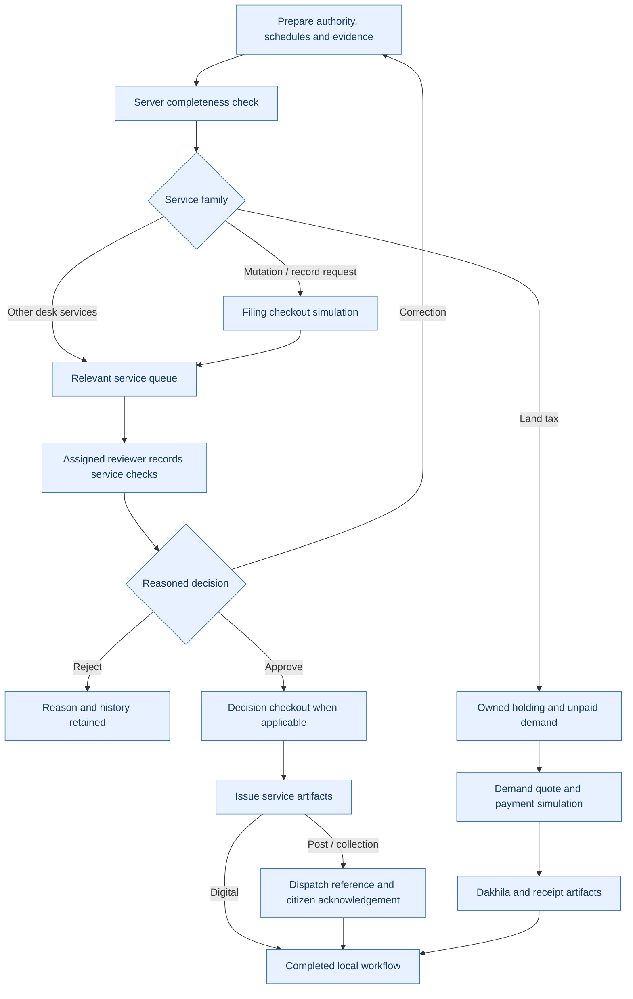
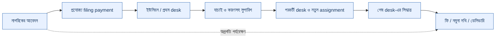

# Application flow — v5.4

See the [README lifecycle diagram](../README.md#app-flow) and [per-service handbook](SERVICE_HANDBOOK.md).

## Legacy v1 applicant states

Draft → Submitted → UnderReview → CorrectionRequested → owner edits/resubmits → Submitted.

UnderReview may proceed to HearingScheduled. Staff can approve or reject only from UnderReview/HearingScheduled. Staff approval creates AwaitingPayment when a sandbox fee exists, otherwise ReadyForDelivery. Payment failure creates PaymentFailed, which can be retried. Successful payment creates ReadyForDelivery. Assigned staff issuance creates Completed and the watermarked outcome.

The owner can withdraw Draft, Submitted or CorrectionRequested requests. Completed, Rejected and Withdrawn are terminal in that request. Review/appeal preparation uses its own separately created service request.

## Staff states and account changes

Each service has exactly one reviewer role. Staff must claim work before recording decisions. Suspending/changing an assigned reviewer returns active review work to the matching queue; ready deliveries retain their ready state and can be claimed by an eligible replacement.

## Records, tax and support

E-porcha and map workflows include delivery preferences. Tax requests retain holding/year references and generate a sample Dakhila outcome. Appointments check local capacity (four requests per office/date/time), with Dhaka future-slot validation; no government slot inventory is connected. Support requests have no sandbox fee and proceed from approval to staff-issued outcome.

## Audit and permissions

Owners see their records. Service staff see submitted records for their role; they cannot see unsubmitted citizen drafts. Administrators inspect cases but do not bypass role decisions. Auditors inspect without writing. Each transition checks role, ownership, status and revision.

## Appointment changes and linked cases

After support issuance, the owner can download a demo token and UTC calendar event for the chosen Dhaka time. Owner rescheduling invalidates the token/outcome, resets assignment and returns to Submitted for fresh support confirmation. Cancellation creates terminal Cancelled; old tokens are unavailable. Every change checks owner, revision, required reason and slot validity/capacity.

Completed/rejected revenue cases offer a separate review/appeal draft with the source case reference and land context. No source evidence or decision is silently changed.

## Truth Card to service handoff

A private parcel worksheet holds facts/sources, proposed relationships, history, boundary references and user tasks. Findings lead to a new linked service draft with parcel context prefilled. The applicant still completes eligibility, service questions and evidence before submission. A draft link does not expose the worksheet to staff. Submitted links follow service-role access, and only the assigned active reviewer can leave a local desk note. Owner edits require re-review of earlier content; unlinking revokes the service desk access. Reports are saved versioned snapshots, not ownership certificates.

## Researched procedure flows — v5.4

New applications use procedure v2. Existing saved/demo applications retain their v1 lifecycle. A caller cannot request v1 through the public API.

Every amount is a test fixture; there is no live government submission or payment. Hearing is conditional, not mandatory for every mutation. Digital copy release still uses the local records desk; there is no official registry lookup.

See the [research matrix](BD_SERVICE_RESEARCH.md) for all service profiles and source limitations.

## Bangla-first interface and role handoffs — v5.5

`i18n.js` retains English interface source text and offers a persisted language switch; new interface defaults to Bangla. It does not translate evidence, input values, reference table cells or user notes. Select option values remain stable even when labels change. A one-time language migration sets existing accounts to Bangla while retaining other preferences; later language choices persist. `desk-ui.js` adds the route timeline and notification bell/count. Original font and layout styles are preserved.

`lib/desk-routing.cjs` defines 33 configurable local route examples and intermediate desk checks. New cases snapshot their route. Current role controls mutation; completed desks retain monitoring access. Forward records checks and reason, clears assignment and notifies the next role. Only the final desk may approve/reject. These checks complement the existing phase payment and artifact engine. The waterbody route models an upazila example and does not infer legal authority for every notice.

[Role matrix](ROLE_WORKFLOWS.md) · [Lease/auction research](BD_LEASE_AUCTION_RESEARCH.md).

## Evidence-preparation flow — v5.6

Draft → Submitted → VP desk claim/checks → Legal coordination claim/checks → DC context review → Records context review → PreparationComplete. Each review can request owner correction; the same desk reviews the resubmission. DC/records require a reported external order or authority reference before forwarding. Owner withdrawal/reopen applies before review or during correction. Completion exports only a labelled preparation report.

The service workflow can insert an allowlisted consultation desk before the current reviewer, then return to that reviewer. It clears active checks/assignment, not prior handoff history. Old desks may monitor but cannot make the current desk's decision.
