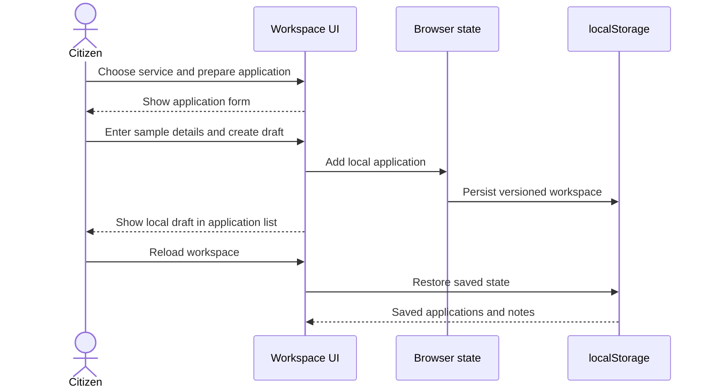
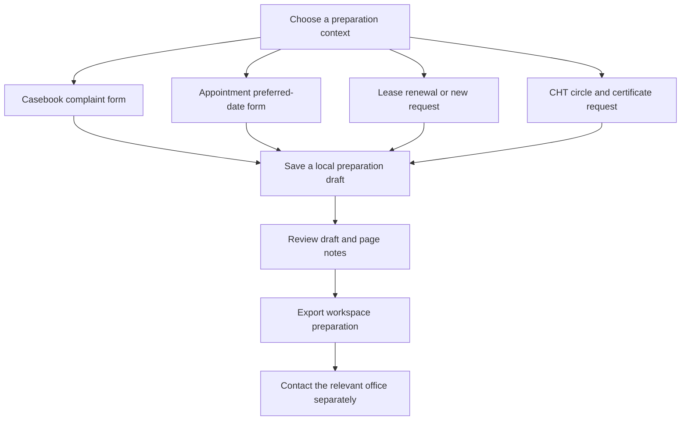
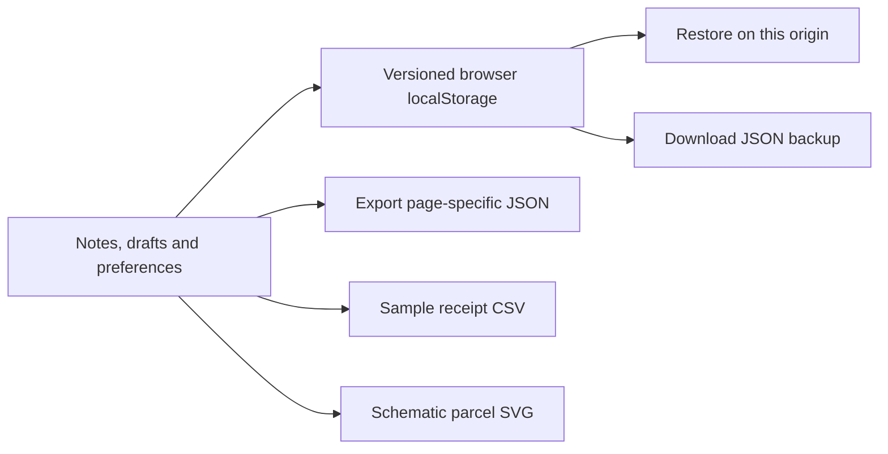

# Application flows

These flows describe the current frontend. Official record checks, decisions, payments and appointment confirmation happen outside it. Screenshots and labels are not statements of legal requirements.

## Navigation map

- **Overview** — `workspace.html#dashboard`
- **Land Search** — `workspace.html#land-search`
- **My Land & Passport** — `workspace.html#my-land`
- **Land Services** — `workspace.html#services`
- **My Applications** — `workspace.html#applications`
- **Govt Land Lease** — `workspace.html#land-lease`
- **Hill Tracts Zone (CHT)** — `workspace.html#ctg-zone`
- **GIS & Parcel Map** — `workspace.html#gis`
- **Documents Vault** — `workspace.html#documents`
- **Payments & Receipts** — `workspace.html#payments`
- **Due Diligence** — `workspace.html#due-diligence`
- **AI Land Assistant** — `workspace.html#ai-assistant`
- **Cases & Complaints** — `workspace.html#casebook`
- **Appointments & Queue** — `workspace.html#appointments`
- **Notifications** — `workspace.html#notifications`
- **Analytics & Reports** — `workspace.html#analytics`
- **Feature Catalogue** — `workspace.html#feature-catalog`
- **Administration** — `workspace.html#admin`

## 1. Discover a record

`Landing → Workspace → Land Search → enter sample reference → filter sample matches → Open parcel → GIS context`

Try Dag 1842. Search results come from fixtures; administrative inputs do not query a live land registry. Save a search for local preparation and use page notes to record questions.

## 2. Prepare an application

The detail view shows illustrative stages. It does not submit to an officer, validate eligibility or obtain an official decision.

## 3. Organise document references

`Documents → Upload a document → choose sample file → validate selection → save metadata → filter/open metadata`

The app checks filename extension and size. File bytes are not retained or sent to a protected document backend. There is no malware scan, real signature verification, OCR or certified copy issuance.

## 4. Review due diligence

`Due Diligence → review eight checklist items → mark completed checks → save notes → export checklist or page data`

Checkboxes record your preparation, not an automated finding. Identity, title, tax, boundary, co-owner, litigation and encumbrance questions still need appropriate verification.

## 5. Prepare support and regional requests

Local draft behavior does not update the fixture case register, reserve live slots, grant leases or issue certificates. Regional legal/process copy requires independent official review.

## 6. Search and resume

`Ctrl/Cmd + K → enter service, page or reference → Enter → choose result`

Global search covers pages, service descriptions, applications and document names. Feature requirements have a separate catalogue search. Favorite pages appear as dashboard shortcuts. Hash URLs support direct access and browser back/forward.

## 7. Save and export

Backups are downloads only; import and cloud sync are not implemented. Changing hostname, browser profile or clearing site data can make saved work unavailable.

## Exit and recovery

- Export before clearing browser data.
- Keep original sample files separately; document bytes are not in the backup.
- If storage is unavailable, the UI reports it; there is no server recovery service.
- Return to [README](../README.md) for setup, limitations and roadmap.
