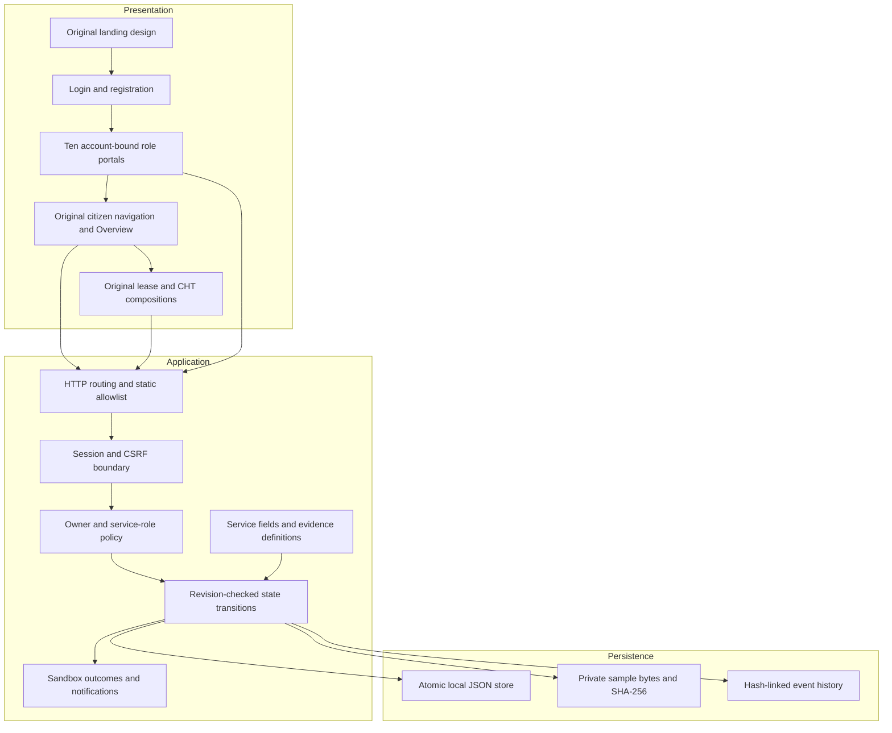
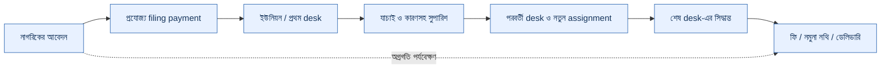

# Application architecture blueprint

This implementation adopts the V5 reference's local application architecture and review flow while retaining the project's existing landing and regional page presentation. This is the running sandbox design; production integrations remain separate.

## Module responsibilities

| Module | Responsibility |
| --- | --- |
| `server-v4.cjs` | Loopback HTTP server, allowed static files, security headers and portal routing |
| `lib/land-dossiers.cjs` | Private worksheet persistence, source provenance, graph validation, linked-case access, local review and immutable report snapshots |
| `land-intelligence.js` | Truth Card, interactive relationship SVG, timeline/boundary, tasks, evidence, report and office-routing UI |
| `workflows.js` | Dedicated demand/receipt, case, appointment and calculator UI using the existing design components |
| `lib/platform.cjs` | Account/session operations, API validation, ownership/role policy, transitions and durable local state |
| `lib/catalog.cjs` | 33 service definitions, service-specific questions, evidence, review role and outcome |
| `lib/geography.cjs` | Matching division/district validation data |
| `lib/seed-demo.cjs` | Additive demo scenarios and preference defaults; no reset of existing work |
| `auth.js` | Account UI and safe return to a selected citizen route after login |
| `portal.js` | Workflow UI, authenticated requests, application forms and role views |
| `citizen.js` | Preserved citizen, lease and CHT presentation; preparation tools/preferences |
| `assets/styles.css`, `assets/landing.css` | Original design and font declarations |
| `preserved.css` | Compatibility styles between the preserved shell and new workflow forms |

## Invariants

1. A UI role label cannot grant API permissions.
2. A citizen/representative may read and edit only their own applicable requests.
3. Staff see submitted requests for their service role and must claim before deciding.
4. Admin oversight cannot bypass service-role decisions; auditors are read-only.
5. Each mutation checks the current revision and legal transition in the sandbox state machine.
6. Required service fields/evidence are validated before submission.
7. Payment success is a local simulation, replay-protected per request, never an external payment confirmation.
8. Only an eligible assigned reviewer may issue a ready outcome.
9. Document hashes concern local byte integrity, not official authenticity.
10. No public static path exposes `.data`, server libraries or account hashes.

## Boundaries and operation

Run one Node process against one local `.data` directory. Passwords use salted scrypt; sessions are memory-only and require login after a restart. User/account data and sample files are held in JSON and are not encrypted. Stop the process before copying/restoring `.data`. The shared demo credentials and loopback deployment are for evaluation, not public hosting.

Government registry/GIS/identity APIs, official signatures, real payments, postal delivery and legal decisions are not integrated. The 460-item feature catalogue remains a roadmap/specification registry. See the [service handbook](SERVICE_HANDBOOK.md), [application flow](APP_FLOW.md) and [validation](../VALIDATION.md).

## Appointment inventory and demo migration

Appointment availability is an aggregate local simulation with four requests per office/date/time. Submission and reschedule recheck capacity on the server. Owner changes require a matching revision and reason; reschedule removes the old outcome and assignment, cancellation removes the old outcome and enters Cancelled. Government inventory is not queried.

Demo edition 7 trims only untouched generated records, retaining user changes and reconciled payments. It preserves all 33 services with three examples per demo owner.

## Land intelligence access

Owners create and edit their private worksheet. Linking a matching own application shares its facts/evidence with the service desk only when that desk can read the application. Only the assigned reviewer of an active linked request can add a local review note. Source labels cannot be upgraded to official verification. Every write checks revision; content changes invalidate the freshness of earlier local notes. Snapshots retain their own SHA-256. See [feature depth and reference mapping](LAND_INTELLIGENCE.md).

## Procedure v2 modules

`lib/procedures.cjs` stores dated source metadata and 33 profiles. `lib/procedure-engine.cjs` enforces schedules, ownership, review tasks, phase quotes, holding demands, delivery and artifact integrity. `procedures-ui.js` extends the existing portal without replacing its styles. New server-created applications use v2; saved v1 cases stay readable and executable. No public request can select the legacy mode. Server-only `newWorkflowVersion:1` is an explicit compatibility-test fixture.

The holding ledger is a local object owned by its applicant; finance can assess positive reasoned demands. Payment quotes bind application and demand revisions. Repeated successful payment of the same application phase returns the earlier receipt. Another case cannot pay an already-paid holding demand. Official services are linked reference sites, not integrated endpoints.

## Bangla-first interface and role handoffs — v5.5

`i18n.js` retains English interface source text and offers a persisted language switch; new interface defaults to Bangla. It does not translate evidence, input values, reference table cells or user notes. Select option values remain stable even when labels change. A one-time language migration sets existing accounts to Bangla while retaining other preferences; later language choices persist. `desk-ui.js` adds the route timeline and notification bell/count. Original font and layout styles are preserved.

`lib/desk-routing.cjs` defines 33 configurable local route examples and intermediate desk checks. New cases snapshot their route. Current role controls mutation; completed desks retain monitoring access. Forward records checks and reason, clears assignment and notifies the next role. Only the final desk may approve/reject. These checks complement the existing phase payment and artifact engine. The waterbody route models an upazila example and does not infer legal authority for every notice.

[Role matrix](ROLE_WORKFLOWS.md) · [Lease/auction research](BD_LEASE_AUCTION_RESEARCH.md).
