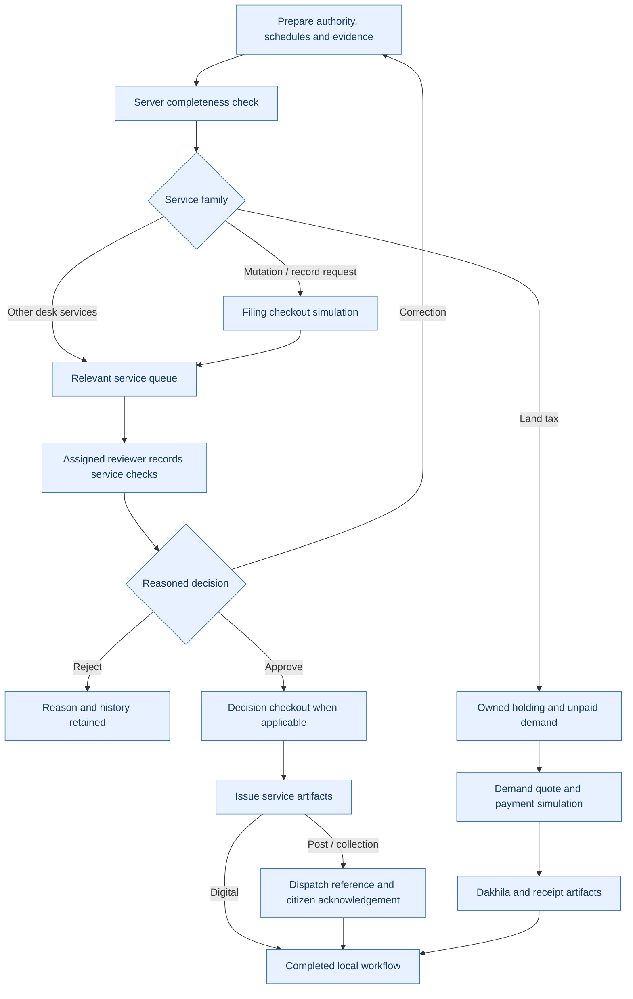

# Bangladesh land-service research and implementation matrix

Research date: **2026-10-17**. Scope: 24 primary-source references and 33 local service mappings. This is an implementation research record, not a legal opinion or a complete reproduction of national/district procedure.

## Findings that changed the implementation

- Mutation preparation needs land schedules, transfer/interest context and a separate filing stage before desk review. The local model separates filing and post-decision payments; correction does not recharge an already-paid filing phase. Hearing need is recorded rather than imposed on every case.
- Record and map requests use survey/record or sheet schedules, checkout, preparation and selected delivery. Postal requests require an address; collection/post require a dispatch reference and citizen acknowledgement.
- Tax uses an owned holding, a reasoned local demand for a year, a current demand quote, successful payment and Dakhila. New registrants receive no fabricated holdings; a completed holding-registration case creates one, and finance records its local demand.
- Case/review/appeal, survey, deed search, settlement and leases have separate desk checks. These are preparation/disposition records, not court orders, registered deeds or allocations.
- CHT requests use a distinct regional route; plains mutation and Khas paths are blocked for a CHT declaration. The dated local charter is insufficient to encode all current circle/category rules.

## Currency and evidence limits

The Ministry laws index lists acquisition/requisition rules published 22 July 2026 and land-use legislation published 7 April 2026. The linked Gazettes were retrieved, but text extraction was unreliable; current statutory forms, limitation periods, valuation and permission decisions are **not implemented or claimed verified**. Those profiles require competent-authority confirmation.

The Ministry fee index and official DLRMS staging notice disagree on record-copy prices (100 versus 120 in the observed references). Staging is used only as a workflow reference. Mutation values 70/1100 and record checkout value 100 in this build are labelled **simulation amounts**, not a live government quote; map, postal, registration, tender and local-office tariffs are not derived automatically. All other configured amounts are synthetic test fixtures.

Government NID/OTP, registry search, gateway/challan reconciliation, official QR verification, actual notices, field visits, postal dispatch, hearings and legal issuance require authorised integrations and operational offices. A local Completed state has no legal effect.

## Per-service mapping

Each row links to the primary references below. Required original service fields and evidence categories remain in the [service handbook](SERVICE_HANDBOOK.md). These added schedules/checks are our local design interpretation, not verbatim prescribed government forms.

| Service | Structured preparation | Required local desk checks | Issued local artifacts | Sources / confidence |
| --- | --- | --- | --- | --- |
| mutation — Mutation after transfer | plots, parties; required land keys: mouza, khatian, dag, area | Transfer chain report; Plot and requested-area comparison; Notice/hearing necessity and reasoned decision | Mutation Khatian; DCR | [mutation](#source-mutation), [stages](#source-stages), [mutationPolicy](#source-mutationpolicy), [fees](#source-fees); Official service-family mapping |
| inheritance — Inheritance mutation | plots, heirs; required land keys: mouza, khatian, dag, area | Predecessor and heir evidence review; Co-heir interests and land schedule; Reasoned inheritance-mutation decision | Inheritance mutation schedule; DCR | [mutationDefinition](#source-mutationdefinition), [mutationPolicy](#source-mutationpolicy), [stages](#source-stages); Official service-family mapping |
| partition — Partition request | plots, parties; required land keys: mouza, khatian, dag, area | Co-sharer and partition reference review; Requested plot allocations; Reasoned separate-holding decision | Partition schedule; DCR | [mutationDefinition](#source-mutationdefinition), [stages](#source-stages); Official service-family mapping |
| consolidation — Holding consolidation | plots; required land keys: mouza, khatian, dag, area | Holding and common-interest comparison; Combined land schedule review; Reasoned consolidation decision | Consolidated holding schedule; DCR | [mutationDefinition](#source-mutationdefinition), [stages](#source-stages); Official service-family mapping |
| record-correction — Record correction | Service-specific fields; required land keys: mouza, khatian | Identify record error and competent route; Compare proposed correction evidence; Record reasoned disposition | Correction disposition | [fees](#source-fees), [survey](#source-survey); Official service-family mapping |
| eporcha — Certified Khatian copy | records; required land keys: mouza, khatian | Match requested survey and record; Prepare certified-copy simulation; Check selected delivery route | Certified Khatian copy; Delivery record | [records](#source-records), [fees](#source-fees); Official service-family mapping |
| instant-copy — Online Khatian copy | records; required land keys: mouza, khatian | Match online record reference; Prepare watermarked online copy; Record release and local verification reference | Online Khatian copy | [records](#source-records), [mutationDefinition](#source-mutationdefinition); Official service-family mapping |
| mouza-map — Mouza map request | sheets; required land keys: mouza | Match Mouza and sheet reference; Prepare requested map sheet; Check delivery address or collection choice | Mouza map sheet; Delivery record | [records](#source-records), [fees](#source-fees); Official service-family mapping |
| holding — Tax holding registration | plots, parties; required land keys: mouza, khatian, dag, area | Match Khatian and applicant interest; Review class and holding linkage; Approve local holding entry | Holding registration summary | [tax](#source-tax), [taxPortal](#source-taxportal); Official service-family mapping |
| land-tax — Land development tax | Service-specific fields; required land keys: none | Check owned approved holding; Check local demand and tax year; Release Dakhila after successful payment | Dakhila; Payment verification | [tax](#source-tax), [taxPortal](#source-taxportal); Official service-family mapping |
| tax-correction — Tax demand objection | Service-specific fields; required land keys: none | Identify holding/demand or payment problem; Compare supporting reference and ledger; Record reasoned objection response | Tax objection / reconciliation response | [tax](#source-tax), [taxPortal](#source-taxportal); Official service-family mapping |
| khas — Khas land settlement | plots, parties; required land keys: mouza, dag, area | Record eligibility enquiry; Record land availability and field enquiry; Record competent committee/authority routing | Settlement review disposition | [khas](#source-khas), [commercial](#source-commercial); Local authority / current-rule confirmation required |
| tea-lease — Tea estate lease renewal | plots; required land keys: mouza, khatian, dag, area | Check current lease and term; Record possession/rent/compliance review; Record competent renewal disposition | Lease renewal preparation outcome | [tea](#source-tea); Local authority / current-rule confirmation required |
| waterbody — Waterbody lease preparation | plots, parties; required land keys: mouza, dag, area | Check selected notice and organisation; Record eligibility and notice-condition review; Record competent lease decision context | Waterbody lease disposition | [waterbody](#source-waterbody), [lease2026](#source-lease2026); Local authority / current-rule confirmation required |
| industrial-lease — Commercial land lease | plots, parties; required land keys: mouza, dag, area | Review proposed organisation/use; Record land-category and feasibility context; Record competent proposal/approval route | Commercial proposal disposition | [commercial](#source-commercial), [laws](#source-laws); Local authority / current-rule confirmation required |
| acquisition — Acquisition compensation claim | plots, parties; required land keys: mouza, khatian, dag, area | Match LA case and notice; Review claimant interest and evidence; Confirm current authority/forms and record disposition | Claim review summary | [acquisition](#source-acquisition), [laws](#source-laws), [acquisition2026](#source-acquisition2026); Local authority / current-rule confirmation required |
| acquisition-objection — Acquisition objection | plots; required land keys: mouza, dag, area | Match notice and objection scope; Record enquiry/hearing context; Confirm current rules and reasoned response | Acquisition objection response | [acquisition](#source-acquisition), [laws](#source-laws), [acquisition2026](#source-acquisition2026); Local authority / current-rule confirmation required |
| requisition — Requisition request | plots; required land keys: mouza, dag, area | Match requisition notice; Review affected interest and requested remedy; Confirm current rules and disposition | Requisition response | [laws](#source-laws), [acquisition2026](#source-acquisition2026); Local authority / current-rule confirmation required |
| revenue-case — Revenue miscellaneous case | Service-specific fields; required land keys: mouza, dag | Confirm case jurisdiction and parties; Record notice/evidence/hearing context; Record reasoned disposal | Revenue case disposition | [cases](#source-cases); Official service-family mapping |
| review — Revenue review | Service-specific fields; required land keys: mouza, khatian | Match challenged order; Review maintainability and grounds; Record reasoned review disposition | Review disposition | [cases](#source-cases), [review](#source-review); Official service-family mapping |
| appeal — Revenue appeal preparation | Service-specific fields; required land keys: mouza, khatian | Identify order and proposed forum; Record admissibility questions and supporting grounds; Record local appeal-preparation outcome | Appeal-preparation report | [cases](#source-cases), [review](#source-review); Official service-family mapping |
| rent-case — Rent certificate case response | Service-specific fields; required land keys: mouza, khatian | Match rent-certificate notice and demand; Review payment/objection evidence; Record reasoned response | Rent-certificate response | [cases](#source-cases); Official service-family mapping |
| survey-objection — Survey objection | plots; required land keys: mouza, khatian, dag | Identify survey stage and entry; Compare objection evidence and field context; Record hearing/disposition and applicable route | Survey objection report | [survey](#source-survey); Official service-family mapping |
| boundary-survey — Boundary survey request | plots; required land keys: mouza, khatian, dag, area | Confirm requested boundary and references; Record simulated field observation; Record limitations and survey response | Boundary review report | [survey](#source-survey); Official service-family mapping |
| deed-copy — Deed search and copy | parties; required land keys: none | Review search/index and access basis; Record search/inspection result; Record copy preparation and release | Deed search result; Deed copy | [deeds](#source-deeds); Official service-family mapping |
| deed-preparation — Registration readiness | plots, parties; required land keys: mouza, dag, area | Review parties and deed type; Record document readiness questions; Record official registration handoff | Registration readiness report | [deeds](#source-deeds), [portal](#source-portal); Official service-family mapping |
| due-diligence — Purchase due diligence | plots; required land keys: mouza, khatian, dag, area | Compare supplied chain and interests; Record discrepancies and unresolved evidence; Deliver bounded preparation report | Due-diligence questions report | [deeds](#source-deeds), [survey](#source-survey), [portal](#source-portal); Official service-family mapping |
| complaint — Service grievance | Service-specific fields; required land keys: none | Classify service grievance and requested remedy; Record enquiry or clarification; Record local response and escalation options | Service grievance response | [grievance](#source-grievance); Official service-family mapping |
| appointment — Office appointment | Service-specific fields; required land keys: none | Review office/date and assistance needs; Confirm local slot and reference; Issue local appointment token | Appointment token | [portal](#source-portal), [taxPortal](#source-taxportal); Official service-family mapping |
| cht — CHT customary-land request | plots, parties; required land keys: mouza, dag, area | Identify circle/category and competent route; Record required local report/field context; Record district/customary authority confirmation | Regional request disposition | [cht](#source-cht); Local authority / current-rule confirmation required |
| land-bank — Land information bank request | Service-specific fields; required land keys: mouza | Scope requested land information; Record available reference and source limitations; Release information response | Land information response | [portal](#source-portal); Local authority / current-rule confirmation required |
| zoning — Land-use and zoning enquiry | plots; required land keys: mouza, dag | Identify intended use and parcel; Check current authority and land-use-law context; Deliver enquiry response, not permission | Land-use enquiry response | [laws](#source-laws), [zoning2026](#source-zoning2026); Local authority / current-rule confirmation required |
| acquisition-proposal — Agency acquisition proposal | plots, parties; required land keys: mouza, dag, area | Review agency/project authority; Review proposed schedule and supporting plan; Confirm current prescribed forms and approval route | Agency proposal review | [laws](#source-laws), [acquisition2026](#source-acquisition2026); Local authority / current-rule confirmation required |

## Primary-source register

Access notes distinguish complete text, indexed excerpts, staging systems and unavailable detailed provisions. No unauthenticated private case records were needed.

### Source mutation

[E-mutation applicant guidance](https://mutation.land.gov.bd/nirdeshika)

Observed access: Indexed official text; direct page returned 403.

Used for: Application preparation and filing payment; verify current portal before real use.

### Source stages

[E-mutation stages](https://mutation.land.gov.bd/namjari-steps)

Observed access: Indexed official text.

Used for: Tracking, decision and Khatian/DCR retrieval.

### Source mutationpolicy

[Mutation correction / rejection instructions](https://mutation.land.gov.bd/notification_and_rules/notification/E_namjari_system_application_dismiss.pdf)

Observed access: Indexed official PDF.

Used for: Reasoned correction and hearing need; not every application requires a hearing.

### Source mutationdefinition

[Mutation FAQ](https://mutation.land.gov.bd/query)

Observed access: Indexed official page.

Used for: Record, plot, area and interest context.

### Source fees

[Ministry land-service fee reference](https://land.gov.bd/vumisheba-fee?lang=bn)

Observed access: Indexed official page; direct access returned 403.

Used for: Published mutation/record/map rates; records conflict with staging notice, so not treated as a live payable quote.

### Source records

[DLRMS public workflow reference](https://dlrms-stg.land.gov.bd/)

Observed access: Official STAGING page / indexed text.

Used for: Search, request, checkout, preparation and delivery design only; production fees/data not verified.

### Source tax

[Land development tax citizen manual, v2, 23 February 2025](https://admin.ldtax.gov.bd/storage/Manual/nNqBZ0Z3b01mszO7PWmy2ZY1jCG3alcEo91Pov7a.pdf)

Observed access: Full official PDF text.

Used for: Holding/demand, payment, Dakhila, reconciliation and objection; local amounts are not statutory tax calculations.

### Source taxportal

[LD Tax manuals](https://ldtax.gov.bd/manual)

Observed access: Full official page.

Used for: Citizen and organisation guidance entry.

### Source cases

[Land revenue case portal](https://case.land.gov.bd/)

Observed access: Indexed official scope; direct portal timed out.

Used for: Miscellaneous, review and rent-certificate cases; forum and limitation need case-specific confirmation.

### Source review

[Revenue review circular collection](https://bhumipedia.land.gov.bd/uploads/PDF/Act/All_circular_-14-26_kxKEoQD.pdf)

Observed access: Indexed official PDF.

Used for: Order and admissibility context, not an automatic right of appeal.

### Source deeds

[Sub-registry search and copy procedure](https://sr.sonatala.bogra.gov.bd/pages/static-pages/697f8d8635ce18e1c06bd6c3)

Observed access: Full official local-office page; content dated 2024.

Used for: Search/inspection precedes copy request where applicable; registration remains a separate authority.

### Source survey

[DLRS service stages](https://dlrs.gov.bd/site/page/0ea563ac-b6cc-419d-b487-576e2e906772)

Observed access: Indexed official page; direct fetch failed.

Used for: Survey-stage objections and hearing/record decision; not a universal boundary clearance.

### Source khas

[Agricultural Khas settlement process map](https://acl.nawabganj.dhaka.gov.bd/pages/office-process-maps/ভূমিহীনদের-মাঝে-কৃষি-খাস-জমি-বন্দোবস্ত-প্রদান-64bed2-699563f7f2b99fa8d15585cc)

Observed access: Indexed official local-office process.

Used for: Eligibility enquiry and committee routing; availability/eligibility require current local confirmation.

### Source tea

[Moulvibazar tea-cell service description](https://www.moulvibazar.gov.bd/en/site/dcoffice_section/RstE-টি-সেল)

Observed access: Indexed official district description.

Used for: Lease file, local verification and renewal execution; not a national current fee rule.

### Source waterbody

[Online waterbody lease process notice](https://minland.gov.bd/pages/notices/6940379335ce18e1c058a14f)

Observed access: Indexed official notice.

Used for: Notice-based online lease preparation; current tender terms govern.

### Source lease2026

[Current district lease notice example](https://sylhet.gov.bd/pages/notices/১৪৩৩-১৪৩৫-বঙ্গাব্দ-মেয়াদে-জলমহাল-ইজারা-প্রদানের-লক্ষ্যে-অনলাইনে-777f7b-696ca272a31054345f12e31c)

Observed access: Indexed 2026 official district notice.

Used for: Notice-specific application period and document route; not a reusable national deadline.

### Source commercial

[Non-agricultural Khas proposal routing](https://narsingdi.gov.bd/pages/static-pages/6995aa9835ce18e1c0793765)

Observed access: Indexed official district page.

Used for: Administrative proposal routing, not an allocation decision.

### Source acquisition

[District acquisition documentation](https://file-khulna.portal.gov.bd/files/bagerhat.gov.bd/files/f2100a05_d383_4f13_9630_79061980f6cf/cfb20e55cde4c1fb1ee2d929a089a5ef.pdf)

Observed access: Indexed official district checklist.

Used for: Claim notice and supporting interests; local/current prescribed forms need confirmation.

### Source laws

[Ministry current laws index](https://minland.gov.bd/pages/laws)

Observed access: Full official index, 2026 updates.

Used for: Lists 2026 acquisition/requisition rules and land-use law; do not rely solely on older manuals.

### Source acquisition2026

[Acquisition/requisition rules 2026 Gazette](https://objectstorage.ap-dcc-gazipur-1.oraclecloud15.com/n/axvjbnqprylg/b/V2Ministry/o/office-minland/2026/7/2014b276-b42f-4d80-97d9-c3dee8bff1a1.pdf)

Observed access: 155-page official PDF retrieved; text encoding corrupt; not fully interpreted.

Used for: Current-form/authority confirmation is required; statutory timing/valuation not implemented.

### Source zoning2026

[Land-use and agricultural-land protection law 2026](https://objectstorage.ap-dcc-gazipur-1.oraclecloud15.com/n/axvjbnqprylg/b/V2Ministry/o/office-minland/2026/7/e3c7fce6-6116-42a8-a525-1db34691055d.pdf)

Observed access: Official 16-page Gazette retrieved; detailed legal rules not machine-encoded.

Used for: Enquiry only; no land-use conversion permission.

### Source cht

[Bandarban local land-service charter](https://acl.sadar.bandarban.gov.bd/pages/static-pages/699124f9516a96d4de40533a)

Observed access: Official local charter, content dated 2019; indexed procedural rows.

Used for: Regional reporting and district routing; circle/land category/current authority must be confirmed.

### Source grievance

[Ministry manuals index / 2026 grievance guidance](https://land.gov.bd/manual)

Observed access: Indexed official listing; 2026 manual listed, full text unavailable.

Used for: Service grievance preparation only; not civil litigation or a live GRS integration.

### Source portal

[Land-service catalogue](https://lsg-portal.land.gov.bd/)

Observed access: Indexed official catalogue.

Used for: Service-family coverage, not proof of an endpoint integration.

## Researched procedure flows — v5.4

New applications use procedure v2. Existing saved/demo applications retain their v1 lifecycle. A caller cannot request v1 through the public API.

Every amount is a test fixture; there is no live government submission or payment. Hearing is conditional, not mandatory for every mutation. Digital copy release still uses the local records desk; there is no official registry lookup.

## Verification and remaining implementation boundaries

`tests/procedures.test.cjs` exercises all 33 default-v2 journeys, including source/jurisdiction acknowledgements, evidence, structured schedules, review gating, payment phases, delivery acknowledgement, artifact integrity and restart. `tests/procedures-browser.cjs` covers the mutation UI and all 33 procedure pages. Existing suites explicitly use v1 fixtures to protect compatibility with older stored work.

The first iteration still uses flexible sample references for office/notice/form/book fields. Case-specific admissibility, real notice service, multi-office approvals, tender bidding/award, statutory inheritance allocation and compensation calculation remain outside the implemented local workflow. Real completion of those tasks needs verified current specifications and authorised government interfaces.
