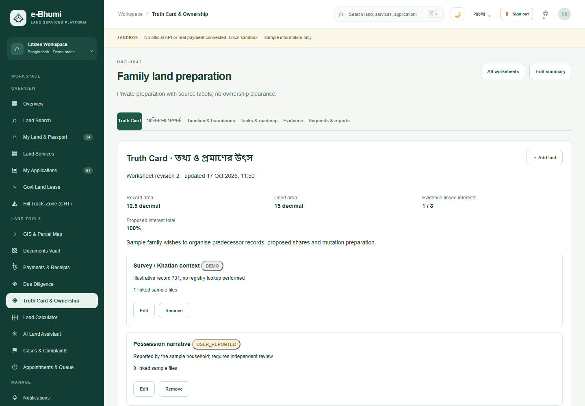
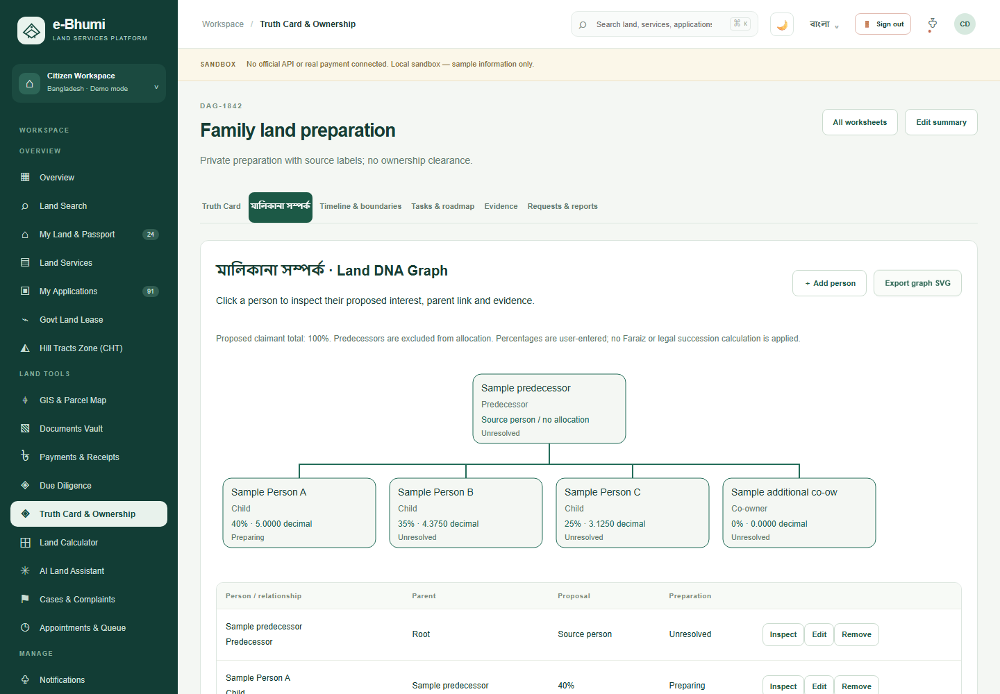
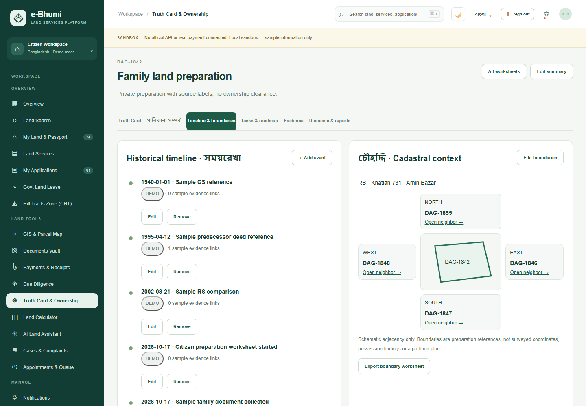
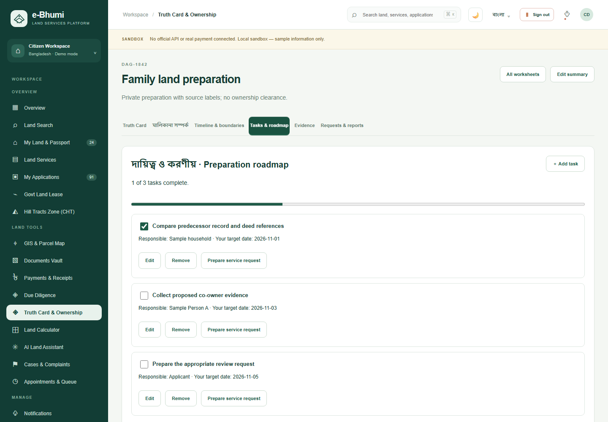
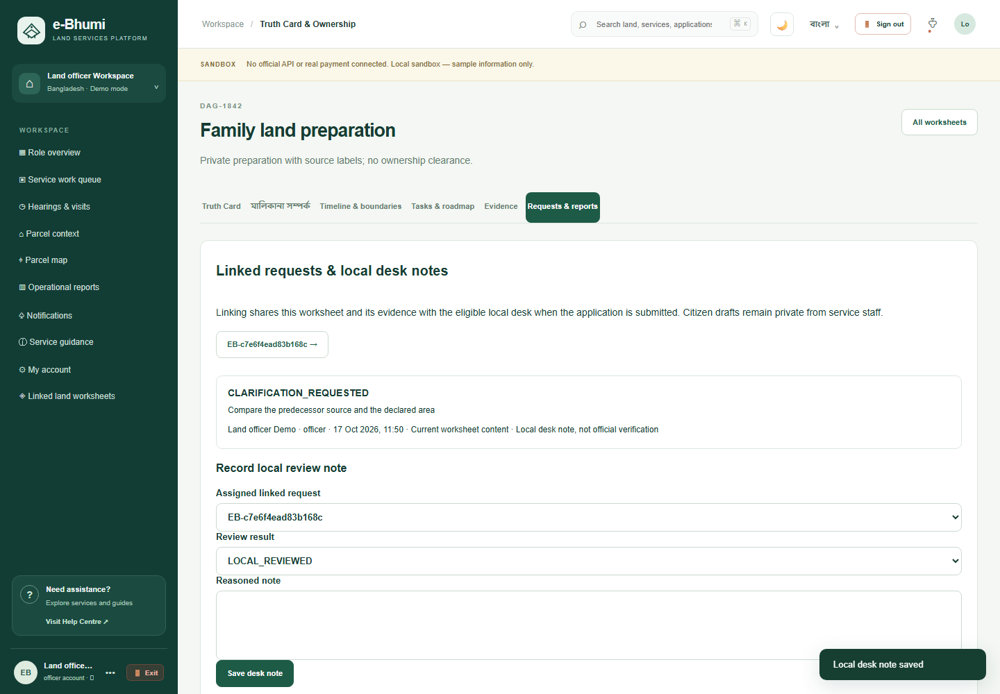
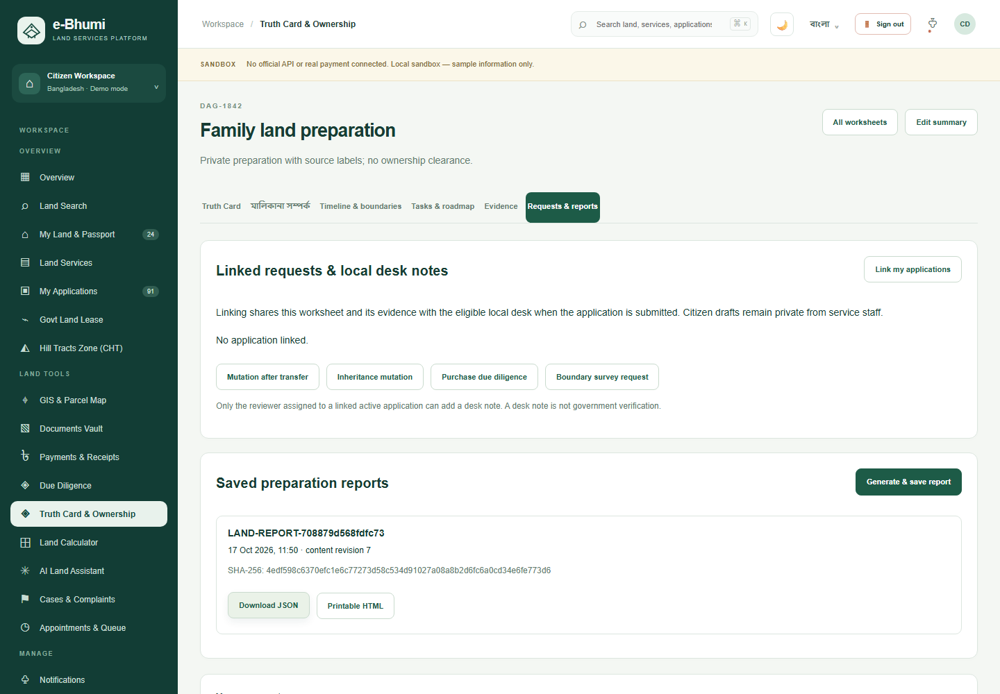
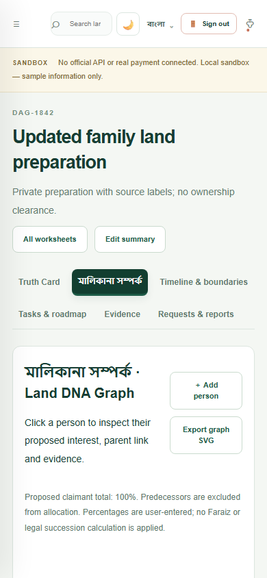
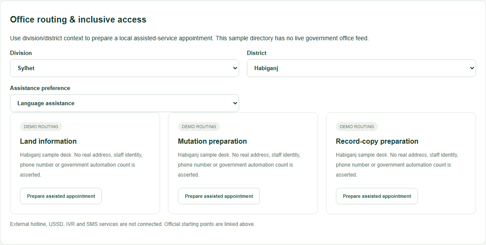
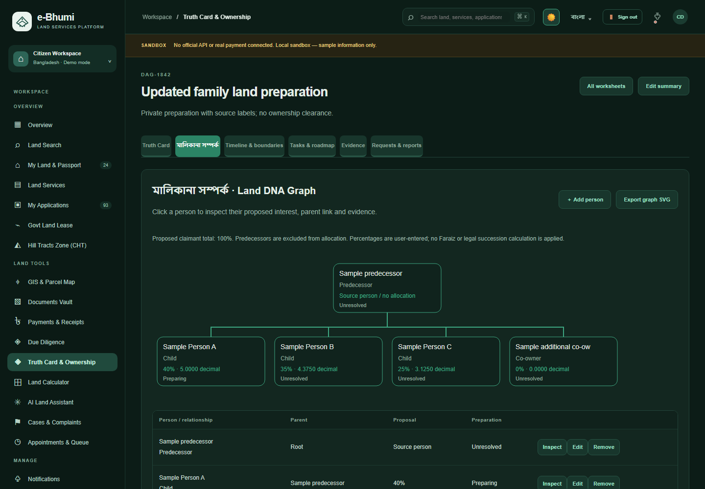

# Truth Cards, ownership relationships and land preparation

This extension adapts the **ideas** in the supplied 16-image screenshot archive while retaining e-Bhumi's existing landing, font stack, citizen shell, regional views and green panel/button system.

## What is working

| Feature | Complete local interaction |
| --- | --- |
| Truth Card | Create/open a private worksheet for a sample parcel; edit its narrative and deed/record areas; add/edit/remove facts; inspect source labels and evidence links |
| Ownership relationships | Add/edit/remove people, connect predecessor/party relationships, enter proposed percentages, inspect graph nodes with mouse/keyboard and export an SVG; server rejects missing parents, cycles and malformed percentages |
| Discrepancy questions | Detect area differences, proposed-share gaps, evidence gaps, unresolved preparation states and overdue user tasks; start a related linked application with parcel context prefilled |
| Timeline | Add/edit/remove dated events with evidence references; user edits become USER_REPORTED; retain distinct sample and user sources |
| Boundary context | Edit four directional references, view an illustrative parcel diagram, open sample neighbors and export the boundary worksheet |
| Tasks / roadmap | Add/edit/remove obligations, responsible-person labels, target dates and related service; check off work and persist progress across reloads |
| Evidence | Upload sample files through backend signature/size checks; link account-owned evidence to facts, people and events; download bytes and inspect server-computed SHA-256 |
| Local desk review | Link an owned application for the same Dag; draft links remain private from service desks; after submission the eligible desk can inspect it; only an assigned active reviewer can leave a reasoned local note |
| Reports | Save a versioned snapshot of facts, proposed people/interests, findings, timeline, boundaries and tasks; download JSON or printable HTML; hashes remain stable after later edits |
| Review freshness | Notes refer to a content revision. Later edits display a re-review message. Unlinking a request revokes that desk's worksheet/evidence access |
| Office routing | Select a division/district and assistance preference, then create a prefilled local appointment draft; service-charter table links to all 33 configured service flows |

## Access and source meaning

- Citizen and representative accounts own separate worksheets. All submitted evidence references must belong to that account. A linked case must belong to the owner and match the parcel Dag.
- Service staff see only worksheets shared through an application they can read. Assigned reviewers can add local notes; they cannot rewrite the owner's facts, graph or tasks.
- Admin/auditor inspection follows the existing oversight model. Neither role can forge an assigned service-review decision.
- DEMO means illustrative fixture content. USER_REPORTED means account-entered or edited information. LOCAL_REVIEWED means a local desk note, never government certification.
- A file digest establishes local byte integrity only. Proposed percentages do not compute or determine Faraiz, legal inheritance, title or possession. Geometry is schematic. Task dates are user targets, not statutory deadlines.

## Demo and storage

Three worksheets per demo citizen/representative account illustrate family preparation, purchase-area comparison and co-owner preparation. The six worksheets do not add service applications; the existing 99 applications per demo account remain. Some sample worksheets are linked to existing submitted/review cases so staff can explore their platform.

Newly registered users start with no worksheets. Opening an existing parcel worksheet is idempotent for that owner/parcel. The server persists worksheets, local review notes and at most 20 report snapshots per worksheet in the existing protected JSON store. Routine list refreshes carry report summaries; full snapshots load when opening a worksheet or downloading a report.

## Screenshot idea mapping

| Archive images | Adopted idea | Implementation |
| --- | --- | --- |
| 2026-09-21 023027, 023342; 2026-09-24 115626 | Land timeline, provenance and cadastral context | Dated evidence-linked events and four-sided schematic boundary panel |
| 2026-09-21 023129, 023219 | Land DNA / family ownership graph | Editable proposed relationship graph with accessible table and node inspection |
| 2026-09-21 023106, 023249, 023321 | Citizen narrative, missing evidence and roadmap | Truth Card findings, preparation tasks and linked service applications |
| 2026-09-24 115649, 115659, 115705 | Case obligations, evidence labels and discrepancy alerts | Persisted tasks/progress, source badges, evidence checks and linked desk inspection |
| 2026-09-23 173942, 224505 | Office routing and inclusive service | Clearly labelled demo office routing, accessibility/language-assisted appointment drafts |
| 2026-09-23 173544, 173919, 173956 | Citizen charter and broad service entry | Existing 33 service workflows and a charter table, without copying unverified fees/deadlines or unsupported live integrations |

Original archive images remain reference material outside the repository. Documentation uses fresh, clean screenshots of this implementation rather than browser chrome or account details from the reference archive.

## Gallery

| Truth Card | Ownership graph |
| --- | --- |
|  |  |

| Timeline and boundaries | Obligations |
| --- | --- |
|  |  |

| Local desk review | Saved reports |
| --- | --- |
|  |  |

## Verification

`tests/land-dossiers.test.cjs` covers privacy, owner/case/evidence rules, graph cycles and IDs, strict dates, source provenance, revision conflicts, assigned review, access revocation, immutable hashes and restart persistence.

`tests/land-dossiers-browser.cjs` exercises the actual UI and API through graph edits, keyboard inspection, cycle rejection, SVG export, timeline/boundaries, task reloads, sample upload, report export, a linked mutation wizard, assigned desk review, stale-review labels, office-assisted appointment preparation and mobile layouts.

