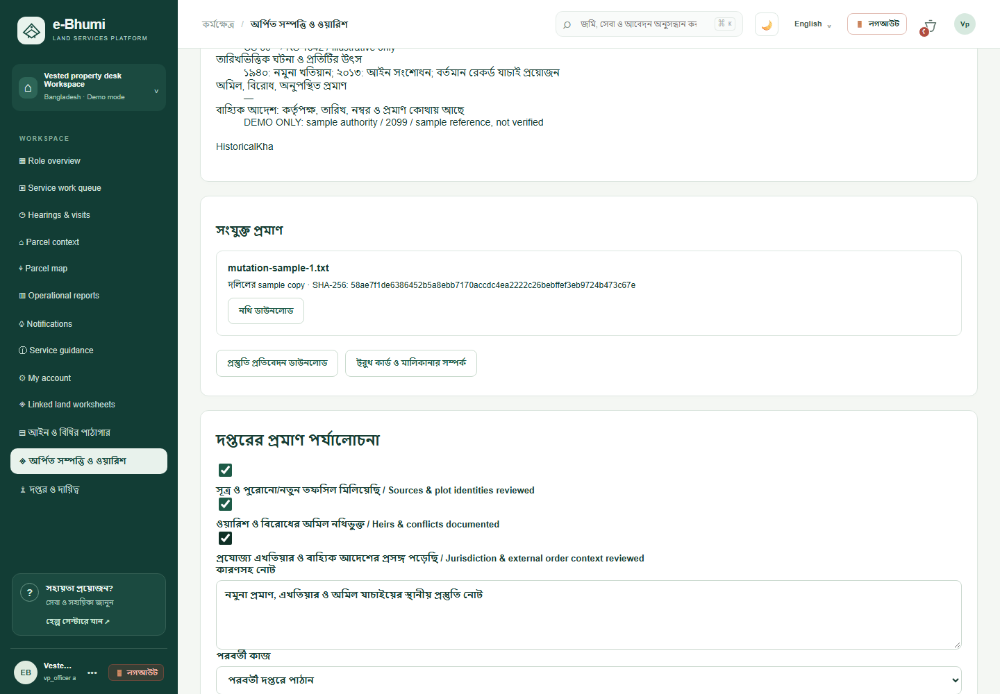
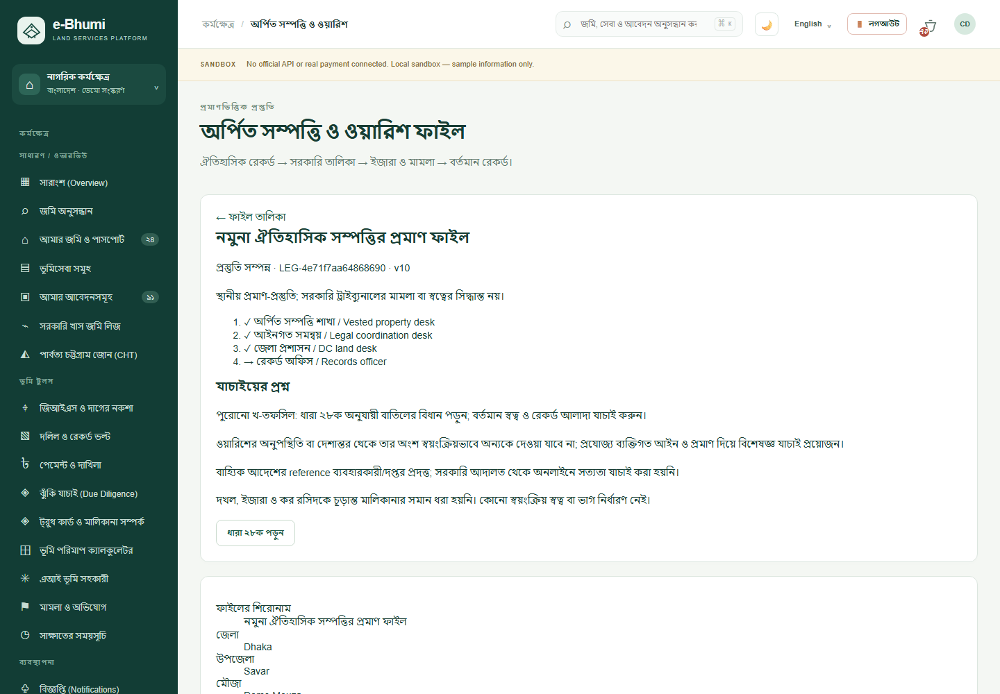

# অর্পিত সম্পত্তি ও ওয়ারিশ: গবেষণা থেকে বাস্তবায়ন

পড়া নকশার উৎস: [শেয়ার করা গবেষণা](https://chatgpt.com/share/6ad33ad3-e4e4-83ec-a8e3-d9629c5748bb)। এটি AI-লিখিত নকশা-ইনপুট, আইনগত কর্তৃপক্ষ নয়। পুরো আলোচনার উত্তরাধিকার, তালিকা, ইজারা, আদালত ও বর্তমান রেকর্ডের সম্পর্ক বিবেচনা করা হয়েছে। নিচের সরকারি সূত্র দিয়ে বাস্তবায়নের আইন-সংক্রান্ত সীমা নির্ধারিত হয়েছে।

| গবেষণার ধারণা | বাস্তবায়ন |
| --- | --- |
| চার স্তরের তথ্য | পুরোনো মালিকানা/ওয়ারিশ; গেজেট/তালিকা/হেফাজত; ইজারা/মামলা; বর্তমান মৌজা-দাগ-খতিয়ান |
| পুরোনো→নতুন দাগের সম্পর্ক | উৎস-সহ বহু সম্পর্কের লিখিত mapping; স্বয়ংক্রিয় ভূমি মিল বা registry verification নয় |
| ওয়ারিশের অংশ | জানা/অজানা সকল ওয়ারিশ ও বিরোধ লিখতে হয়; অনুপস্থিতি বা দেশান্তর থেকে অংশ বাতিল হয় না |
| খ-তফসিল | HistoricalKha আলাদা label; বাতিলের ধারা ২৮ক পড়ার link; বর্তমান vested status ঘোষণা নয় |
| প্রমাণ ও কেস ট্র্যাকিং | ব্যক্তিগত খসড়া, vault evidence, নিজস্ব service applications, revision checks, সংশোধন, প্রত্যাহার, পুনরায় খোলা |
| দায়িত্বের ক্রম | অর্পিত সম্পত্তি শাখা → আইনগত সমন্বয় → জেলা প্রশাসন → রেকর্ড; প্রত্যেকের claim, কারণ ও তিন evidence check |
| বাহ্যিক আদেশ | DC/records ধাপে পরবর্তী handoff-এর আগে reported order/authority reference প্রয়োজন; অনুপস্থিত হলে correction; অনলাইন সত্যতা যাচাই নয় |
| ফলাফল | DEMO প্রস্তুতি প্রতিবেদন JSON; স্বত্ব-সনদ, প্রত্যর্পণ আদেশ বা আদালতের ডিক্রি তৈরি হয় না |
| বিদ্যমান মালিকানা graph | Truth Card-এর graph ও উৎস-প্রমাণ review আগের মতো; প্রস্তুতি ফাইল থেকে একই টুলে যাওয়ার link |

## সরকারি ভিত্তি

[২০০১ আইন](https://bdlaws.minlaw.gov.bd/act-print-856.html), [ধারা ২৮ক](https://bdlaws.minlaw.gov.bd/act-print-856/section-print-42860.html), [ধারা ৮](https://bdlaws.minlaw.gov.bd/act-print-856/section-print-29631.html), [ধারা ১০](https://bdlaws.minlaw.gov.bd/act-print-856/section-print-29633.html), [ধারা ১৮](https://bdlaws.minlaw.gov.bd/act-print-856/section-print-29641.html)।

শেয়ার করা আলোচনার ২০২৬ সালের নির্দিষ্ট সুপ্রিম কোর্ট রায়ের দাবি—case number/সরকারি judgment PDF পাওয়া যায়নি। সেই দাবির ভিত্তিতে কোনো eligibility, deadline, title বা automatic return rule কোডে প্রয়োগ করা হয়নি।

## ডেটা ও দায়িত্বের সীমা

সব private evidence বর্তমান/আগের অনুমোদিত review desk, owner এবং oversight policy অনুযায়ী পড়া যায়। খসড়া specialist-কে দেওয়া হয় না। ফাইলে evidence যুক্ত করলে সংশ্লিষ্ট reviewer নথি download করতে পারে; অন্য নাগরিক পারে না। নথির SHA-256 স্থানীয় bytes-এর অখণ্ডতা বোঝায়, সরকারি সত্যতা নয়। Linked service application থেকে তার আলাদা access policy অতিক্রম করা যায় না।

বাহ্যিক আদেশের তথ্য free-text reference; signed order authenticity, court integration, gazette OCR, cadastral reconciliation ও automatic heir graph ingestion ভবিষ্যতের সংযোগ। User-reported sources ও unresolved conflicts প্রতিবেদনে থেকে যায়। এই প্রস্তুতি process শেষ হওয়া মানে আইনি বিরোধ শেষ হওয়া নয়।

