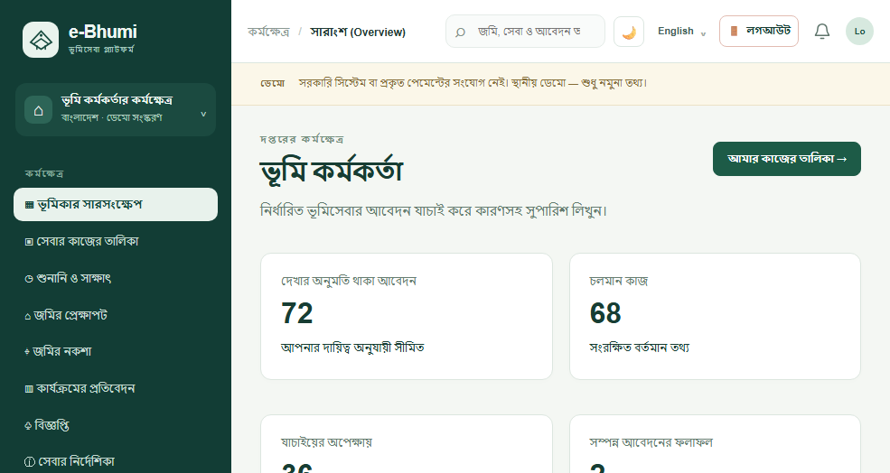
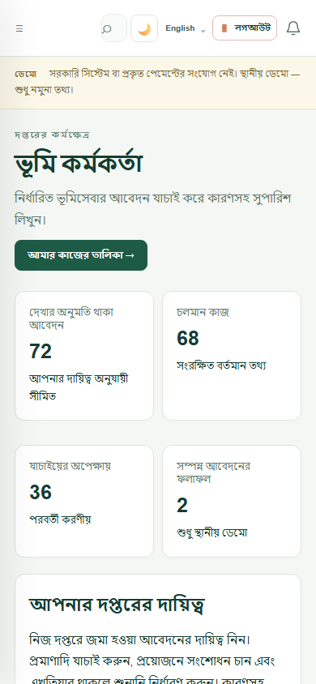

# বাংলা অভিজ্ঞতা ও browser মন্তব্য — v5.7.0

| মন্তব্য | ফলাফল |
| --- | --- |
| প্রথম পাতার headline | আপনার জমি। সেবার পথে **স্বচ্ছতা।** — স্বচ্ছতা আগের সবুজ emphasis-এ |
| brand subtitle | ভূমি সংযোগ—নাগরিকের সহযাত্রী |
| কাজের ধাপের মেনু | কার্যপদ্ধতি |
| Role Portals | প্রবেশকেন্দ্র |
| login emphasis | ভূমি সংযোগ। |
| notification | ১৮০° পুরোনো CSS rotation override; SVG সোজা; badge ও accessible label; ছোট পর্দায় দৃশ্যমান |

ইংরেজি landing copy একই আছে। মূল DM Sans/Hind Siliguri font, সবুজ emphasis, landing/lease/CHT composition এবং নীল blueprint style রাখা হয়েছে। interface.css শুধু অতিরিক্ত layout/interaction fixes দেয়। brand subtitle-এর দীর্ঘ বাংলা বাক্যকে নিজের লাইনে রাখা হয়েছে।

অনুবাদে exact labels, আইকনসহ মেনু, সংখ্যাভিত্তিক UI বাক্য, placeholder, accessible label, title, পরিচিত error ও display-only option labels কাজ করে। reverse lookup index দিয়ে English ফেরানোর repeated dictionary scan কমানো হয়েছে। input values, option values, ব্যক্তিগত নোট, নাম, evidence ও user-content অনুবাদে বদলায় না। table-এর action/button/status-label অনুবাদ হয়, user-supplied table values নয়। সরকারি উৎসের ভাষা এবং technical identifiers তাদের নিজস্ব ভাষায় থাকতে পারে।

২৪ রোলের **৩৪৩টি role/view combination** 985×524 viewport-এ পরীক্ষা করা হয়েছে: কোনো page error বা horizontal overflow নেই। আলাদা interface browser test সব ২৪ role-এ 985px ও 390px layout, notification access, Bangla→English→Bangla, version, ভুল login-এর বাংলা বার্তা এবং application option value পরীক্ষা করে। Unknown English reference values are recorded by the audit rather than guessed or rewritten.

নিজস্ব export-এ এখন law notes/bookmarks, vested-property files, Truth Cards, holdings, document metadata, payments, application records ও preferences থাকে; file bytes আলাদা protected download-এ পাওয়া যায়। Legacy file creation-ও প্রশাসকের intake pause মেনে চলে।

