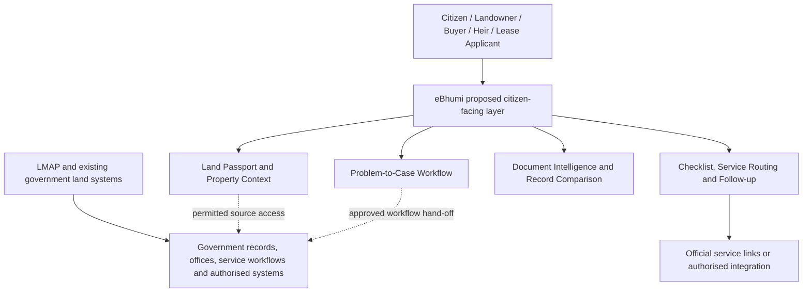
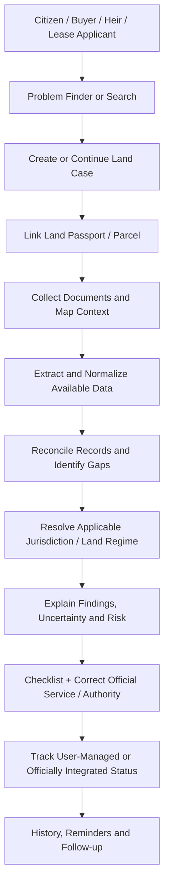
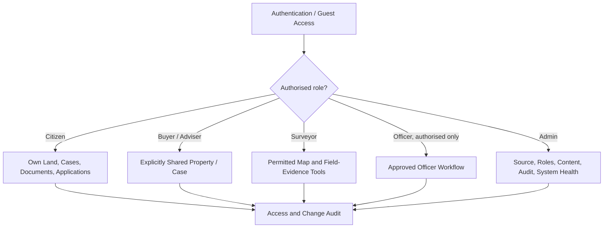
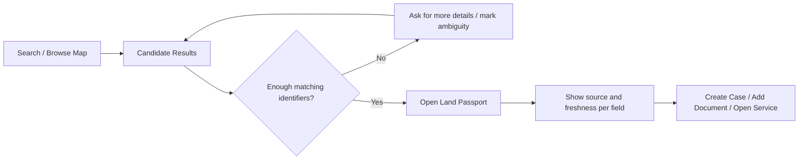
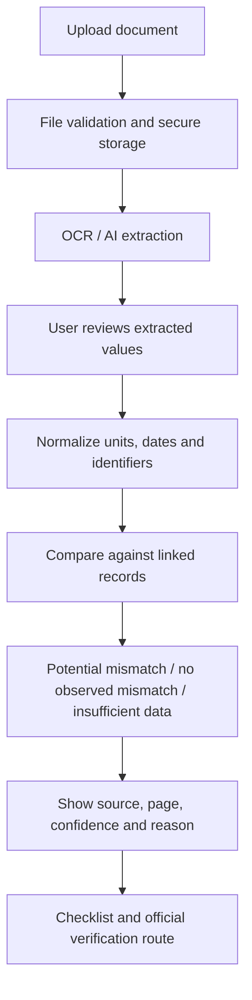
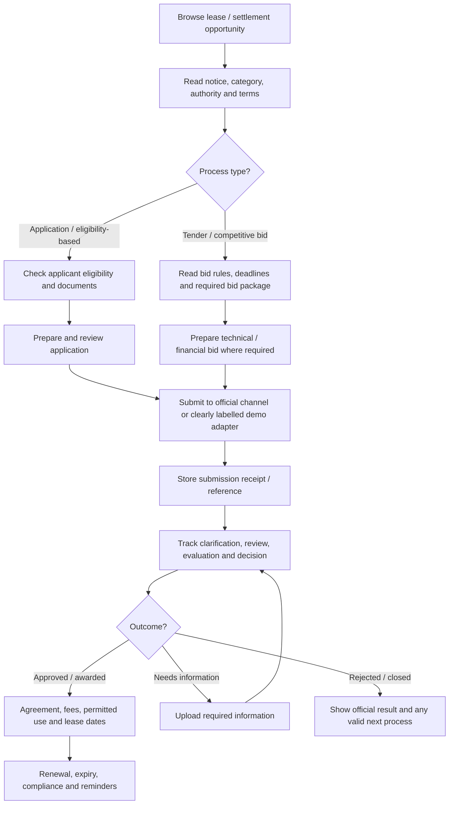
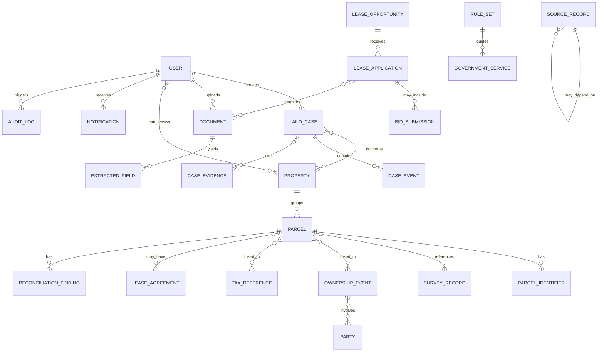
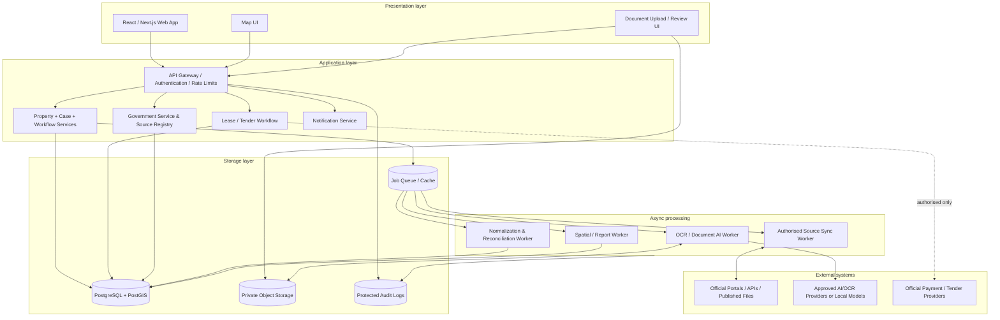
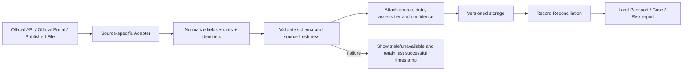
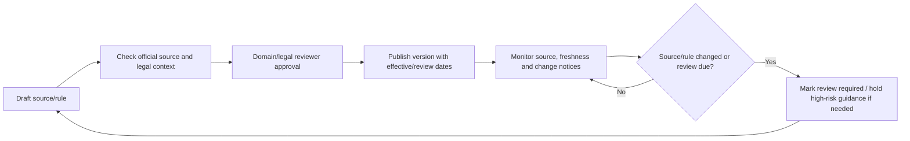

# eBhumi — Research & Development (R&D) Documentation

| Document control | Details |
|---|---|
| **Project** | eBhumi — Proposed Government Land Intelligence & Citizen Service Platform for Bangladesh |
| **Document type** | Government-oriented R&D, functional specification, workflow and architecture reference |
| **Version** | 1.4 |
| **Prepared / updated** | 16 October 2026 |
| **Status** | Research-backed proposal for government-project planning, stakeholder validation and phased implementation |
| **Primary language** | English technical documentation with Bangla terminology, concise Bangla explanations and Bangla-first UX requirements |
| **Intended readers** | Government stakeholders, land-administration specialists, project managers, product/design teams, developers, GIS/data teams, QA and operations |
| **Document scope** | Product requirements, feature catalogue, workflows, data model, architecture, governance, roadmap and official references |

> **Purpose of this document**  
> This is the central R&D reference for requirements analysis, government stakeholder review, service-design planning, solution architecture, implementation, testing, maintenance, and future enhancement of eBhumi. It describes the proposed product scope, how features work, how users move through workflows, how official-source information should be handled, and what conditions must be met before a capability can be treated as an operational government service.
>
> **Governance note:** This document is a proposed technical and functional design. It does not, by itself, constitute formal approval by the Government of Bangladesh, the Ministry of Land, or the LMAP project. Ownership, implementation mandate, data access and production integrations must be confirmed by the competent authorities.

> **Terminology convention:** The document uses English for technical architecture, API contracts and implementation requirements. Bangladesh-specific land terms are shown in Bangla at first important use where helpful, and explained in one concise sentence in context or in the glossary. Simple explanations are for product understanding; the applicable law, current government circular, lease deed or authority instruction remains controlling where a formal legal meaning is required.

---

## Table of Contents

1. [Executive Summary](#1-executive-summary)
2. [Government Research Basis, LMAP Alignment & Interpretation Rules](#2-government-research-basis-lmap-alignment--interpretation-rules)
3. [Problem Statement & Product Principles](#3-problem-statement--product-principles)
4. [Users, Roles & Primary Navigation](#4-users-roles--primary-navigation)
5. [Core Product Workflow](#5-core-product-workflow)
6. [Major Feature Modules — Detailed R&D](#6-major-feature-modules--detailed-rd)
   - [6.1 Core Platform & Problem Finder](#61-core-platform--problem-finder)
   - [6.2 Land Passport](#62-land-passport-জমির-সমন্বিত-প্রোফাইল)
   - [6.3 GIS & Cadastral Explorer](#63-gis--cadastral-explorer-ভূমি-জরিপ-ও-দাগভিত্তিক-মানচিত্র)
   - [6.4 Document Intelligence & Reconciliation](#64-document-intelligence--reconciliation-engine-নথি-বিশ্লেষণ-ও-রেকর্ডের-অমিল-যাচাই)
   - [6.5 Mutation & Record Update](#65-mutation--record-update-নামজারি-ও-রেকর্ড-হালনাগাদ)
   - [6.6 Lease & Settlement Hub](#66-lease--settlement-hub-ইজারা-ও-বন্দোবস্ত-কেন্দ্র)
   - [6.7 Special Land Regime & Rights Intelligence](#67-special-land-regime--rights-intelligence-বিশেষ-ভূমি-ব্যবস্থাপনা-ও-অধিকার-যাচাই)
   - [6.8 Due Diligence & Risk Report](#68-due-diligence--risk-report-জমি-কেনার-আগে-প্রাথমিক-যাচাই-ও-ঝুঁকি-প্রতিবেদন)
   - [6.9 Inheritance & Family Land](#69-inheritance--family-land-উত্তরাধিকার-ও-পারিবারিক-জমি)
   - [6.10 Land Tax & Fee Information](#610-land-tax--fee-information-ভূমি-উন্নয়ন-কর-ও-ফি)
   - [6.11 Acquisition, Disputes & Evidence](#611-acquisition-disputes--evidence-অধিগ্রহণ-বিরোধ-ও-প্রমাণাদি)
   - [6.12 Government Service Directory & Integration](#612-government-service-directory--integration-layer-সরকারি-সেবা-নির্দেশিকা-ও-সংযোগ)
   - [6.13 Notifications & Case Tracking](#613-notifications--case-tracking-বিজ্ঞপ্তি-ও-কেসের-অগ্রগতি)
   - [6.14 Admin, Data Governance & Quality](#614-admin-data-governance--quality-প্রশাসন-তথ্য-পরিচালনা-ও-গুণমান)
7. [Full Feature Catalogue — 274 Features](#7-full-feature-catalogue--274-features)
   - [7.1 Core Platform](#71-core-platform)
   - [7.2 Land Information & GIS](#72-land-information--gis)
   - [7.3 Land Passport & Records](#73-land-passport--records)
   - [7.4 AI & Document Intelligence](#74-ai--document-intelligence)
   - [7.5 Mutation & Record Update](#75-mutation--record-update)
   - [7.6 Lease & Settlement Hub](#76-lease--settlement-hub)
   - [7.7 Special Land Regime & Rights Intelligence](#77-special-land-regime--rights-intelligence)
   - [7.8 Region & Special Land Categories](#78-region--special-land-categories)
   - [7.9 Land Purchase & Due Diligence](#79-land-purchase--due-diligence)
   - [7.10 Inheritance & Family Land](#710-inheritance--family-land)
   - [7.11 Land Tax & Financial Services](#711-land-tax--financial-services)
   - [7.12 Acquisition, Disputes & Evidence](#712-acquisition-disputes--evidence)
   - [7.13 Government Services & Integration](#713-government-services--integration)
   - [7.14 Notifications & Tracking](#714-notifications--tracking)
   - [7.15 Citizen, Professional & Officer Workspace](#715-citizen-professional--officer-workspace)
   - [7.16 Admin, Security & Data Management](#716-admin-security--data-management)
   - [7.17 Future Advanced Features](#717-future-advanced-features)
   - [7.18 Capability Consolidation](#718-capability-consolidation--shared-engines-multiple-journeys)
8. [Data Model & Entity Relationships](#8-data-model--entity-relationships)
9. [Proposed Technical Architecture](#9-proposed-technical-architecture)
10. [Government Integration & Source Provenance](#10-government-integration--source-provenance)
11. [Special Land Regimes — Rules-Aware Design](#11-special-land-regimes--rules-aware-design)
12. [Security, Privacy, Legal & AI Guardrails](#12-security-privacy-legal--ai-guardrails)
13. [UX, Accessibility & Trust Design](#13-ux-accessibility--trust-design)
14. [Initial Pilot vs Production Boundaries](#14-initial-pilot-vs-production-boundaries)
15. [Delivery Roadmap & Dependencies](#15-delivery-roadmap--dependencies)
16. [Acceptance Criteria & Quality Strategy](#16-acceptance-criteria--quality-strategy)
17. [Reference End-to-End Government Service Journeys](#17-reference-end-to-end-government-service-journeys)
18. [Risks, Assumptions & Open Questions](#18-risks-assumptions--open-questions)
19. [Glossary — Bangladesh Land Terms & eBhumi Concepts](#19-glossary--bangladesh-land-terms--ebhumi-concepts)
20. [Bangladesh Government References & Source Register](#20-bangladesh-government-references--source-register)
21. [Document Change Log](#21-document-change-log)

### How to use this document

- **For decision-makers and domain experts:** Start with Sections 1–5, then review Sections 11–14 and the open questions in Section 18.
- **For product, UX and engineering teams:** Use Sections 5–10 to understand workflows, feature behaviour, entities, architecture and integration boundaries.
- **For implementation planning:** Use the 274-feature catalogue in Section 7 together with the delivery roadmap and acceptance criteria in Sections 15–16.
- **For terminology and research:** Use the glossary in Section 19 and official-source register in Section 20. Current law, circulars, tender notices and authority instructions must be rechecked before production use.
---

## 1. Executive Summary

**Primary audience: ordinary citizens in Bangladesh.** Government officers, land professionals, administrators and integration teams are important secondary audiences, but they support the citizen-facing mission rather than define it. Product decisions, feature prioritisation, language, accessibility, and release acceptance must begin with citizens’ needs.

**eBhumi is a citizen-centric land intelligence and service-orchestration platform.** It is designed to help people understand a land-related problem, connect the relevant property and evidence, compare records, understand applicable next steps, and reach the appropriate government service or authority.

The platform is **not intended to replace the Ministry of Land, DLRS, the e-Mutation system, the land development tax system, land revenue case management, or specialised regional authorities**. Bangladesh already has digital land services and an official land-management automation programme. The proposed eBhumi role is to provide a coherent citizen-facing and case-oriented experience across relevant information, documents, rules and official services: users often start with a problem (“I want to buy land”, “the records disagree”, “my family land has not been divided”), while official services are organised by function, department, application, record, or jurisdiction.

The product connects those two views:

> **Problem → Case → Property → Evidence → Record Checks → Applicable Rules → Government Service → Next Action → Follow-up**

The main product object is the **Land Passport**: a unified property profile that brings together land identity, mapped context where available, related records and documents, timeline events, tax and application references, special-status checks, discrepancies, and recommended next actions. The Land Passport is a **presentation and relationship layer**, not an official title document or government-issued parcel identity.

The proposed design is aligned to the Ministry of Land / LMAP published direction for interoperable land information, modernised service delivery and digitised land-management workflows. eBhumi is presented here as a **proposed citizen-facing orchestration and intelligence layer** that can guide users across appropriate official services; formal government approval, source-owner validation, data-sharing agreements and production integration decisions remain separate prerequisites.

The product includes the following main capability families:

- Problem Finder and AI Land Case Builder.
- Land Passport, My Land, document vault, timeline, and ownership relationships.
- Smart land search and cadastral GIS.
- AI document extraction and cross-record comparison.
- Mutation and record-update assistance.
- Lease, settlement, tender, and bid workflows, subject to the rules for each land category and notice.
- Special Land Regime Checker for areas and land categories with distinct legal/administrative processes.
- Due diligence, risk explanation, inheritance, tax, acquisition, complaint, and evidence workflows.
- Government-service directory, source links, and future authorised integration adapters.
- Citizen, professional, officer, and admin workspaces, with role-based access and audit trails.

### 1.1 Product outcome

A citizen should be able to answer five questions from a single connected experience:

1. **Which land/property are we discussing?** — Identity and location.
2. **What information and evidence is available?** — Records, documents, maps, and provenance.
3. **What does the available information indicate?** — Timeline, relationships, inconsistencies, restrictions, and uncertainty.
4. **What should I prepare or verify next?** — Checklist and guidance.
5. **Where should I go and what can I track?** — Official service, application/bid/case reference, deadline, and next action.

### 1.2 Non-negotiable principles

- Treat general citizens as the primary audience; optimise the default experience for clear Bangla, simple words, mobile and low-bandwidth access, and problem-first guidance.
- Do not require users to know a department or service name before receiving basic guidance.
- Provide public information and guidance without mandatory sign-in wherever private data is not needed.
- No unsupported claim that data is official, current, complete, legally conclusive, or connected in real time.
- Never equate an AI-extracted value with a verified government record.
- Never have AI declare ownership, decide a court case, confirm fraud, approve a mutation, or award a lease.
- Treat maps, land categories, regional jurisdiction and tenure restrictions as evidence inputs that may require official verification.
- Use approved government interfaces or published/authorised records for production integrations. Do not make scraping the core data strategy.
- Clearly label sample/mock records and simulated application, payment, tender, or bid flows.
- Build for Bangla-first usability, mobile devices, low bandwidth, accessible typography, and people unfamiliar with technical land terminology.

---

## 2. Government Research Basis, LMAP Alignment & Interpretation Rules

### 2.1 Alignment with the published LMAP vision and mission

The Ministry of Land's official **Land Management Automation Project (LMAP)** Vision & Mission page describes objectives that include:

- Increasing speed and transparency in land administration through land-management automation.
- Building an interoperable land-information database.
- Developing online office management and electronic revenue-court management.
- Making land-related services easier for citizens to access and synchronising land services with other government services.
- Applying online and electronic service automation across the listed Union Land Offices, Upazila Land Offices and land-related offices of Deputy Commissioners; the page states a target of 5,247 offices.
- Building a database covering all classes of land.
- Digitising or modernising processes such as record correction and updating, mutation, partition and consolidation of holdings, revenue-certificate cases, land acquisition, agricultural and non-agricultural khas-land settlement, tea-garden term leases, sairat mahals, vested property, waqf, debottor and other property management, and government-side civil-case information.

**Interpretation rule:** These are objectives and service areas stated on the official LMAP page. They must not be interpreted as proof that every listed workflow, office, record, integration or geographic dataset is currently operational or available through a public API. Delivery status must be verified separately with the project and the responsible authorities.

#### Proposed relationship between LMAP and eBhumi



The proposed eBhumi design should **complement, connect to and guide users toward official systems** instead of silently recreating government registers, duplicating official decisions, or claiming to replace LMAP. Its proposed contribution is the citizen-facing orchestration layer: explain the user's issue, connect relevant property and documents, flag inconsistencies, identify the likely applicable service, show source and uncertainty, and help the user follow the correct next step.

### 2.2 Bangladesh government sources used for research

This document's factual and procedural research basis is limited to official Bangladesh government sources, including:

- Ministry of Land and the LMAP project's published objectives and service information.
- e-Mutation, land development tax, land records and maps, land revenue case management, and other official land-service portals.
- Bhumipedia's published laws, manuals, guidelines and land-settlement policies.
- Ministry of Chittagong Hill Tracts Affairs laws and rules, and Bangladesh Laws pages for statutory texts.
- Official land acquisition/requisition law and forest/land-classification legislation.
- Official e-Government Procurement information where a specific procurement notice or authority uses that channel.

The full register is provided in [Section 20 — Bangladesh Government References & Source Register](#20-bangladesh-government-references--source-register). Government sources are the starting point for R&D, not a substitute for formal legal interpretation, current authority instructions, source-owner confirmation, or a written data-sharing approval.

### 2.3 Bangla terminology and plain-language explanations

The interface and user-facing help should be Bangla-first, while technical documentation and system contracts may use English. Important land terms should not be translated loosely or treated as interchangeable. On first meaningful use, show the English term, the common Bangla term and a one-line plain-language explanation. Where the same term has a specific statutory meaning, link to the relevant government law, policy or official guidance.

| Term shown in eBhumi | Bangla term | One-line user-facing explanation |
|---|---|---|
| Mutation / e-Mutation | নামজারি / ই-নামজারি | প্রযোজ্য পরিবর্তনের পর ভূমি রেকর্ড হালনাগাদের প্রশাসনিক প্রক্রিয়া। |
| Khatian | খতিয়ান | নির্দিষ্ট জরিপ/রেকর্ড ব্যবস্থায় জমি ও স্বত্ব-সম্পর্কিত তথ্যের রেকর্ড। |
| Dag / Plot number | দাগ নম্বর / প্লট নম্বর | সংশ্লিষ্ট মৌজা ও জরিপ নকশায় নির্দিষ্ট জমির অংশ শনাক্ত করার নম্বর। |
| Mouza | মৌজা | ভূমি জরিপ ও রেকর্ডে ব্যবহৃত একটি নির্দিষ্ট ভৌগোলিক একক। |
| Porcha | পর্চা | সাধারণভাবে খতিয়ান বা ভূমি রেকর্ডের অনুলিপিকে বোঝাতে ব্যবহৃত শব্দ। |
| Dakhila | দাখিলা | ভূমি উন্নয়ন কর পরিশোধের রসিদ। |
| Khas land | খাসজমি | প্রযোজ্য সরকারি রেকর্ড ও নীতিমালায় সরকারের ব্যবস্থাপনাধীন হিসেবে শ্রেণিবদ্ধ জমি। |
| Lease | ইজারা | নির্দিষ্ট শর্ত ও মেয়াদের অধীনে জমি/সম্পদ ব্যবহারের অধিকার। |
| Settlement | বন্দোবস্ত | নির্দিষ্ট সরকারি নীতি ও প্রক্রিয়ায় জমি বরাদ্দ বা বন্দোবস্ত দেওয়ার ব্যবস্থা। |
| Jomabhag / partition | জমাভাগ / জমি ভাগ | প্রযোজ্য প্রক্রিয়ায় যৌথ জমি বা হিসাবের অংশ পৃথক করার ব্যবস্থা। |
| Joma ektrikaran | জমা একত্রীকরণ | প্রযোজ্য প্রক্রিয়ায় একাধিক জমা/হিসাব একত্র করার ব্যবস্থা। |
| Warish certificate | ওয়ারিশ সনদ | উত্তরাধিকারীদের পরিচয় বা সম্পর্ক প্রমাণের জন্য ব্যবহৃত সনদ। |
| Land acquisition | ভূমি অধিগ্রহণ | প্রযোজ্য আইন অনুসারে নির্দিষ্ট সরকারি উদ্দেশ্যে জমি অধিগ্রহণের প্রক্রিয়া। |
| Sairat Mahal | সায়রাতমহাল | প্রযোজ্য সরকারি বিধি অনুযায়ী রাজস্ব/ইজারা ব্যবস্থাপনার আওতাধীন নির্দিষ্ট সম্পদ বা উৎস। |

Use these descriptions as explanatory microcopy, not as a substitute for statutory definitions. The complete glossary is in [Section 19](#19-glossary--bangladesh-land-terms--ebhumi-concepts).

### 2.4 Research interpretation and evidence labels

| Label | Meaning | Example |
|---|---|---|
| **Existing official service** | An official government service or portal is publicly referenced. It does not guarantee uptime or that every journey can be completed online. | e-Mutation, land-development tax, records/maps, land revenue case management. |
| **Published project objective** | An objective or target explicitly stated by the LMAP/project or a government policy page. It is not automatically evidence of current operational delivery. | Interoperable database or automation target across listed offices. |
| **Design proposal** | A feature proposed for eBhumi; not claimed to exist in an official system. | Land Passport, Problem Finder, Record Reconciliation Engine. |
| **Prototype/mock** | A demonstration built using controlled sample records, local state or simulated connectors. | Sample lease application or simulated bid receipt. |
| **Integration-dependent** | Needs authorised API/data sharing, official feeds or a documented, lawful assisted process. | Live mutation status, verified ownership history, live tender submission. |
| **Legal/authority review required** | The workflow depends on land category, lease terms, jurisdiction, current law or an authority's decision. | CHT land transfer, forest-land status, lease eligibility, title-related assessment. |

These labels must be preserved in UX copy, reports, demo data, APIs, test fixtures and government stakeholder presentations.

### 2.5 Scope and verification rules

1. Use official sources and current legal instruments as the default reference for procedures, fees, eligibility, deadlines and responsible authorities.
2. Treat a publicly available webpage as a web page, not as a reusable API. Confirm data-access authority, technical specifications and permitted purpose before integrating it.
3. Do not state that a service is “online end-to-end” unless the full user journey has been verified.
4. Do not infer that all offices or all regions share the same workflow merely because the service is listed nationally.
5. Record every rule's official source, date checked, effective date (where known), reviewer and version.
6. If the official source does not establish an answer, display “not confirmed in the available official source” and route the user to the competent authority.
7. Avoid publishing sensitive personal data or real parcel/ownership information in sample environments unless its use is authorised and protected.


---

## 3. Problem Statement & Product Principles

### 3.1 Problem statement

A citizen may need to understand a land problem by moving between different documents, maps, offices, rules, and websites. Common sources of friction include:

- Different identifiers and terminology across deeds, khatians, dag/plot records, tax holdings, maps, leases, cases, and service portals.
- Missing, dated, inconsistent, or hard-to-interpret records.
- No single citizen-friendly view of the property and its known events.
- Confusion about required documents, responsible authority, deadlines, permissions, fees, and the next official step.
- Distinct processes for general land, CHT land, government khas land, tea-garden leaseholds, forest categories, acquisition-affected land, and other special land regimes.
- Uncertainty about whether a displayed value is official, user-supplied, AI-extracted, estimated, or stale.
- Gaps between digital information and physical verification, hearings, field visits, or authority decisions.

### 3.2 Product principles

#### A. Problem-first, not service-first

Let users start with “I want to buy land”, “my records don't match”, “I need mutation”, “I need to lease government land”, or “I have a boundary issue”. eBhumi translates the user's intent into a structured, reviewable journey.

#### B. Property-centred, not portal-centred

A property can link to map features, survey records, uploaded documents, tax references, mutation applications, lease documents, acquisition notices, case records, and citizen-created evidence. The Land Passport provides a unified view while respecting source boundaries.

#### C. Evidence before conclusions

The platform shows source, date, extraction/verification status, and conflicting values. It can report “potential mismatch found” but cannot convert a heuristic into a final legal decision.

#### D. Rules-aware workflows

Do not apply the same checklist to all regions and categories. A land regime resolver identifies possible regional/category rules and requires official confirmation where the category or jurisdiction is uncertain.

#### E. Interoperate rather than replace

Start with official link-outs, current published guidance, user-uploaded documents, authorised data feeds, and mock adapters. Add live integrations only after access, legal basis, security, and data ownership are agreed.

#### F. Incremental delivery

The initial government-aligned pilot should validate a carefully selected set of complete journeys using controlled sample data and/or approved data sources. National coverage, every special land category, and all government integrations are phased objectives—not assumptions for the first release.

### 3.3 Product flow diagram



---

## 4. Users, Roles & Primary Navigation

### 4.1 User personas

**Audience hierarchy:** the primary user is the general citizen/landowner or a person trying to understand a land problem. Buyers, heirs, lease applicants and family representatives are citizen subgroups. Lawyers, surveyors, government officers and administrators are secondary or conditional users. Their tools must not make the default citizen experience more complex.

| Persona | Primary needs | Default workspace |
|---|---|---|
| **Citizen / Landowner** | Understand land records, store documents, track land issues, get service guidance. | My Land / Problem Finder |
| **Buyer / Investor** | Review available documents, identify potential inconsistencies, prepare due diligence checklist. | Buy Before You Buy |
| **Heir / Family representative** | Understand available family/ownership documents, identify missing documents and mutation/partition steps. | Family Land |
| **Lease applicant / business** | Find lease opportunities, check eligibility, prepare application, submit bids where relevant, track deadlines. | Lease & Settlement Hub |
| **Surveyor / Amin / land professional** | Review map and parcel context, record field evidence, prepare a report. | GIS / Field Workspace |
| **Lawyer / authorised adviser** | Organise records and evidence with user permission. | Shared Case Workspace |
| **Government officer (future, authorised)** | Review a queue or records only within a formally authorised workflow. | Officer Workbench |
| **Platform administrator** | Manage references, sample data, source links, roles, audit and system health. | Admin Console |

### 4.2 Navigation proposal

Primary navigation should be organised by citizen intent rather than by a large list of government department names. Show simple Bangla labels first, with English/technical terms available as secondary labels:

- **জমির তথ্য / Explore** — Search and map.
- **আমার জমি / My Land** — Land Passports, documents, timeline, alerts.
- **জমির সমস্যা সমাধান / Resolve** — Problems, cases, evidence, checklists, reports.
- **ইজারা ও আবেদন / Lease & Apply** — Lease/settlement notices, eligibility, application, tender/bid, renewal.
- **সরকারি সেবা / Services** — Government service directory and official links.
- **eBhumi-কে জিজ্ঞেস করুন / Ask eBhumi** — AI Land Assistant and case builder.
- **Admin / Professional / Officer Workspace** — available only to authorised roles.

Global search should find a property, dag/khatian reference, document, case reference, lease notice, or service page according to access rights.

### 4.3 Role-based access concept



Authentication should not be required for every public information page. Private documents, personally identifiable information, personal property workspaces, saved applications, and confidential case materials require appropriate access control and secure session handling.

---

## 5. Core Product Workflow

### 5.1 Workflow A — Find land and open its Land Passport (জমির সমন্বিত প্রোফাইল)

1. The user searches by a known identifier or navigates by division, district, upazila, mouza, and available plot/dag details.
2. eBhumi returns matches from the dataset(s) it is authorised to use, with the source and data date.
3. The user selects a candidate parcel/property. The system checks whether identifiers are sufficiently specific and warns about multiple matches.
4. The Land Passport opens with property identity, map context, related records, source status, timeline, documents, cases, taxes, leases, and alerts where information is available.
5. Missing fields are shown as “not available” or “needs verification”, not silently filled.
6. The user can open a Problem Case, upload supporting documents, or continue to an official service.



### 5.2 Workflow B — Document upload and discrepancy analysis (নথি আপলোড ও তথ্যের অমিল যাচাই)

1. The user chooses a case or Land Passport.
2. The system accepts an allowed PDF/image format, validates file size and type, and scans it for malware where infrastructure supports it.
3. OCR/AI extracts candidate fields such as party names, mouza, dag, khatian, area, dates, deed number, and survey label when visible.
4. The UI presents extracted fields with page/region references and confidence; users can correct extraction errors.
5. Normalization converts numeral formats, units, date representations, and known text variants without altering the original document.
6. The Reconciliation Engine compares only fields that are meaningfully comparable and shows both values and their sources.
7. A rule-based explanation produces “potential mismatch”, “no mismatch observed in checked fields”, or “insufficient data”.
8. The output lists missing evidence and possible next checks. It is not an ownership verdict or legal certification.



### 5.3 Workflow C — Mutation and record update assistance (নামজারি ও রেকর্ড হালনাগাদে সহায়তা)

The mutation module guides the citizen through eligibility guidance, document preparation, official application links, and status tracking. The platform must distinguish between:

- **Preparation support:** eBhumi helps compile information and documents.
- **Official submission:** only the authorised government service can confirm an actual application submission unless an approved integration exists.
- **Status display:** live official status is shown only when integrated from an authorised source; otherwise it is user-entered/demo status and labelled accordingly.

Proposed steps: `Reason for mutation → collect property and applicant details → applicable checklist → document verification → fee/source guidance → official hand-off or authorised submission adapter → reference receipt → tracking → missing-document/notice response → decision/outcome → updated Land Passport evidence`.

### 5.4 Workflow D — Lease and settlement application / bid (ইজারা, বন্দোবস্ত ও দরপত্র/বিড)

Lease and settlement must support multiple workflow types. Not every lease or settlement is a competitive tender; the process depends on the particular land category, authority, notice and policy. eBhumi should therefore configure each opportunity as a workflow template rather than hard-coding a universal process.



Minimum data for an opportunity: notice ID, issuing authority, land category, location/parcel description, area/units, intended use, eligibility, required documents, submission channel, application/bid type, fees/security if officially stated, start/deadline dates, terms, clarification channel, source URL, publication date, last checked timestamp, and current status.

Bid security or payment must never be collected through a prototype pretending to be a government payment gateway. A mock flow must state that no real application, bid, or payment has been sent.

### 5.5 Workflow E — Special Land Regime Checker (বিশেষ ভূমি ব্যবস্থাপনা যাচাই)

The special-regime resolver should use more than a district name. It should combine candidate geography, record categories, source data, tenure documents, and user confirmation to decide which rule set may need attention.

1. Identify the property or opportunity.
2. Determine the region and any declared/sourced land category.
3. Check for available special records: CHT jurisdiction, leasehold, forest category, khas/settlement, acquisition status, or other restrictions.
4. Show possible applicable workflow(s), responsible authority and supporting official references.
5. Ask for documents/confirmations needed to disambiguate uncertain categories.
6. Generate a category-specific checklist and recommended contacts.
7. Do not label land “transferable”, “not transferable”, “safe”, or “illegal” without the applicable authoritative evidence and necessary human/official decision.

### 5.6 Workflow F — Buy Before You Buy (জমি কেনার আগে যাচাই)

The report should organise checks rather than promise certainty:

- Identity: does the provided deed refer to the same property and location?
- Record consistency: do the provided documents agree on key identifiers and area?
- Mutation/tax: what evidence has been supplied or linked?
- Timeline: are ownership events documented and gaps visible?
- Case/restriction/acquisition/special category: what sources were checked and what remains unknown?
- Boundary/map: is a reliable cadastral boundary available or only a contextual basemap?
- Next steps: list missing documents and verification routes.

The output must be called **Preliminary Due Diligence Report** or **Land Information Review**, never an “official title clearance certificate” unless authorised by a competent authority.

### 5.7 Workflow G — Inheritance / family land (উত্তরাধিকার ও পারিবারিক জমি)

`Create family-land case → identify property → add known family relationships → attach death/warish/deed/record documents → separate verified and user-supplied relationships → identify unknown or conflicting heirs/shares → prepare document checklist → explain mutation/partition route → save timeline and next actions`.

Any share calculator must display the assumptions, jurisdiction/religion-specific rule set where applicable, input completeness, and a clear note that the output is informational and requires legal/official verification. The platform should not claim to resolve succession rights.

### 5.8 Workflow H — Land dispute and field evidence (ভূমি বিরোধ ও মাঠপর্যায়ের প্রমাণ)

`Create incident → select linked property or enter location → record issue type → upload dated photos/documents/voice note → capture GPS only with permission → preserve original file and metadata → record user narrative → build evidence index → produce checklist and competent-authority route → track the user's follow-up`.

Evidence collection should not encourage trespass, confrontation, surveillance of unrelated people, or unsafe conduct. eBhumi organises evidence; it does not determine who owns or possesses land.

### 5.9 Workflow I — Land tax information (ভূমি উন্নয়ন করের তথ্য)

`Select property/holding → show linked official tax reference if available → display official portal and user status → show prior receipts supplied/linked → provide estimator only if current rates and assumptions are sourced → hand off to authorised payment portal → reconcile payment only through verified confirmation`.

Never ask a user to enter or disclose a payment PIN/OTP into eBhumi. Do not retry a real transaction automatically after an uncertain gateway response.

---

## 6. Major Feature Modules — Detailed R&D

This section explains the core domain modules and how they cooperate. The exhaustive catalogue of all 274 individual features appears in Section 7.

### 6.1 Core Platform & Problem Finder

#### Purpose
Make land services understandable from the citizen's problem rather than expecting users to know government service names.

**Key term:** **Land Case (জমি-সংক্রান্ত কেস)** is eBhumi's structured workspace for one issue, connecting the related property, evidence, checklist, event history and next action. It is not automatically an official government case unless an authorised service confirms the reference.

#### Inputs
Free-text question, guided choices, optional location/property identifiers, user consent, and optional documents.

#### Processing
- Intent classification: purchase due diligence, mutation, tax, inheritance, lease, record correction, boundary/possession dispute, acquisition, special property, or general inquiry.
- Clarifying questions only when needed; users can skip optional fields.
- Create a structured Land Case with issue type, property links, evidence, missing information and next steps.
- Provide official source links for procedural guidance.

#### Outputs
A case workspace, suggested checklist, relevant Land Passport, workflow status and next action.

#### Failure handling
If confidence is low, ask the user to choose between possible case types. If no appropriate digital service is found, offer verified contact/service information and mark the workflow as requiring human assistance.

### 6.2 Land Passport (জমির সমন্বিত প্রোফাইল)

#### Purpose
A central, property-oriented view of disparate land information. It does not create legal title; it links available evidence.

**Key terms:** **Khatian (খতিয়ান)** is a record associated with a particular survey/record context; **Dag (দাগ)** identifies a plot in that context; **Mouza (মৌজা)** is the cadastral/revenue area used to organise records. These identifiers must be stored with their survey and jurisdiction context because the same number can appear in different places or surveys.

#### Recommended tabs
1. **Overview:** identifiers, area, location, land category, source/freshness.
2. **Map:** available parcel polygon or a clearly labelled approximate/context map.
3. **Records:** survey type, khatian/dag, record references, status.
4. **People & Ownership:** named parties as found in documents, co-sharer/heir relationships, provenance and verification.
5. **Timeline:** dated survey, registration/transfer, mutation, tax, case, lease, acquisition and user-recorded events.
6. **Documents:** secure files and extracted metadata.
7. **Tax & Services:** references and links, not unverified balances.
8. **Cases & Incidents:** related issue cases, notices and user evidence.
9. **Restrictions & Special Regime:** lease, forest, khas, acquisition, CHT, or other indicators with source labels.
10. **Checks & Next Steps:** discrepancy findings and a prioritised checklist.

#### Data display rule
Every meaningful field should show a provenance state: `OFFICIAL SOURCE`, `USER PROVIDED`, `AI EXTRACTED — UNVERIFIED`, `SYSTEM INFERRED`, `STALE / LAST CHECKED`, or `NOT AVAILABLE`. “Official source” must include a source link/reference and retrieval/check date when available.

### 6.3 GIS & Cadastral Explorer (ভূমি জরিপ ও দাগভিত্তিক মানচিত্র)

#### Purpose
Let users explore parcels spatially and relate map features to the Land Passport and cases.

#### Core capabilities
- Administrative hierarchy and map search.
- Plot polygon selection when trusted cadastral geometry is available.
- Layer toggles, legends, satellite/context basemap, area/distance measurements.
- Display map source, survey epoch/date, accuracy limitations and licensing conditions.
- Import or preview user-provided GeoJSON/KML where supported.
- Show neighbouring plots only when the geometry is adequate; spatial adjacency is not proof of legal boundary.

#### Important GIS distinction
A basemap helps with orientation; it is not an authoritative cadastral boundary. A scanned historical map, AI-extracted polygon, user-drawn polygon and government-provided cadastral layer must have different source labels. If no official geometry is available, the UI must not draw fabricated plot outlines.

### 6.4 Document Intelligence & Reconciliation Engine (নথি বিশ্লেষণ ও রেকর্ডের অমিল যাচাই)

#### Purpose
Turn uploaded documents into reviewable fields and compare only comparable information.

**Key term:** **Record reconciliation (রেকর্ডের তুলনা ও অমিল শনাক্তকরণ)** compares documented values across sources; it identifies possible inconsistencies but does not decide which conflicting record is legally correct.

#### Pipeline
1. Upload validation, size/type checking and malware scanning where available.
2. Secure storage with access control and short-lived preview URLs.
3. OCR and document type classification.
4. Field extraction with confidence and page/bounding-box references.
5. User correction/confirmation.
6. Normalisation (Bangla/English numerals, area units, date formats, identifier tokens).
7. Pairwise and multi-source comparison.
8. Rules-based explanation with severity and reasons.
9. Exportable report and next-step checklist.

#### Reconciliation example
If a supplied deed lists 12 decimal and a supplied khatian lists 10 decimal, create a `POTENTIAL_AREA_MISMATCH` finding with both values, units, source documents, page references, extraction confidence and a recommendation for official verification. Do not decide which value is legally correct.

### 6.5 Mutation & Record Update (নামজারি ও রেকর্ড হালনাগাদ)

#### Purpose
Help prepare for mutation/record-update procedures and track the journey transparently.

**Key term:** **Mutation / Namjari (নামজারি)** is the administrative process for updating relevant land records after a qualifying change. It should not be described as, by itself, final proof of title or a replacement for deed/registration and other required checks.

#### Features
Eligibility guidance, case type selection, form preparation, document checklist, field normalisation, pre-mutation consistency checks, fee/source reference, official portal hand-off, reference storage, status history, notice/hearing reminders, missing-document submissions, final outcome record and Land Passport update.

#### Integration contract
A mutation adapter must distinguish `DRAFT`, `READY_TO_HAND_OFF`, `SUBMITTED_TO_OFFICIAL_SERVICE`, `OFFICIAL_STATUS_RECEIVED`, `USER_REPORTED_STATUS`, and `DEMO_STATUS`. Only the official system or an authorised integration can confirm actual submission/status.

### 6.6 Lease & Settlement Hub (ইজারা ও বন্দোবস্ত কেন্দ্র)

#### Purpose
Bring opportunities, applications, tenders, bids, lease obligations and renewals into a trackable workflow without pretending every land category uses the same legal route.

**Key terms:** **Lease (ইজারা)** grants a time- or condition-bound right to use land/resource; it does not automatically transfer ownership. **Settlement (বন্দোবস্ত)** is allocation under a specific government policy/process. **Tender/bid (দরপত্র/বিড)** is used only when required by the applicable notice or procedure.

#### Opportunity catalogue
- Notices and source documents.
- Issuing authority and jurisdiction.
- Land/use category, location, area and available map.
- Eligibility and exclusions as stated in the notice/rules.
- Application vs tender/bid process type.
- Required documents, forms, deadlines, fees, bid security, payment method, permitted use, term, renewal and transfer restrictions where officially stated.
- Last checked time, notice version and status.

#### Applicant experience
- Save opportunity.
- Run a checklist and eligibility pre-check.
- Prepare an application or a tender/bid package.
- Upload supporting documents.
- Validate mandatory fields and deadlines.
- Show where/how to submit officially.
- Store receipt/reference.
- Respond to clarification and submit additional documents if the official process allows it.
- Track outcome, agreement and lease lifecycle.

#### Tender/bid rules
Bid formats, two-envelope submissions, security deposits, eligibility documents, evaluation method, electronic signature requirements and submission channels vary by notice and applicable public procurement/lease procedure. Configure these from authoritative documents; never assume one universal format. Do not process actual money or bid submission in the prototype.

### 6.7 Special Land Regime & Rights Intelligence (বিশেষ ভূমি ব্যবস্থাপনা ও অধিকার যাচাই)

#### Purpose
Identify circumstances in which a simple general-land workflow may be insufficient.

**Key term:** **Special land regime (বিশেষ ভূমি ব্যবস্থাপনা/আইনি শ্রেণি)** means a parcel or resource may be governed by a specific law, policy, lease, restriction or authority in addition to the common land-service workflow. Location alone is not enough to confirm a legal category.

#### Candidate regimes/categories
- Chittagong Hill Tracts (Rangamati, Khagrachhari, Bandarban) and applicable local/regional rules.
- Government agricultural and non-agricultural khas land / settlement.
- Tea-garden/estate leasehold and related conditions.
- Reserved, protected, acquired, vested, unclassed state forest or other legally classified forest land.
- Acquisition/requisition-affected land.
- River/char/coastal land requiring category- and history-specific checks.
- Vested, abandoned, waqf, debottar, sairat or other special property categories where relevant records and law support a check.

#### Resolver output
`Possible regime(s) → why it was flagged → official sources → missing evidence → relevant authority/service → category-specific checklist → disclaimer/uncertainty`.

A district alone should never determine the full legal category. Use available parcel identifiers, actual notices, lease deeds, official maps/registers and user confirmation. The system must support overlapping flags and manual verification.

### 6.8 Due Diligence & Risk Report (জমি কেনার আগে প্রাথমিক যাচাই ও ঝুঁকি প্রতিবেদন)

#### Purpose
Organise checks for a buyer or reviewer and identify gaps before a decision.

**Key term:** **Due diligence (জমি কেনার আগে প্রয়োজনীয় যাচাই)** means checking available identity, records, documents, restrictions and risks before proceeding; an eBhumi report is preliminary and is not an official title clearance.

#### Check families
Identity match; document consistency; available survey records; ownership/transfer history; mutation evidence; tax evidence; case/restriction/acquisition references; special land regime; mapped area/boundary quality; missing documents; source freshness.

#### Reporting format
- Executive summary of what was checked.
- Findings grouped by information domain.
- Severity: information, attention, high-priority verification, or insufficient data.
- Each finding has source, date, compared values, reason, limitation, and recommended next step.
- Unchecked categories listed explicitly.
- Downloadable PDF labelled `Preliminary — Not an Official Title Certificate`.

No single opaque “safe to buy” score. If a numerical score is used in later versions, the logic must be documented, explainable and tested; a score must never replace legal review.

### 6.9 Inheritance & Family Land (উত্তরাধিকার ও পারিবারিক জমি)

#### Purpose
Organise family-related records and explain procedural next steps.

**Key terms:** **Warish certificate (ওয়ারিশ সনদ)** is a document used to evidence heir relationships; **co-sharer (সহ-শরিক)** refers to a person with a share in jointly held property under the applicable record/legal context. eBhumi must not calculate or present a binding legal inheritance share without validated facts, a reviewed ruleset and appropriate legal review.

#### Capabilities
Family/ownership relationship graph, heir list as provided/verified, estate property links, documents, known shares, unknown or disputed relationships, land timeline, partition/record update checklists, and referral to official/legal guidance.

#### Guardrails
Do not infer legal heirship solely from names or relationships entered by the user. Do not present inheritance shares as authoritative without a reviewed ruleset, necessary facts and legal disclaimers. Keep sensitive family details private and consent-controlled.

### 6.10 Land Tax & Fee Information (ভূমি উন্নয়ন কর ও ফি)

#### Purpose
Help users understand official routes, keep their receipts, and estimate costs when reliable current rules exist.

**Key term:** **Land Development Tax (ভূমি উন্নয়ন কর)** is a government tax related to land holdings under the applicable rules; **Dakhila (দাখিলা)** is the receipt/evidence of tax payment. eBhumi should display the actual receipt or balance only when provided by the user or retrieved through an authorised source.

#### Capabilities
Tax portal link, receipt vault, user-entered payment records, official-status integration where approved, land unit calculator, fee/charge information with source/date, and reminders based on verified or user-confirmed due dates.

#### Guardrails
Rates, exemptions, arrears and surcharges can change and depend on location, land class, holding and policy. Every calculator should show the source, effective date, inputs and whether the number is an estimate. Never collect payment credentials or imitate a real government payment gateway.

### 6.11 Acquisition, Disputes & Evidence (অধিগ্রহণ, বিরোধ ও প্রমাণাদি)

#### Purpose
Link a property to user-reported incidents or publicly available acquisition/case information where the source supports it.

#### Capabilities
Acquisition notices, parcel/area match where reliable geometry exists, acquisition timeline, compensation information only when sourced, dispute case classification, evidence locker, field incident capture, complaint tracker and correct-authority guidance.

#### Guardrails
Location overlap alone does not establish acquisition. A public case result may be incomplete or refer to another person/property. Do not allege encroachment or wrongdoing from an automated signal; report possible overlap and require confirmation.

### 6.12 Government Service Directory & Integration Layer (সরকারি সেবা নির্দেশিকা ও সংযোগ)

#### Directory content
Service name, purpose, authority, eligible user, official portal, application channel, required documents, published fee (if current and official), process, support contact, available language and last reviewed date.

#### Integration tiers
1. **Tier 0 — Source link:** official portal link and guidance.
2. **Tier 1 — Assisted workflow:** checklist and user-managed progress; eBhumi is not submitting to the government.
3. **Tier 2 — Approved read integration:** retrieve a subset of official status/data via authorised API or agreement.
4. **Tier 3 — Approved transaction integration:** submit, pay or sign through official, secure, authorised infrastructure.

Every integration has source owner, permission, rate/usage constraints, data freshness, retry/timeout rules, monitoring, and a graceful fallback. A public web page is not automatically a public API.

### 6.13 Notifications & Case Tracking (বিজ্ঞপ্তি ও কেসের অগ্রগতি)

Notifications derive from a source event, user-entered target date, or scheduled reminder. Store the origin of the date/event. Show whether it is official, user-entered, or simulated. De-duplicate alerts, let users control channels, and never expose private property details in lock-screen or email previews by default.

### 6.14 Admin, Data Governance & Quality (প্রশাসন, তথ্য পরিচালনা ও গুণমান)

Admin tools must manage source links and metadata, workflow templates, document types, ruleset versions, demo fixture data, roles, complaints, system health and audit entries. Changing a rule or checklist must create a versioned audit record with a user, timestamp and reason. Production administrators should not be able to silently rewrite official-source content or remove source provenance.

---

## 7. Full Feature Catalogue — 274 Features

**Interpretation:** The 274 entries are a capability catalogue, not 274 separate applications, pages, microservices or independent releases. Reuse shared domain capabilities and deliver only the subset approved for each phase. Related labels may describe different user journeys backed by one reusable engine.

The following catalogue translates the agreed feature list into functional definitions. A row is a planned capability; delivery phase and integration state are defined in the roadmap. Related features can share a service or screen, but their permissions, data sources and workflow transitions must remain explicit.

### 7.1 Core Platform

| # | Feature | What it does / how it works |
|---:|---|---|
| 1 | **Problem Finder** | Lets users describe a land problem in natural Bangla or English, then routes the request to a matching guided journey. |
| 2 | **AI Land Case Builder** | Converts a conversation into a draft case with issue type, related property, people, documents, missing facts and next steps; user reviews before saving. |
| 3 | **Land Case Engine** | Stores each issue as a case with an ID, category, status, linked property, evidence, checklist, events and resolution notes. |
| 4 | **Unified Land Profile** | Combines available information from different sources into a single view while preserving each source’s own identity and verification status. |
| 5 | **Land Passport** | Property-centred profile for identifiers, map, records, ownership references, timeline, documents, tax, lease, cases, restrictions and recommended actions. |
| 6 | **My Land Dashboard** | Shows properties a user owns, follows or has permission to view, plus linked cases, documents, reminders and recent activity. |
| 7 | **Family Land Workspace** | Organises related properties, heirs, co-sharers and documents for a family case with explicit permissions and clear verification labels. |
| 8 | **Global Smart Search** | Searches land identifiers, service pages, cases, documents and notices in one interface, filtered by user permissions. |
| 9 | **Bangla & English Interface** | Switches interface labels and supported content between Bangla and English without changing the underlying source data. |
| 10 | **Low-Literacy / Rural-First Mode** | Uses plain Bangla, guided choices, short explanations, icons with labels and fewer required fields. |
| 11 | **Voice-Based Problem Input** | Allows speech-to-text problem entry where browser/device support and user permission are available. |
| 12 | **Accessibility Support** | Supports keyboard navigation, focus states, screen readers, contrast and reduced-motion preferences. |
| 13 | **Low-Bandwidth Mode** | Defers heavy map imagery, reduces previews and avoids unnecessarily large downloads on slow connections. |
| 14 | **Responsive UI** | Adapts layouts to mobile, tablet and desktop without making key tasks depend on hover. |
| 15 | **Dark / Light Theme** | Offers readable themes and persists the user preference locally or in their account settings. |

### 7.2 Land Information & GIS

| # | Feature | What it does / how it works |
|---:|---|---|
| 16 | **Interactive GIS Map** | Displays available map layers, lets users pan/zoom/select a mapped feature and links selected features to a Land Passport. |
| 17 | **Cadastral Map Explorer** | Explores survey/mouza/plot geometry where a trusted cadastral dataset exists, showing its source, survey era and limitations. |
| 18 | **Division–District–Upazila–Mouza Navigation** | Uses administrative selections to progressively narrow the search area and available cadastral context. |
| 19 | **Dag / Plot Search** | Searches plot identifiers within the selected mouza/survey context and returns multiple candidates when identifiers are ambiguous. |
| 20 | **Khatian Search** | Finds record references by available khatian number, survey type, mouza and administrative context. |
| 21 | **Map-Based Parcel Selection** | Lets users select a visible polygon to open its available record summary; selection does not itself prove ownership. |
| 22 | **Land Area Measurement** | Calculates a measurement from a drawn polygon or sourced geometry, stating method, units and accuracy limits. |
| 23 | **Land Unit Converter** | Converts supported units such as decimal, acre, square feet, square metres, katha and bigha using disclosed conversion assumptions. |
| 24 | **GPS Location & Field Mapping** | Requests device location with consent and shows approximate current position or field points on a map. |
| 25 | **Neighboring Plot Detection** | Finds geometrically adjacent parcels when geometry is available; labels adjacency as spatial analysis, not legal boundary proof. |
| 26 | **Land Classification** | Displays a source-backed land-use/classification attribute where it exists and identifies whether it is official, user-provided or inferred. |
| 27 | **Land Use Visualization** | Renders supported land-use categories as map overlays and legends, with source date and geographic coverage. |
| 28 | **Special Land Map Layers** | Shows authorised overlays for special categories such as forest, khas, tea estate or acquisition areas only where reliable spatial data exists. |
| 29 | **Historical Map Comparison** | Allows comparison of sourced map versions/survey periods where comparable georeferenced layers are available. |
| 30 | **What Changed? Engine** | Compares two records or geometries and lists changed fields/vertices with the compared versions and source dates. |
| 31 | **AI Mauza Sheet Scanner** | Accepts a scanned/photo/PDF mauza sheet and extracts candidate metadata for user review before georeferencing or tracing. |
| 32 | **Automatic Plot Detection** | Uses image/contour processing to suggest possible plot boundaries; candidates remain unverified until a user or qualified reviewer confirms them. |
| 33 | **Manual Plot Tracing** | Lets a user draw a polygon over a georeferenced sheet and save it as a user-created geometry, not an official parcel boundary. |
| 34 | **Map Georeferencing** | Positions a scanned map using known control points or user-defined extents and displays uncertainty when coordinates are approximate. |
| 35 | **GeoJSON / CSV / KML Export** | Exports permitted tabular or spatial data for use elsewhere, keeping attribution and data-use/licensing information where required. |
| 36 | **Printable Land Report** | Generates a print-friendly summary of parcel identity, sources, findings, limitations and next actions. |
| 37 | **QR-Based Document / Report Verification** | Creates a QR code to open a report/reference verification page; a QR alone does not make a document government-certified. |

### 7.3 Land Passport & Records

| # | Feature | What it does / how it works |
|---:|---|---|
| 38 | **Property Identity Management** | Stores the property’s known identifiers and administrative context with links back to the originating records. |
| 39 | **Internal Parcel ID** | Creates an eBhumi internal key to link records; it must be labelled as internal and must not be represented as a government-issued ID. |
| 40 | **Ownership Information** | Displays owner/party names only as supported by linked official records or user-provided documents, with the source and verification state. |
| 41 | **Ownership History** | Organises available transfer/ownership events without assuming that every historical link is complete or legally conclusive. |
| 42 | **Land Timeline** | Shows dated events such as survey, document, transfer, mutation, tax, lease, case or incident with source and status. |
| 43 | **CS / SA / RS / BS Survey Record History** | Links available survey-era references and highlights gaps or conflicting records; it does not invent missing historical records. |
| 44 | **Khatian & Dag Record Management** | Stores searchable references and associations between survey type, khatian, dag, mouza and property. |
| 45 | **Land Record Vault** | Keeps references to land record documents and official retrieval links; sensitive records require access control. |
| 46 | **Document Vault** | Stores user-uploaded documents securely, labels document type/status and supports authorised sharing and deletion policies. |
| 47 | **Ownership Graph** | Visualises relationships between people and recorded transactions where evidence exists, differentiating known facts from user-entered relationships. |
| 48 | **Family / Heir Relationship Graph** | Maps family relationships and links evidence of heirship; it does not make an official legal determination of heirs. |
| 49 | **Land Memory** | Maintains an auditable property-related event collection over time, with data retention and correction controls. |
| 50 | **Generational Land Continuity** | Lets an authorised family representative preserve the property’s history and start a future succession workflow without automatically transferring rights. |
| 51 | **Land Health Dashboard** | Summarises which information domains are complete, outdated, inconsistent or unavailable, avoiding a misleading blanket “healthy” verdict. |
| 52 | **Land Situation Report Generator** | Compiles available records, documents, known conflicts, unknowns and next actions into a downloadable report. |
| 53 | **Official Source Provenance** | Attaches origin, URL/reference, publication/retrieval date and retrieval method to sourced fields. |
| 54 | **Data Verification Status** | Marks fields as official-source, user-provided, AI-extracted, inferred, stale or unavailable. |
| 55 | **Record Reconciliation Engine** | Compares normalised values across records and produces explainable findings with both values and source references. |
| 56 | **Multi-Source Cross-Check** | Runs comparisons across selected deed, khatian, map, mutation, tax, lease or case sources only when available and lawfully accessible. |
| 57 | **Document Comparison** | Highlights differences between two uploaded documents, including key fields and relevant pages/locations. |
| 58 | **Area Discrepancy Detection** | Compares areas after checking units and stated basis; reports the difference without deciding which record prevails legally. |
| 59 | **Ownership / Record Mismatch Detection** | Flags name/identifier differences for human review, accounting for spelling variations and source context. |
| 60 | **Missing Information Detection** | Identifies required profile fields or evidence that are blank, contradictory or unavailable. |
| 61 | **Missing Document Predictor** | Suggests likely documents for a workflow from a versioned checklist; the user must confirm requirements against the official notice/rules. |
| 62 | **Document Change Detection** | Compares versions or re-uploaded extracts and reports changed values, using hashes/version metadata where appropriate. |

### 7.4 AI & Document Intelligence

| # | Feature | What it does / how it works |
|---:|---|---|
| 63 | **AI Land Assistant** | Answers land-process questions using curated guidance and source links, and escalates uncertain legal or case-specific questions. |
| 64 | **AI Document Scanner** | Classifies uploaded documents and extracts candidate field values with a review step before those values affect a case. |
| 65 | **OCR-Based Data Extraction** | Converts visible printed/handwritten text into candidate text; accuracy varies by scan quality, language, handwriting and form. |
| 66 | **Land Document Classification** | Classifies an upload as deed, khatian, tax receipt, map, notice, lease, warish certificate or unknown document. |
| 67 | **Bangla Land Terminology Explanation** | Explains terms in plain Bangla and includes the original term and official source where available. |
| 68 | **AI Document Comparison** | Compares extracted fields and/or text from multiple documents and points to specific inconsistent sections. |
| 69 | **AI Conflict Detection** | Uses rules and extracted evidence to propose potential conflicts; every finding includes its rationale and uncertainty. |
| 70 | **Explainable Land Risk Report** | Groups findings by issue type, provides source evidence and recommended checks, and avoids an unsupported buy/no-buy verdict. |
| 71 | **AI Service Router** | Suggests an official service/authority based on the stated problem and the verified service directory. |
| 72 | **Smart Document Checklist** | Builds a case-specific list of required/likely documents and lets the user track each as available, missing or needs verification. |
| 73 | **AI Land Case Builder** | Asks follow-up questions and drafts a structured case; user sees and confirms the summary before saving. |
| 74 | **AI Land Timeline Generation** | Suggests timeline events from dated documents, with every suggested event linked to the document/page and marked extracted/unverified. |
| 75 | **AI-Powered Next-Step Recommendation** | Ranks possible next actions by workflow dependency and source support; uncertain situations route to human/official help. |
| 76 | **Human / Official Support Escalation** | Provides contact channels, appointment/complaint links or a support hand-off for cases that AI cannot safely resolve. |

### 7.5 Mutation & Record Update

| # | Feature | What it does / how it works |
|---:|---|---|
| 77 | **Mutation Module** | Groups eligibility guidance, document preparation, official hand-off, tracking, notices and outcome evidence into one journey. |
| 78 | **Mutation Eligibility Checker** | Uses stated reason and available records to guide the user toward the appropriate official process, not to grant eligibility. |
| 79 | **Online Mutation Application Preparation** | Prepares a reviewed information pack or form draft; official submission occurs only through an authorised channel. |
| 80 | **Mutation Document Checklist** | Displays the current sourced checklist for the stated case type and allows the user to mark document status. |
| 81 | **Pre-Mutation Verification** | Checks whether identifiers and area across supplied documents align and warns about issues needing review before filing. |
| 82 | **Mutation Application Tracking** | Shows real status only through an authorised integration; otherwise stores user-entered status or demo status with a label. |
| 83 | **Mutation Status Timeline** | Keeps dated application events such as draft, submitted, notice, hearing, decision and record update, identifying who supplied each event. |
| 84 | **Hearing & Notice Tracking** | Stores notice files, hearing date, source, acknowledgement and reminders where lawful and supplied. |
| 85 | **Missing Document Submission** | Lets users prepare/upload requested additional items and records whether they have actually been sent to the official service. |
| 86 | **Mutation Alerts & Notifications** | Notifies users about a deadline or newly verified status; notifications disclose the source of the event. |
| 87 | **Record Correction Assistance** | Helps describe an apparent error, collect evidence and find the relevant official correction/appeal path. |
| 88 | **Land Partition / Jomabhag Workflow** | Organises co-sharer records and procedural guidance for partition or account consolidation, with legal review where needed. |
| 89 | **Updated Khatian Management** | Attaches a new khatian copy/reference after the user provides it or an authorised integration confirms it. |
| 90 | **Land Passport Record Update** | Adds the outcome as a versioned event and preserves older values with their dates and sources. |

### 7.6 Lease & Settlement Hub

| # | Feature | What it does / how it works |
|---:|---|---|
| 91 | **Lease Opportunity Directory** | Lists sourced lease/settlement notices with authority, category, location, term, eligibility, deadline and official source. |
| 92 | **Land Lease Search & Filters** | Filters opportunities by administrative area, land category, use, process type, deadline and available area. |
| 93 | **Lease Eligibility Checker** | Runs a pre-check against notice/policy fields and produces “appears to meet”, “appears not to meet” or “insufficient data” with reasons. |
| 94 | **Online Lease Application** | Provides a structured application draft and document uploads; only an authorised government integration can submit the real application. |
| 95 | **Government Land Settlement Application** | Guides eligible applicants through the process configured for the specific settlement category and jurisdiction. |
| 96 | **Agricultural Khas Land Settlement** | Provides an agricultural khas-land pathway based on the applicable current policy and locality-specific official criteria. |
| 97 | **Non-Agricultural Khas Land Lease** | Guides users through the relevant non-agricultural khas-land policy and notice, without assuming the agricultural pathway applies. |
| 98 | **Tea Garden Lease Management** | Handles sourced tea-garden lease notices, lease documents, permitted use and approval conditions from the applicable guideline/contract. |
| 99 | **Lease Tender Directory** | Lists notices and tender documents from official sources with publication date and last-checked time. |
| 100 | **Tender Notice & Conditions Viewer** | Displays eligibility, scope, deadlines, evaluation rules and submission method extracted from the notice, with link to original. |
| 101 | **Online Bid Submission** | Prepares a bid package and submits only through the authorised official tender channel; demo submissions remain visibly simulated. |
| 102 | **Technical Proposal Submission** | Collects structured technical fields and attachments only where the notice requires them. |
| 103 | **Financial Bid Submission** | Collects the financial bid values and attachments specified by the notice; protects confidential values and validates format. |
| 104 | **Bid Security / Deposit Tracking** | Records the required type, amount, evidence and refund/status information when an official notice specifies it; never collects funds itself by default. |
| 105 | **Bid Submission Receipt** | Stores a receipt/reference from the official system or marks it as a demo receipt if simulated. |
| 106 | **Bid Status Tracking** | Displays official evaluation events if integrated, or clearly labelled user-entered/demo statuses. |
| 107 | **Lease Application Tracking** | Tracks draft, submitted, under review, clarification requested, decided and agreement stages as supported by the process. |
| 108 | **Lease Document Upload** | Stores application, lease deed, notice, approval, payment receipt and amendments with secure access. |
| 109 | **Lease Renewal Application** | Uses the lease term, renewal window and applicable contract/rules to prepare a renewal package. |
| 110 | **Lease Modification Request** | Helps prepare requests to amend permitted terms such as use or area only where the relevant process permits such a request. |
| 111 | **Transfer Permission Application** | Collects supporting evidence and routes a request for transfer consent where the lease/rule requires it. |
| 112 | **Sublease Permission Workflow** | Explains and prepares sublease-permission requests where subleasing is legally/contractually allowed; it never assumes permission is available. |
| 113 | **Additional Document Submission** | Records additional attachments and distinguishes upload to eBhumi from delivery to the actual issuing authority. |
| 114 | **Clarification Response Submission** | Helps answer authority queries and track the response deadline, submission receipt and related documents. |
| 115 | **Objection Submission** | Provides a structured objection draft where the applicable notice or process allows objections and identifies the official submission channel. |
| 116 | **Review / Reconsideration Application** | Explains a published review/appeal route and helps compile the application where one exists; deadlines and legal availability require verification. |
| 117 | **Lease Agreement Management** | Stores agreement terms, authorised use, parties, term, obligations, conditions and amendments with source references. |
| 118 | **Lease Expiry Reminder** | Uses a verified lease date or user-confirmed date to generate reminders, with clear labels if the date has not been verified. |
| 119 | **Lease Payment / Installment Tracking** | Records user-entered or integrated payment events and links receipts; payment confirmation must come from a trusted source. |
| 120 | **Lease Compliance Tracking** | Tracks sourced contract conditions, reporting dates and uploaded compliance evidence without claiming official compliance certification. |

### 7.7 Special Land Regime & Rights Intelligence

| # | Feature | What it does / how it works |
|---:|---|---|
| 121 | **Special Land Regime Checker** | Identifies possible special legal/administrative regimes from location, land category, official records and user evidence; asks for confirmation when uncertain. |
| 122 | **Region-Specific Land Rules** | Provides versioned rule summaries and checklists for a jurisdiction/category, each linked to an official law, policy or notice. |
| 123 | **Region-Specific Document Checklist** | Changes the checklist according to land regime, purpose and notice, and distinguishes mandatory text from recommended supporting evidence. |
| 124 | **Special Land Risk Checker** | Flags known restrictions or missing proof associated with a special land category and explains the underlying source. |
| 125 | **Legal Status Verification** | Records which official register, notice or authority was checked and when; it does not substitute for legal advice or certified search. |
| 126 | **Land Rights & Restrictions Checker** | Summarises restrictions explicitly found in authoritative records or documents and flags unresolved terms for review. |
| 127 | **Lease Terms & Conditions Checker** | Extracts lease period, permitted use, renewal, transfer and termination clauses for human review. |
| 128 | **Transfer Permission Checker** | Checks whether provided policy/contract language appears to require consent and directs the user to official confirmation. |
| 129 | **Land Use Restriction Checker** | Connects verified zoning/environment/forest or lease-use rules to the parcel where geometry and jurisdiction support a match. |
| 130 | **Authority & Service Router** | Maps issue category and location to the likely responsible authority and published service/contact channel. |
| 131 | **Special Land Dispute Journey** | Creates a category-aware checklist and case timeline for special land disputes, with careful jurisdiction and legal caveats. |
| 132 | **Special Land Situation Report** | Summarises category, sources, lease/status documents, known restrictions, missing evidence and next checks. |

### 7.8 Region & Special Land Categories

| # | Feature | What it does / how it works |
|---:|---|---|
| 133 | **General Land Management** | Uses standard land-service guidance for ordinary land only after checking the property is not governed by a different category or contract. |
| 134 | **Chittagong Hill Tracts Land Management** | Provides a separate CHT-aware workflow referencing the applicable Regulation, local institutions and current special rules. |
| 135 | **Rangamati Land Workflow** | Uses the selected district’s documented authorities and source links; does not assume every local process is identical. |
| 136 | **Khagrachhari Land Workflow** | Provides district-specific guidance and reference links for applicable land and dispute processes. |
| 137 | **Bandarban Land Workflow** | Provides district-specific guidance and reference links for applicable land and dispute processes. |
| 138 | **Circle Chief / Headman / Mouza Information** | Stores verified directory/reference information about the applicable traditional/administrative roles where publicly available. |
| 139 | **CHT Land Dispute Commission Information** | Explains the Commission’s role and official application/contact information from the current legal text and authoritative sources. |
| 140 | **Tea Garden Land Management** | Identifies tea-estate/leasehold context using deed, estate records and official sources rather than treating all Sylhet land as special-regime land. |
| 141 | **Tea Garden Lease & Renewal** | Links lease deed, term, renewal conditions and relevant authority/guideline into an estate-specific workflow. |
| 142 | **Forest Land Status Checker** | Checks available forest category/gazette/record data and warns that vegetation imagery alone does not establish legal forest status. |
| 143 | **Reserved Forest / Protected Forest Information** | Displays sourced designation and authority records, with date/version and relevant statutory references. |
| 144 | **Government Khas Land Checker** | Uses official records or notices to identify a potential khas-land designation; map overlap alone is not conclusive. |
| 145 | **River Char Land Information** | Combines available location, record and history references; requires official review where accretion/erosion or settlement status is uncertain. |
| 146 | **Coastal Land Management** | Shows category-specific notices/guidance and flags erosion, chars, acquisition or special settlement matters only where evidence exists. |
| 147 | **Acquisition-Affected Land Checker** | Compares a parcel to official acquisition notifications/geometries when available and clearly reports match confidence. |
| 148 | **Vested Property Information** | Links relevant official records and legal guidance; does not infer vested status from owner name, identity or historical assumptions. |
| 149 | **Abandoned Property Information** | Provides source-linked checks for officially recorded abandoned property classifications, with legal review required. |
| 150 | **Waqf / Debottar Property Status** | Allows evidence to be recorded and directs users to the competent registry/authority; does not determine religious/endowment status autonomously. |
| 151 | **Sairat Land / Property Information** | Shows source-backed information on relevant public resource/market/lease categories where the authority publishes it. |

### 7.9 Land Purchase & Due Diligence

| # | Feature | What it does / how it works |
|---:|---|---|
| 152 | **Buy Before You Buy** | Creates a buyer-oriented review case from seller documents, property references, map context and available official records. |
| 153 | **Pre-Purchase Due Diligence** | Runs a repeatable checklist of identity, records, mutation, tax, legal restrictions, lease, acquisition and boundary checks. |
| 154 | **Seller Document Review** | Classifies and compares the seller-provided documents and records whether originals/certified copies were actually inspected. |
| 155 | **Ownership Chain Verification Assistance** | Builds a linked evidence timeline of recorded transfers and gaps; it does not certify that the title chain is legally valid. |
| 156 | **Deed Forensics** | Flags unusual values, inconsistent identifiers, altered-looking text or missing linked deeds for expert review; it cannot prove forgery alone. |
| 157 | **Potential Fraud / Anomaly Detection** | Finds data patterns that warrant checking and uses neutral wording such as “potential anomaly”; does not label a person a fraudster. |
| 158 | **Encumbrance / Restriction Information** | Shows mortgage/lien/restriction data only when available from appropriate records, and labels scope and freshness. |
| 159 | **Acquisition Status Check** | Links parcel to official acquisition notices/cases where available, including unresolved matches and source data gaps. |
| 160 | **Government Interest Check** | Checks supported records for khas, forest, vested, lease, acquisition or other government-interest indicators. |
| 161 | **Land Boundary Verification Assistance** | Compares available cadastral geometry, deed description and survey evidence and recommends qualified field/official verification. |
| 162 | **Before-Purchase Checklist** | Generates a practical checklist of checks and documents still needed before a purchase decision. |
| 163 | **Buyer Risk Report** | Summarises findings, missing evidence, source scope, warnings and suggested professional/official checks. |
| 164 | **Purchase Decision Support** | Helps organise the decision record without giving a definitive “safe to buy” or “unsafe to buy” verdict. |

### 7.10 Inheritance & Family Land

| # | Feature | What it does / how it works |
|---:|---|---|
| 165 | **Inheritance Land Workflow** | Guides users through property identification, available heir documents, record status, missing evidence and next official steps. |
| 166 | **Heir Information Management** | Stores user-entered and documented heir details separately with privacy controls and source labels. |
| 167 | **Family Ownership Graph** | Shows people/property relationships and transfer evidence with uncertain/unverified edges clearly marked. |
| 168 | **Inheritance Document Checklist** | Lists likely relevant documents for the stated circumstances and links each item to authoritative guidance where available. |
| 169 | **Inheritance Share Calculator** | Performs an informational calculation only when a rule set and inputs are explicit; displays assumptions and requires legal verification. |
| 170 | **Unpartitioned Land Tracking** | Records known co-sharers and whether partition evidence has been supplied, without assuming actual legal shares. |
| 171 | **Co-Sharer Information** | Links co-sharer references to the property, protecting personal information and requiring lawful access/consent. |
| 172 | **Partition Eligibility Guidance** | Explains the potential process and identifies where the user must verify local rules or seek professional advice. |
| 173 | **Inheritance-Related Mutation Assistance** | Connects inheritance documents and property identifiers to the mutation checklist and official hand-off. |
| 174 | **Family Land Timeline** | Combines property and family-related evidence into a time-ordered view with source links and uncertainty labels. |

### 7.11 Land Tax & Financial Services

| # | Feature | What it does / how it works |
|---:|---|---|
| 175 | **Land Development Tax Hub** | Links land parcels/holdings to the official tax service and keeps receipt/reference information in one workspace. |
| 176 | **Tax Information & Due Tracking** | Shows sourced payable/due information or user-entered figures, distinguishing these from official balances. |
| 177 | **Tax Payment History** | Stores receipts and verified transaction events with fiscal year, source and reference number. |
| 178 | **Dakhila / Tax Receipt Vault** | Securely stores user-provided or officially retrieved receipts and makes them linkable to the property. |
| 179 | **Land Tax Estimator** | Calculates estimates only from a current, cited rate schedule and disclosed inputs; otherwise links to the official calculator/service. |
| 180 | **Mutation Fee Estimator** | Shows sourced fee components and effective date, or marks the result illustrative where rules cannot be verified. |
| 181 | **Lease Fee / Deposit Information** | Extracts officially published lease rents, deposits, fees or bid security requirements from the relevant notice. |
| 182 | **Payment Status Tracking** | Confirms a payment only from an authoritative gateway/ledger response; otherwise marks it pending, user-reported or unknown. |
| 183 | **Payment Receipt Management** | Stores payment receipts securely and warns users to resolve uncertain payments through the official provider before paying again. |

### 7.12 Acquisition, Disputes & Evidence

| # | Feature | What it does / how it works |
|---:|---|---|
| 184 | **Acquisition Watch** | Lets a user follow a property and see verified acquisition notices/updates that are reliably linked to it. |
| 185 | **Acquisition Notice Tracking** | Stores notice dates, reference numbers, issuing authority and deadlines from official documents. |
| 186 | **Acquisition-Affected Parcel Mapping** | Overlays a parcel and official acquired/proposed-acquisition extent where the data has known geometry and source quality. |
| 187 | **Compensation Status Tracking** | Tracks compensation only from official/integrated status or user-provided records clearly labelled as such. |
| 188 | **Land Dispute Center** | Classifies the issue and organises evidence, timeline, checklist, source references and appropriate routes. |
| 189 | **Boundary Dispute Workflow** | Collects map/measurement evidence and directs users to qualified survey/official resolution processes. |
| 190 | **Ownership Dispute Workflow** | Links competing documents/claims and highlights what evidence or authority review is needed. |
| 191 | **Record Dispute Workflow** | Helps compile record references and locate applicable correction, objection, appeal or revenue-case routes. |
| 192 | **Land Encroachment Reporting** | Lets users document a suspected incident and report via appropriate channel without making an automated legal finding. |
| 193 | **Evidence Locker** | Stores authorised photos, videos, voice notes, maps and documents under a case with secure access controls. |
| 194 | **Field Incident Mode** | Captures an incident with user-entered facts, date/time and optional consented GPS/location. |
| 195 | **GPS-Based Incident Capture** | Adds coordinates/accuracy estimate when device permission is granted and records the time and method. |
| 196 | **Photo / Video / Voice Evidence Upload** | Accepts supported evidence formats with metadata, size limits, malware checks and privacy notices. |
| 197 | **Evidence Timeline** | Organises incident evidence chronologically and records source, uploader and any edits/annotations. |
| 198 | **Complaint & Grievance Management** | Prepares or links a complaint to an official grievance channel and stores the user’s reference after confirmed submission. |
| 199 | **Complaint Reference Number** | Records official or eBhumi-local references and clearly distinguishes the two. |
| 200 | **Complaint Status Tracking** | Shows official status only if retrieved from the official system; otherwise uses user-entered or demo status labels. |
| 201 | **Legal / Administrative Next-Step Guide** | Provides source-linked procedural options and contact information with a recommendation for professional support when necessary. |

### 7.13 Government Services & Integration

| # | Feature | What it does / how it works |
|---:|---|---|
| 202 | **One-Stop Government Service Directory** | Searchable directory of official land services, their purpose, authority, channel, documents, fees if published and source date. |
| 203 | **No Wrong Door Service Router** | Routes a problem to the most relevant service or office regardless of which department’s name the user knows. |
| 204 | **Official Government Portal Links** | Maintains tested links to official services and marks unavailable or changed links for administrator review. |
| 205 | **Official Source & Law Directory** | Indexes source laws, policies, manuals, circulars and service guides with jurisdiction, date and version. |
| 206 | **Required Documents & Fee Information** | Shows published requirements and fees with source/effective date, avoiding unsourced fee promises. |
| 207 | **Service Eligibility Guidance** | Explains apparent eligibility from the official criteria but leaves the final decision to the authority. |
| 208 | **Application Preparation Assistance** | Helps fill drafts and check fields before a user leaves for the official channel. |
| 209 | **Official API Integration** | Connects through authorised APIs/contracts with field mapping, authentication, logging, retries and monitoring. |
| 210 | **Government Source Adapter Architecture** | Encapsulates each source’s access rules and schema so one source change does not break unrelated modules. |
| 211 | **Government Data Synchronization** | Synchronises approved source data with freshness timestamps, error handling and change tracking. |
| 212 | **Public Record Integration** | Uses available public/authorised files or endpoints with licence, privacy and re-use restrictions respected. |
| 213 | **Government Application Status Integration** | Pulls the actual status only from an authenticated, authorised and auditable government interface. |
| 214 | **Source Update Tracking** | Monitors whether a source page/document has changed and prompts re-review of affected guidance. |
| 215 | **Human Support / 16122 Information** | Shows the current verified contact/help path and records any follow-up the user chooses to maintain. |

### 7.14 Notifications & Tracking

| # | Feature | What it does / how it works |
|---:|---|---|
| 216 | **In-App Notifications** | Shows actionable alerts inside the user’s account, tied to a case/property and its source event. |
| 217 | **Application Status Alerts** | Notifies about status transitions only when official or explicitly user-entered/demo status changes. |
| 218 | **Missing Document Alerts** | Reminds the user about checklist items needed for their case or an actual notice they recorded. |
| 219 | **Hearing Date Reminders** | Reminds from a verified notice or user-entered date; includes a source reference and timezone/date format. |
| 220 | **Mutation Progress Alerts** | Announces new authorised status data or user-entered progress and labels the origin clearly. |
| 221 | **Lease Deadline Reminders** | Warns about application, bid, clarification or renewal deadlines sourced from the relevant notice/contract. |
| 222 | **Lease Renewal Alerts** | Uses a verified or user-confirmed lease expiry date and links to the applicable renewal process. |
| 223 | **Tax Due Reminders** | Uses official due information or a user-confirmed reminder date rather than inventing a tax obligation. |
| 224 | **Acquisition Updates** | Notifies followers when a verified source or authorised integration provides a relevant update. |
| 225 | **Saved Property Alerts** | Lets users follow a property and opt into changes, subject to access rights and privacy controls. |
| 226 | **Case Progress Timeline** | Maintains a dated sequence of case events with actor/source and status transition. |
| 227 | **Case SLA & Escalation** | Calculates deadlines only from applicable official rules/recorded dates and flags overdue status for review. |
| 228 | **Resolution Tracking** | Records the reported or officially confirmed outcome and keeps evidence of the resolution status. |

### 7.15 Citizen, Professional & Officer Workspace

| # | Feature | What it does / how it works |
|---:|---|---|
| 229 | **Citizen Dashboard** | Highlights My Land, cases, saved properties, document tasks, reminders and government-service shortcuts. |
| 230 | **Landowner Dashboard** | Focuses on properties, record/tax references, documents, ownership events and unresolved checks. |
| 231 | **Buyer / Investor Workspace** | Organises purchase cases, seller-provided files, due-diligence checks and report export. |
| 232 | **Heir / Family Workspace** | Organises family properties, heirs, supporting documents, unpartitioned property and workflow steps. |
| 233 | **Lawyer / Professional Workspace** | Allows a user to share chosen cases/documents with an authorised adviser and revoke access. |
| 234 | **Surveyor / Amin Workspace** | Offers map context, field points and report preparation subject to data access and professional boundaries. |
| 235 | **Government Officer Workspace** | A future module available only with formal authority, approved role definitions and secure integration. |
| 236 | **Officer Work Queue** | Lists assigned official tasks, deadlines and pending reviews only when part of an authorised government workflow. |
| 237 | **Document Verification Queue** | Allows designated reviewers to examine submitted documents, add review notes and record decisions with audit trail. |
| 238 | **Field Verification Workflow** | Schedules and records field inspection tasks, observations and attachments in an authorised workflow. |
| 239 | **Hearing & Case Management** | Organises hearing dockets, dates, case files and official notes where a competent authority has authorised the system. |
| 240 | **Administrative Review Workflow** | Supports review assignments, decision drafts and approvals with version control and role separation. |
| 241 | **Officer Assignment & Escalation** | Records responsible person/office, reassignment reason, deadlines and escalation history. |
| 242 | **District / Upazila Monitoring Dashboard** | Aggregates authorised workflow metrics at the relevant administrative level, with access restrictions and auditability. |

### 7.16 Admin, Security & Data Management

| # | Feature | What it does / how it works |
|---:|---|---|
| 243 | **Admin Dashboard** | Provides health, task queue, data freshness, integration errors and governance controls. |
| 244 | **User & Role Management** | Creates, disables and assigns accounts/roles using secure authentication and least privilege. |
| 245 | **Role-Based Access Control** | Enforces permission checks for pages, APIs, records, files, exports and shared links. |
| 246 | **Property / Parcel Data Management** | Maintains imported, reference, user and sample datasets with source/quality metadata. |
| 247 | **Document Metadata Management** | Manages type labels, extraction schema, retention policy, access category and source references. |
| 248 | **Special Land Rule Management** | Stores versioned checklists and rule references per land regime, with effective date and review ownership. |
| 249 | **Government Source Management** | Tracks source URL, authority, adapter, credentials/configuration location, data permissions and health. |
| 250 | **Data Quality Dashboard** | Tracks missing values, duplicate IDs, inconsistent units, stale sources and unresolved reconciliation findings. |
| 251 | **Audit Logs** | Records security-sensitive changes, access events and administrative actions in a protected audit store. |
| 252 | **Document Access Logs** | Records who accessed/downloaded/shared sensitive files when required by policy. |
| 253 | **Consent-Based Document Sharing** | Allows users to share selected files for a defined purpose/time and revoke access when possible. |
| 254 | **Privacy & Personal Data Protection** | Minimises collection, sets retention/access rules and protects NID, contact and family details. |
| 255 | **Secure Document Storage** | Stores uploads in private object storage with encryption, malware checks and short-lived access URLs. |
| 256 | **Backup & Recovery** | Defines backup frequency, restore tests, recovery objectives and secure handling of sensitive backups. |
| 257 | **API Health Monitoring** | Measures API availability, latency, error rate and dependencies without exposing sensitive user content. |
| 258 | **Integration Status Monitoring** | Tracks sync age, failures, rate limits and source schema changes for every authorised adapter. |
| 259 | **Demo / Mock Data Mode** | Uses clearly labelled seed data and simulated workflows without representing them as genuine official outcomes. |
| 260 | **Data Provenance & Verification Controls** | Requires every significant sourced/extracted value to retain origin, date, verification status and correction history. |

### 7.17 Future Advanced Features

| # | Feature | What it does / how it works |
|---:|---|---|
| 261 | **Offline Field Mode** | Stores approved field notes locally during low/no connectivity and syncs them after reconnection with conflict handling. |
| 262 | **Offline Application Drafts** | Lets users prepare forms offline and clearly marks them as drafts until they are sent through an official channel. |
| 263 | **Automatic Data Synchronization** | Runs scheduled or event-based updates from authorised sources with monitoring, retries and reconciliation. |
| 264 | **Advanced Parcel Change Detection** | Compares trusted historical geometry versions and flags changes for human/official review. |
| 265 | **Historical Land Reconstruction Engine** | Combines scanned historical maps, control points, record references and georeferencing into a documented reconstruction workflow. |
| 266 | **National Parcel Identity Integration** | Maps internal IDs to an official national parcel identifier only if a government scheme/interface exists and authorises use. |
| 267 | **Cross-Authority Record Reconciliation** | Compares authorised land, registration, tax, court, acquisition and special-regime sources at scale. |
| 268 | **Advanced Spatial Risk Analysis** | Combines approved spatial layers, parcel geometry and rule sets to flag possible overlap or exposure with clear limitations. |
| 269 | **Satellite / Drone Data Integration** | Uses licensed/authorised imagery or survey datasets with acquisition date, resolution and positional accuracy metadata. |
| 270 | **Government-Authorized Digital Signature** | Connects to a legally accepted signature/identity service only after authority, credential and legal requirements are met. |
| 271 | **Government-Authorized Online Bid Integration** | Submits bid packages through the official system only where an authorised interface and tender rules permit it. |
| 272 | **Government-Authorized Payment Integration** | Routes payments to approved payment gateways and reconciles transaction results securely without handling PIN/OTP. |
| 273 | **National-Scale Analytics** | Provides aggregated service and land-data trends with governance, anonymisation and access controls. |
| 274 | **Advanced Fraud / Anomaly Intelligence** | Identifies patterns worth reviewing, explains signals, measures false positives and prevents automated accusations or decisions. |

---

### 7.18 Capability consolidation — shared engines, multiple journeys

The catalogue should be implemented through reusable capabilities rather than duplicate modules. This map clarifies which entries belong to shared implementation units:

| Shared capability / domain | Related feature families | Implementation guidance |
|---|---|---|
| Property identity & Land Passport | Unified Land Profile, Land Passport, My Land, Land Memory, Land Health, Land Situation Report | One property-centred read model with field-level provenance; views can differ by user task. |
| Problem / case workflow | Problem Finder, AI Case Builder, Land Case Engine, Dispute Journey, Case Tracking, Case SLA | One configurable case engine with issue-specific templates, status rules and event history. |
| Document intelligence | Document Vault, OCR, field extraction, document comparison, discrepancy checker, missing-document predictor | One secure document pipeline; extraction, user correction, comparison and verification remain distinct states. |
| Record reconciliation | Record Reconciliation, Multi-Source Cross-Check, Pre-Mutation Verification, Due-Diligence Checks, What Changed? | One comparison framework with versioned rules for different source/record types. |
| People & relationships | Ownership Graph, Family Graph, Heir/Co-sharer workspace, Ownership Timeline | One relationship model with separate user-provided, evidence-backed and officially verified edges. |
| Workflow assistance | Mutation, Lease/Settlement, Acquisition, Complaint, service routing | Shared checklist, hand-off, notice, deadline and follow-up components; process rules stay category-specific. |
| Source / rule governance | Official Source Provenance, Government Source Registry, Rulesets, Source Review, freshness and quality dashboard | One controlled registry and review lifecycle, reused by all feature modules. |
| Notification & audit | Alerts, reminders, activity history, source sync events, audit trail | Shared notification preference, event provenance, deduplication and audit mechanisms. |

Avoid duplicating business logic simply because the same capability appears in several user-facing journeys. A single implementation can have different views and domain-specific rules.

---

## 8. Data Model & Entity Relationships

The model separates the **real-world concept of a property**, individual **parcel/record references**, the **documents that evidence claims**, and the **cases/workflows** that a user is pursuing. These are related, but they are not interchangeable.

### 8.1 Core entities

| Entity | Purpose | Important fields / relationships |
|---|---|---|
| `User` | Person or organisation using eBhumi. | Account status, role, preferences, consent history. |
| `Property` | Logical user-facing property grouping. | Internal property key, display name, access policy, linked parcels. |
| `Parcel` | Spatial/administrative unit referenced by records. | Internal ID, mouza, dag, survey type, area, geometry reference, source. |
| `ParcelIdentifier` | An identifier used by a specific source. | Type, value, issuing/source system, effective dates, linked parcel candidate. |
| `AdministrativeArea` | Division/district/upazila/mouza/other administrative unit. | Type, official name/code, parent area, source/version. |
| `SurveyRecord` | Record associated with a survey era or publication. | Survey type, khatian/dag, date, authority, document/source reference. |
| `Party` | Person/organisation named in evidence. | Name as written, optional normalised form, privacy class; avoid unnecessary sensitive data. |
| `OwnershipEvent` | A claimed or sourced ownership/transfer event. | Date, type, source document, parties, verification state, related parcel. |
| `Document` | Uploaded or linked file. | Type, secure storage key, checksum, uploader, access class, retention, source. |
| `ExtractedField` | OCR/AI candidate field. | Field name/value, confidence, page/region, extraction model/version, reviewer status. |
| `ReconciliationFinding` | Difference/unknown between two or more comparable values. | Rule ID, values/sources, severity, explanation, state, reviewer notes. |
| `LandCase` | User- or authority-related problem journey. | Case type, owner, status, related properties, checklist, created/updated times. |
| `CaseEvent` | Timeline item inside a case. | Event type, date, actor/source, payload, evidence link. |
| `MutationApplication` | Mutation preparation or official reference. | Reason, draft/submission state, government reference if known, source status. |
| `LeaseOpportunity` | A public lease/settlement/tender notice. | Notice ID, authority, category, eligibility, terms, dates, official URL, version. |
| `LeaseApplication` | User application for a specific opportunity or renewal. | Applicant, opportunity, files, application type, current eBhumi status, official receipt. |
| `BidSubmission` | Tender/bid package where applicable. | Notice, bid type, package checksum, secure timestamps, official channel receipt; sealed values access-controlled. |
| `LeaseAgreement` | Lease terms or agreement evidence. | Parties, area, term, permitted use, obligations, renewal/transfer restrictions, source. |
| `TaxReference` | Link to a tax holding/receipt/account. | Source system, holding reference, user receipts, verified status; do not invent balance. |
| `CaseEvidence` | Evidence linked to a case or incident. | Document/photo/video/location/time, source, access log, integrity metadata. |
| `GovernmentService` | Official service directory entry. | Authority, URL, process, required docs, fee source/date, reviewed timestamp. |
| `SourceRecord` | Source or integration catalogue entry. | Owner, URL/API, access rights, rate limits, sync metadata, reliability state. |
| `RuleSet` | Versioned checklist/rule used for a workflow. | Jurisdiction/category, effective date, source, version, reviewer. |
| `Notification` | Message to a user. | Trigger source, channel, date, content class, delivery status. |
| `AuditLog` | Security- or governance-relevant activity. | Actor, action, target, timestamp, reason, request/reference. |

### 8.2 Relationship diagram



The diagram is conceptual. A production implementation may normalise or split tables differently after the first working vertical slice and a data-governance review.

### 8.3 Data integrity rules

- Do not merge two parcel candidates based on name similarity alone.
- Keep raw source values and normalized values separately.
- Do not overwrite old values when records change; preserve version history and timestamps.
- A single person may appear under spelling variants; retain the original text and mark any normalisation as an aid, not an identity match.
- Store the source and legal authority behind every rule/checklist.
- Separate document upload, OCR result, user confirmation, official verification and administrative decision as different states.
- Keep private documents and personal data out of public search indexes and public map popups.
- Treat internal eBhumi IDs as internal identifiers until an official identity scheme is authorised and mapped.

---

## 9. Proposed Technical Architecture

This is a **recommended target architecture**, not a statement that all components have already been implemented. A practical baseline is React or Next.js with TypeScript, a single Node.js API framework, PostgreSQL/PostGIS, private object storage, and background processing for OCR and other long-running tasks. Add a separate Python AI/document service only if testing shows that a clear service boundary is needed. Finalise the stack after a technical spike and review by the government technical team; avoid operating two backend stacks without a defined responsibility split.

### 9.1 Recommended baseline

| Layer | Proposed option | Responsibilities |
|---|---|---|
| Web frontend | React / Next.js + TypeScript | Accessible citizen UI, Land Passport, forms, dashboards, source-labelled results. |
| UI styling | Tailwind CSS plus a documented accessible component system | Consistent design tokens, responsive layouts, keyboard support. |
| Map | MapLibre GL or another reviewed GIS client | Parcel/map layers, filters, drawing/measurement and selection. |
| Core API | Node.js using one selected framework (Express or NestJS) | Accounts, properties, cases, documents metadata, workflow, notifications, adapters. |
| AI/document service | Python FastAPI (separate service when necessary) | OCR orchestration, file processing, document classification/extraction, comparison assistance. |
| Primary database | PostgreSQL | Transactional data, workflow state, users and metadata. |
| Spatial database | PostGIS extension | Geometry, spatial joins and spatial indexes when authoritative/usable geometry exists. |
| ORM / migrations | Prisma or another single reviewed choice | Schema migrations, typed database access and versioned data models. |
| File store | Private object storage | Original documents, derived previews and reports with controlled access. |
| Job queue | Redis + BullMQ/Celery or equivalent | OCR, large map tasks, sync, report generation and notifications. |
| Search | PostgreSQL full-text/trigram to start; external search later if justified | Bangla/English text, identifier aliases and source filtering. |
| Monitoring | Centralised logs, metrics, error reports and health checks | Uptime, API errors, OCR failures, source sync age and security events. |

Do not choose multiple equivalent tools before proving the need. For an initial government project phase, a well-structured modular application plus isolated background workers can be easier to govern, test and operate than a microservice-heavy system.

### 9.2 High-level architecture diagram



### 9.3 Suggested backend modules

- `auth-and-access` — authentication, session lifecycle, role/permission checks.
- `properties-and-parcels` — internal property/parcel records and identifiers.
- `records-and-sources` — source registry, source snapshots, provenance.
- `documents` — secure upload, scanning, storage, extraction jobs.
- `reconciliation` — normalisation, matching rules, findings, human review.
- `cases-and-workflows` — issue categories, workflow templates, events, checklist.
- `mutation` — preparation, hand-off, status adapter and document set.
- `lease-settlement` — opportunities, notices, applications, bids, renewal.
- `special-regimes` — rule sets, geography/category flags, authority routing.
- `tax-and-finance` — estimates, source links, receipts and verified payment events.
- `gis` — geometry metadata, search, layers, measurement and map exports.
- `services-directory` — official links, published fees and procedural guides.
- `notifications` — in-app/email/SMS integration only where configured and consented.
- `admin-and-audit` — source updates, rule versions, roles, system health and history.

### 9.4 API principles

- Use versioned routes such as `/api/v1/...`.
- Validate request/response schemas and reject unsafe file inputs.
- Enforce object-level access checks on every property, case, document, export and shared link.
- Use pagination and filtering on large results.
- Return source/provenance and status fields as part of relevant responses.
- Use idempotency keys for supported submission/payment integrations.
- Never pass raw API secrets to the browser. Keep external credentials server-side.
- Provide a clear distinction between production, sandbox and demo connectors.
- Document APIs with OpenAPI or equivalent machine-readable documentation.

#### Illustrative API groups

```text
/api/v1/auth/*
/api/v1/properties/*
/api/v1/parcels/*
/api/v1/land-passports/*
/api/v1/documents/*
/api/v1/extractions/*
/api/v1/reconciliation/*
/api/v1/cases/*
/api/v1/mutation/*
/api/v1/lease-opportunities/*
/api/v1/lease-applications/*
/api/v1/bids/*
/api/v1/special-regimes/*
/api/v1/services/*
/api/v1/notifications/*
/api/v1/admin/sources/*
/api/v1/admin/rulesets/*
/api/v1/health
```

These are proposed route families for planning. They are not existing endpoints until implemented.

---

## 10. Government Integration & Source Provenance

### 10.1 Official-source starting points

The official [LMAP Vision & Mission page](https://lmap.minland.gov.bd/pages/static-pages/6922dd9a933eb65569e15992) sets out project objectives and named service areas. The national [Ministry of Land portal](https://www.land.gov.bd/) links to service categories for mutation, land-development tax, records/maps, acquisition/requisition, lease/settlement, land administration, land revenue cases and other land services. The [project outputs page](https://land.gov.bd/proklpo-output?lang=bn) describes intended digital outputs. Relevant operational reference points include [e-Mutation](https://mutation.land.gov.bd/), [Land Development Tax](https://ldtax.gov.bd/), [DLRS](https://dlrs.gov.bd/), and the [Land Revenue Case Management System](https://case.gov.bd/).

The existence of a public website is not evidence of a reusable API. For each source, confirm access terms, legal basis, authentication, data scope, freshness, personal-data constraints, and responsible owner before integrating.

### 10.2 Integration tiers

| Tier | Integration type | What eBhumi can do | Allowed status language |
|---|---|---|---|
| 0 | Official link-out | Explain process and open official page. | “Open official service”; no claim of submission. |
| 1 | Assisted preparation | Draft fields/checklist, save files and let user navigate to official portal. | “Prepared in eBhumi”; not submitted. |
| 2 | Approved read integration | Retrieve permitted records/status with source timestamp. | “Status retrieved from [source] at [time]”. |
| 3 | Approved write/transaction integration | Submit, pay or sign where officially supported and authorised. | “Submitted/paid” only after authoritative receipt/confirmation. |

### 10.3 Source-adapter contract

Each adapter must document:

- Authority and source owner.
- Legal basis / permission and use conditions.
- Input identifiers and accepted search keys.
- Data schema and field mapping.
- Source timestamp, retrieval timestamp and sync interval.
- Authentication and secret storage.
- Error states, rate limits, timeouts and retry policy.
- Provenance format and verification level.
- Data minimisation, retention and access policy.
- Fallback link and human-resolution path.



### 10.4 Provenance object (recommended schema)

Each displayed/compared important field should conceptually include:

```json
{
  "field": "land_area",
  "value": "12.00",
  "unit": "decimal",
  "source_type": "USER_UPLOADED_DOCUMENT",
  "source_reference": "document-id-or-official-url",
  "source_date": null,
  "retrieved_at": "2026-10-15T00:00:00Z",
  "extraction_status": "AI_EXTRACTED_UNVERIFIED",
  "confidence": 0.91,
  "review_status": "PENDING_USER_REVIEW",
  "ruleset_version": null
}
```

This is an example format, not a real property record. Timestamps, confidence and field naming must be implemented consistently. Do not expose internal identifiers or sensitive metadata to unauthorised users.

### 10.5 Source-quality states

- `VERIFIED_OFFICIAL` — source ownership and content have been checked; still display the source date.
- `OFFICIAL_SOURCE_NOT_RECENTLY_CHECKED` — once valid but possibly stale.
- `USER_PROVIDED` — uploaded or manually entered by the citizen.
- `AI_EXTRACTED_UNVERIFIED` — model-generated candidate value not confirmed.
- `SYSTEM_INFERRED` — produced by deterministic logic or a model from other facts.
- `CONFLICTING_SOURCES` — two or more values disagree.
- `NOT_AVAILABLE` — no supported value found.
- `DEMO_DATA` — sample fixture for testing/presentation.

“Verified” must mean an explicit verification process with a documented source, not merely that the value looks plausible.

---

### 10.6 Source and ruleset maintenance lifecycle

Operational guidance must have an owner and a controlled review cycle. Suggested lifecycle:



Minimum registry fields: source owner/authority, title, URL, source type, legal basis or service context, access permission/terms, publication/effective date where known, last checked, reviewer, version, next review date, known limitations, replacement/superseded source and failure state. Rule changes need a reason and preserved prior version. If a critical rule expires or its source cannot be confirmed, display a warning and route to the authority instead of quietly continuing to show it as current.

---

## 11. Special Land Regimes — Rules-Aware Design

Different land categories and regions may use different authorities, legal instruments, records and procedures. The rules engine should be configurable, sourced and versioned—not a collection of vague hard-coded if/else statements.

### 11.1 General land

Use ordinary land-service guidance when the relevant parcel/record indicates that the general workflow is appropriate. Typical reference topics include deed/registration, khatian/dag, mutation, tax, map/record search and court/complaint information. Each procedure still depends on transaction type and current law.

### 11.2 Chittagong Hill Tracts (CHT)

The Ministry of Chittagong Hill Tracts Affairs publishes laws and rules relevant to the region. **Legal-source caution:** the official Bangladesh Laws text for the [Parbatya Jela Samuh (Law Repeal and Enforcement and Special Provisions) Act, 1989](https://bdlaws.minlaw.gov.bd/act-print-722.html) states that the Chittagong Hill-Tracts Regulation, 1900 was repealed by that Act. Therefore, eBhumi must not present the 1900 Regulation alone as the current governing law; it may be relevant as a historical/legal reference only when confirmed by legal review. Use the current 1989 Act, applicable amendments, rules and competent-authority guidance for requirements. The [ministry rules page](https://mochta.gov.bd/pages/static-pages/694032ac35ce18e1c056049c) remains a starting reference. The [CHT Land Dispute Resolution Commission Act, 2001](https://bdlaws.minlaw.gov.bd/act-print-877.html) defines Commission functions related to certain land disputes under applicable laws, customs and procedures.

#### Product behaviour
- Offer CHT-specific source/rule checks for Rangamati, Khagrachhari and Bandarban.
- Ask which land record, transfer, settlement, dispute or acquisition process is involved.
- Display relevant local/authority guidance only after source review.
- Provide the official Commission or authority route where appropriate.
- Do not infer that every transaction in the three districts has the same approval process; the applicable rule depends on facts, land category and current law.

### 11.3 Tea-garden / tea-estate land

The Ministry of Land publishes a [Tea Garden Land Management Guideline (2017)](https://bhumipedia.land.gov.bd/ebook/view/305). It is a starting source for the special management and leasing of suitable khas land for tea cultivation.

#### Product behaviour
- Distinguish private/freehold-type records from estate/leasehold documents, where supported by evidence.
- Capture lease period, permitted use, renewal, transfer/sublease and approval provisions from the actual contract/guideline.
- Require the user to verify the estate and exact parcel/lease area against official records.
- Never treat every property in Sylhet as tea-estate land or apply tea-garden restrictions without supporting evidence.

### 11.4 Khas land and settlement

Useful policy references include the [Agricultural Khas Land Management and Settlement Policy, 1997 (amendment 2022)](https://bhumipedia.land.gov.bd/ebook/view/339) and the [Non-agricultural Khas Land Management and Settlement Policy, 1995](https://bhumipedia.land.gov.bd/ebook/view/334). Eligibility, amount, authority and procedure depend on the current policy, amendments, land availability and specific circumstances. Do not copy a general eligibility rule into every local case.

#### Product behaviour
- Show agricultural and non-agricultural workflows separately.
- Store the policy version/effective date used for each checklist.
- Distinguish settlement from lease, outright ownership transfer, temporary licence and tender/auction processes.
- Let an applicant prepare documents and track their own progress, but do not claim official allocation before a competent authority confirms it.

### 11.5 Forest land

The [Forest and Tree Conservation Act, 2026](https://bdlaws.minlaw.gov.bd/act-print-1685.html) is an important current legal reference as of this document's date. Its text addresses forest-land management, survey/recording and restrictions. A vegetation layer or satellite image alone does not determine legal forest status.

#### Product behaviour
- Prefer official gazette/record/forest-authority sources for category.
- Distinguish Reserved Forest, Protected Forest, Acquired/Vested/Unclassed State Forest or other relevant category only when the source supports that classification.
- If a map layer only provides environmental/vegetation context, label it as such.
- Never recommend regular lease/settlement of a forest category unless current law and the competent authority explicitly permit the relevant process.

### 11.6 Acquisition / requisition

The [Acquisition and Requisition of Immovable Property Act, 2017](https://bdlaws.minlaw.gov.bd/act-print-1220.html) governs the subject. Official notices, affected parcel descriptions and compensation stages need to be linked to a specific case/reference.

#### Product behaviour
- Store notice ID/date, authority, purpose, affected location, owner/claimant communication, compensation records if provided, and appeal/deadline information where sourced.
- Treat geographic overlap as a possible match, not proof of legal acquisition.
- Preserve every status change and its authority/source.

### 11.7 Char, coastal and river-related land

Use careful, fact-specific guidance because erosion, accretion, maps, historic records, settlement status and land rights can be complex. Do not infer current legal ownership solely from a recently visible landform or image.

**Key terms:** **Char (চর)** is land formed or exposed in a riverine setting; **acquisition (অধিগ্রহণ)** is a statutory process involving government acquisition of land; **requisition (রিকুইজিশন)** is a distinct legal process for temporary use/possession where the applicable law permits it. The system must not treat these as interchangeable.

### 11.8 Special categories such as vested, abandoned, waqf, debottar and sairat

Only offer a specific status check when the relevant official source or user-provided document supports it. These categories have different legal foundations and must not be lumped together as “special land” for legal decision-making.

### 11.9 Rule-set schema

Every ruleset should include:

- `ruleset_id`, jurisdiction and category.
- Effective-from/effective-to dates, when known.
- Official law/policy/notice links.
- Responsible reviewer and review date.
- Eligibility fields, exclusions, checklist, workflow transitions and submission channel.
- Conditions that require human/official advice.
- Version change log and regression tests.

---

## 12. Security, Privacy, Legal & AI Guardrails

Land data may include personal names, family relationships, NID-related data, contact details, financial receipts, litigation material and private documents. Security must be a product requirement, not a final polish task.

### 12.1 Baseline controls

- Collect only what the workflow needs; avoid collecting/storing full NID values unless a justified authorised process requires them.
- Use role-based and object-level access checks. A user must not open another user's Land Passport, document or case by guessing an ID.
- Store secrets server-side in a secret manager/environment mechanism; never embed integration credentials in frontend source.
- Protect upload flows using allow-listed file types, size limits, extension/MIME/content checks, malware scanning where available and private storage.
- Use TLS in transit, encryption at rest where supported, secure session management and rate limits.
- Use short-lived signed access URLs for private documents and avoid public bucket access.
- Keep security-relevant audit logs. Do not log raw document contents, passwords, PINs, OTPs or full sensitive identifiers.
- Support consent-based sharing and revocation where feasible.
- Define backup, restore, retention and account deletion policies.
- Conduct dependency scanning, security testing and access-control regression tests.

### 12.2 AI safety rules

AI may:
- Explain common land terms.
- Classify document type and extract candidate fields.
- Compare provided values and explain the mismatch.
- Suggest next-step checklists from curated rules.
- Route to an official information source.

AI must not:
- Decide or certify land ownership.
- Issue a court/legal judgment.
- Claim a person committed fraud or encroachment.
- Invent a khatian, dag, owner, lease notice, case, fee, authority or official status.
- Claim that an application, tender, payment or mutation was submitted without official confirmation.
- Use model confidence as legal confidence.

### 12.3 Human review triggers

Require human or official verification where:
- Two documents materially conflict.
- Identity/ownership or heirship is disputed.
- A special land regime may apply.
- A forest/khas/vested/abandoned/acquisition flag affects rights or transferability.
- A lease includes restriction/consent clauses.
- A user asks for a binding legal conclusion.
- The system finds no authoritative source or the relevant data is stale.

### 12.4 Safe labels in the UI

Preferred labels:
- “Potential mismatch found.”
- “This value was extracted by AI and has not been verified.”
- “The available records are incomplete.”
- “Possible spatial overlap — official boundary verification required.”
- “Application status is user-reported.”
- “Demo submission — nothing was sent to a government system.”

Avoid labels:
- “Fake deed confirmed.”
- “Owner verified” without a qualifying source and verification process.
- “Safe to buy.”
- “Lease approved” for a simulated state.
- “Official certificate” for a locally generated eBhumi report.

---

### 12.5 Data lifecycle, consent and bid confidentiality

- Define purpose and lawful basis before collecting identity, family, financial, location or case data. Collect only fields required for the user's chosen task.
- Publish retention/deletion rules for uploaded files, derived OCR data, generated reports, audit logs and backups. Deleting a user-facing file must trigger the approved treatment of derived copies and retention exceptions.
- Provide user-visible controls for consent-based sharing, access review and revocation where the feature supports sharing. Log access and changes to private case/document resources without logging their raw contents.
- Separate public lease notices from private applicant data. Application attachments are private to the applicant and authorised reviewers.
- If an authorised tender system uses sealed/confidential bids, keep technical and financial bid components under distinct access policies, encrypt/store securely, record access attempts, and prevent unauthorised early disclosure or post-deadline editing. The exact rules come from the actual notice and system specification.
- Do not collect bid security or real payments in eBhumi by default. Use the authorised government channel; any prototype bid is visibly simulated and contains no real confidential financial bid intended for submission.
- Define incident response, access revocation, breach handling and contact/escalation procedures before live citizen documents are accepted.

---

## 13. UX, Accessibility & Trust Design

### 13.1 Design direction

Use a high-trust civic-tech aesthetic: clean typography, calm colour contrast, clear tables and timelines, map as a functional tool, restrained animation, and strong source labels. Use eBhumi’s own approved design system and avoid imitating other products’ layout or visual identity.

### 13.2 Bangla-first interactions

- Present common intent buttons such as “আমার জমি”, “জমি কিনব”, “নামজারি করব”, “জমি ইজারা নেব”, “জমির কাগজ বুঝব”, “জমি নিয়ে সমস্যা” and “আবেদন/বিড track করব”.
- Explain technical terms inline and let the user see the official term.
- Support Bangla and English numerals in search/normalisation.
- Avoid making colour the only signal for risk or status.
- Provide a plain-language summary followed by detailed source material.

### 13.3 Source badge hierarchy

Use explicit text badges rather than relying on colours alone:

- **Official source**
- **Last checked: [date]**
- **User provided**
- **AI extracted — review required**
- **System inference**
- **Conflicting records**
- **Not available**
- **Demo data**

### 13.4 Error and empty states

For each search, map and integration screen define states for loading, no results, ambiguous match, source unavailable, source stale, permission denied, parse failure, retryable error, and manual follow-up. A source failure must not erase the last known retrieval timestamp or pretend that no record exists.

### 13.5 Map UX rules

- Use a visible layer list and legend.
- Display source, date, scale/accuracy information where available.
- Differentiate authoritative cadastral geometry, contextual basemap, scanned sheet overlay, and user-traced polygons.
- Give a keyboard-accessible alternative to map-only interaction.
- Provide a table/list view for accessibility and low-bandwidth users.

---

## 14. Initial Pilot vs Production Boundaries

### 14.1 Capability matrix

| Capability | Initial pilot / prototype path | Production path |
|---|---|---|
| Land Passport | Seed data with clearly marked sources and sample identifiers. | Authorised and quality-controlled data links; formal governance. |
| GIS | Real basemap plus a small permissible sample/official dataset; label its coverage. | Official cadastral integration/licensing, versioning and scale strategy. |
| Document AI | Upload sample documents and review extraction. | Privacy review, secure storage, model evaluation, retention and operational monitoring. |
| Reconciliation | Rule-based comparisons on known sample fields. | Versioned rules, test corpus, expert review and explainability monitoring. |
| Mutation | Guidance plus official link or demo tracker. | Authorised status/submission API or explicitly assisted workflow. |
| Lease/tender | Sample opportunity and simulated bid receipt. | Official notice feed and approved application/bid integration; procurement/legal review. |
| Payment | Fee explanation/official redirect or sandbox. | Approved gateway, secure server integration and idempotent reconciliation. |
| Special regime | Curated official source library and cautious rules. | Legal review, updated rules, authority collaboration and source maintenance. |
| Case/court data | User files and public source links. | Authorised data access, privacy restrictions and source identity match. |
| Notifications | In-app/demo notifications. | Consent-managed verified channel integration. |
| Officer tools | Non-production demonstration only. | Government sponsorship, formal authorisation, role controls, audit and security approval. |

### 14.2 Required pilot disclosure

Every demo dataset, simulated tender, bid receipt, mutation status, payment event, source connector or certificate must be identified as sample/mock. A generated PDF should say **“eBhumi Preliminary Information Report — Not a government-issued certificate”** unless a competent authority has formally authorised that status.

---

## 15. Delivery Roadmap & Dependencies

The 274-feature catalogue describes the proposed long-term scope. The first citizen pilot should prioritise a small set of complete user journeys over shallow screens for every feature. The primary audience is the general citizen; professional and officer experiences are secondary and must not complicate the default user journey.

**First pilot: three complete citizen journeys**

1. **Record mismatch:** upload a sample or permitted document → review OCR fields → compare deed/khatian values → explain potential mismatch → produce a preliminary report and next-step checklist.
2. **Mutation preparation:** identify the reason/property → prepare the sourced document checklist → review information → prepare a hand-off pack → open the official service or clearly labelled demo flow.
3. **Lease / settlement application or bid:** find a notice → read source/terms → complete category-aware checklist → prepare an application or bid draft as appropriate → hand off to the official channel or use a visibly simulated flow → track only the correctly labelled status.

Land Passport, Problem Finder, source provenance, document storage, accessibility and the government service directory are shared foundations for all three journeys. GIS and other features may be limited to supported areas/data in the first pilot.

### Phase 0 — Research & governance groundwork

**Deliverables:**
- Confirm the primary citizen journeys, citizen research plan, MVP boundary and approved product/publication standards.
- Approve feature/status labels: official, user supplied, AI extracted, inferred, demo.
- Build source register with official URLs, owners, legal instruments, dates and review responsibilities.
- Identify legal/data-sharing assumptions and special-regime review needs.
- Define sample data and never use actual personal data in public demos.

### Phase 1 — Citizen Core Foundation

**Build:**
- Problem Finder.
- Global Search and basic property matching.
- Land Passport with source/status fields.
- My Land / case workspace.
- Document Vault.
- Smart Document Checklist.
- Government Service Directory.
- Basic Bangla/English, responsive and accessible UI.

**Exit criteria:** A user can open a sample property, understand what data is available, create a case, attach a document and see the next-step checklist.

### Phase 2 — Pilot Journey A: Document Intelligence & Reconciliation

**Build:**
- Secure upload and OCR worker.
- Document classification and extraction review.
- Identifier/unit/date normalisation.
- First set of explainable comparison rules.
- Discrepancy report and PDF export.
- AI assistant with curated-source grounding.

**Exit criteria:** At least three pre-defined sample cases produce expected extracted fields and mismatch explanations; every finding cites source/page/value.

### Phase 3 — Pilot Journeys B and C: Mutation + Lease/Settlement

**Build:**
- Complete the first mutation-preparation workflow: reason/property, source-backed checklist, document review, hand-off instructions, reference storage and accurate status labels.
- Complete the lease/settlement opportunity workflow: source-linked opportunity directory, category-aware eligibility pre-check, application draft, notice-specific bid draft where appropriate, deadline and attachment validation, and an official hand-off or labelled demo adapter.
- Protect confidential bid information and prevent changes after the configured submission deadline in any actual authorised bid workflow.

**Exit criteria:** All three pilot journeys can be completed from entry to next action. The lease journey demonstrates both application-based and tender/bid-based processes only where appropriate sample notices exist; every simulated action says it was not submitted to a government system.

### Phase 4 — GIS & Land Timeline

**Build:**
- Map search and supported parcel selection.
- Land Passport map tab.
- Timeline events and document linkage.
- Area measurement for supported geometries.
- Layer provenance and a non-map list alternative.

**Exit criteria:** A sample journey connects one parcel, a source-labelled map, two documents and a timeline without implying the sample is a certified record.

### Phase 5 — Special Regimes & Due Diligence

**Build:**
- Special Land Regime Checker.
- CHT, tea-garden, khas, forest and acquisition source cards.
- Versioned rule/checklist system.
- Buyer due-diligence workspace.
- Land risk report and human/official escalation.

**Exit criteria:** Each supported category has at least one source-reviewed checklist and tests for “unknown/missing data”; no source-less classification produces a final legal verdict.

### Phase 6 — Cases, Evidence & Family Land

**Build:**
- Evidence Locker and Field Incident Mode.
- Inheritance/family relationship workspace.
- Complaint route and reference management.
- Case progress timeline, reminders and resolution tracking.

**Exit criteria:** Private evidence is access-controlled; shared documents have access rules; case events are auditable.

### Phase 7 — Security, Quality & Production Readiness

**Build:**
- Fine-grained access control.
- Security testing and file-upload tests.
- Audit log protection and backup/restore procedures.
- Source-health and data-quality dashboard.
- Monitoring, deployment automation and incident handling.
- Accessibility and Bangla UX regression tests.

### Phase 8 — Authorised government integrations

**Prerequisites:** written permission/agreements as required, API specifications, data-owner contacts, security review, testing environment, legal/privacy review, service-level expectations and support ownership.

**Build only once prerequisites are met:** verified read integrations, then approved write/transaction integrations. Keep service-link fallback for sources without a permitted API.

#### Roadmap diagram


---

## 16. Acceptance Criteria & Quality Strategy

### 16.1 Functional acceptance criteria

- Every saved Land Case has a unique eBhumi-local ID, creator, issue type, creation date, state, and event history.
- Every Land Passport field with material impact includes a source/verification state.
- A parcel search can return ambiguous candidates and ask the user to refine instead of silently selecting one.
- Document uploads validate type and size, store privately, and create an audit event.
- OCR output is not applied to a property as verified data until the review state is explicit.
- Reconciliation findings show both compared values, units, sources and the rule used.
- A checklist displays its source, rule version and last review date.
- Mutation and lease flows distinguish draft, saved, handed-off, submitted, official status, user-reported status and demo status.
- Bid/payment features cannot create a false official receipt or collect live payment credentials in demo mode.
- Special-regime output lists why it was triggered, which source supports it, what is unknown, and the next official verification route.
- A generated report identifies its creator, timestamp, input sources, checked scope, findings and limitations.
- User access is tested against property, case, document, export and shared-link resources—not just routes/pages.

### 16.2 Quality categories

| Test class | What to test |
|---|---|
| Unit tests | Units, identifier normalisation, status transitions, checklist rules, calculations and source-label logic. |
| Integration tests | Database/file storage, job queue, OCR interface, API schemas, adapter error handling. |
| Workflow tests | End-to-end purchase, inheritance, mutation, lease application/bid, special-regime and dispute journeys. |
| Security tests | IDOR/access-control, upload abuse, session handling, secrets, rate limits, injection and unauthorised sharing. |
| Accessibility tests | Keyboard-only navigation, screen-reader semantics, contrast, zoom, map alternatives and reduced motion. |
| Data-quality tests | Duplicate candidates, missing values, conflicting identifiers, stale sources and bad geometry. |
| AI evaluation | Field-level precision/recall on a reviewed corpus, confidence calibration, hallucination tests and refusal/uncertainty checks. |
| Operational tests | Backups/restores, service downtime behaviour, queue retry, alert de-duplication and source sync failures. |

### 16.3 Citizen usability and accessibility acceptance

The following are **proposed pilot targets**, to be finalised in the approved user-acceptance plan:

- Test the three pilot journeys with a diverse group of citizens, including rural/urban users, different digital-skill levels, and small-screen/low-bandwidth conditions. Include participants who prefer Bangla and users who need accessibility support where practicable.
- At least 80% of test participants should complete each pilot task without facilitator intervention after receiving only the in-product guidance. Record task success, time, abandonment and misunderstood labels; investigate failures instead of treating the threshold as proof of universal usability.
- At least 90% of participants should correctly distinguish an official status from a user-reported status or demo state after seeing the status label and explanation.
- All high-impact findings in the pilot report must show source/provenance and limitations; zero prototype receipts may be presented as genuine government receipts.
- Core journeys must be usable without hover, with keyboard and touch; map content must have a list/table alternative; source-unavailable states must have a clear fallback.
- Conduct an accessibility and Bangla-language review with a documented issue list and closure decision before pilot acceptance.

### 16.4 AI evaluation corpus

Use synthetic or lawfully obtained test documents with a documented annotation process. Test clean scans, low-quality scans, rotated images, Bangla/English numerals, multiple columns, faded seals, handwritten notes, missing pages, contradictory data and unsupported document types. Track extraction accuracy per field instead of claiming one overall “AI accuracy” number.

---

## 17. Reference End-to-End Government Service Journeys

The reference journeys below illustrate how the proposed government-facing platform can be validated during requirements review, stakeholder workshops, user-acceptance testing, training and phased deployment. They focus on end-to-end problem solving rather than isolated screens.

### Journey 1 — “I want to buy land”

1. Start in Problem Finder.
2. Select a sample property.
3. Open Land Passport.
4. Upload sample deed and khatian.
5. Review extracted fields.
6. Run record comparison.
7. View a potential area/name mismatch and its evidence.
8. Review special-status/acquisition categories: source checked or “not available”.
9. Generate preliminary due-diligence report and missing-checklist.
10. Open the official-source directory for next steps.

### Journey 2 — “My father’s land is not divided”

1. Create an inheritance case.
2. Link property and user-provided family relationships.
3. Attach sample documents.
4. View the ownership graph and unknown relationships.
5. View likely checklist items and legal/official verification caveats.
6. Continue to the mutation/partition guidance.

### Journey 3 — “My deed and khatian do not match”

1. Upload two sample documents.
2. Run OCR and confirm values.
3. Compare identifiers and area.
4. Open the relevant pages and explanation.
5. Save finding in a case.
6. Export a report that says “potential mismatch; official verification required”.

### Journey 4 — “I want to lease land / submit a bid”

1. Browse a sample opportunity and original notice metadata.
2. View the category, authority, eligibility and deadline.
3. Run eligibility pre-check.
4. Complete the relevant application/bid checklist.
5. Upload fictional demo attachments.
6. Submit to the mock adapter.
7. Display a receipt labelled **DEMO — not submitted to a government system**.
8. Track mock clarification and decision events.

### Journey 5 — “Is this a special-category parcel?”

1. Open a property with sample geographic/category evidence.
2. Run Special Land Regime Checker.
3. Review source references and the reason the category was flagged.
4. View category-specific rules and missing evidence.
5. Get the appropriate authority/service route.
6. Generate a special land situation report.

### Demonstration principle

End-to-end user journeys should be validated across the relevant roles rather than relying only on isolated feature screens. Keep later-phase capabilities visible in the roadmap with honest implementation and integration states.

---

## 18. Risks, Assumptions & Open Questions

### 18.1 Key risks

| Risk | Consequence | Mitigation |
|---|---|---|
| Data completeness is low | Incorrect or empty Land Passport | Field-level source status, “not available” state, controlled sample data, source review. |
| Ambiguous parcel matches | Evidence can be linked to wrong land | Multi-field matching, ambiguity UI, human confirmation, no silent merge. |
| OCR errors | False mismatch warnings | Review screen, confidence by field, page reference and override. |
| Rules become outdated | Incorrect checklist or advice | Versioned rule registry, owner/review date, official source links, expiry/review tasks. |
| Special-regime rules are oversimplified | Legal/administrative misrouting | Jurisdiction-aware checks, legal review and “needs verification” outcomes. |
| Users interpret risk report as title guarantee | Harmful purchase decisions | Careful report name, scope/limitations, source evidence and no definitive buy/sell verdict. |
| Mock flow is mistaken for official submission | Lost deadlines or financial loss | Persistent demo banners, explicit receipts, no fake official branding. |
| Government source is unavailable/changes schema | Stale/wrong information | Adapter monitoring, versioned snapshots where permitted, last-success timestamps, link fallback. |
| Sensitive land/family information is exposed | Privacy/safety harm | Data minimisation, access control, secure storage, audit, retention and consent. |
| Feature scope expands too far | MVP does not finish | Phase gating; deep implementation of a small set of journeys. |
| Bid/payment process assumptions are wrong | Invalid workflow or legal exposure | Configure from each official notice; legal/procurement review; no universal bid template. |
| Map interpreted as legal boundary | Boundary or ownership disputes | Source/accuracy labels and explicit caution; authoritative survey/field validation route. |

### 18.2 Open questions before implementation

- What official domain, visual identity and publication standards should be approved for eBhumi?
- Which three end-to-end user journeys should be prioritised for the first acceptance-test cycle?
- Which geographic sample dataset can be lawfully used and what coverage/accuracy metadata accompanies it?
- Will initial authentication be required for My Land, or will the prototype use guest/demo accounts?
- Which current official forms, laws, circulars and service instructions should be reviewed by a legal/land-administration expert before checklists are frozen?
- Which OCR/model provider is allowed, and can documents legally be sent to that provider? Is a local/on-premises option needed?
- What hosting, database, object store and backup service are available to the team?
- Is there any formal government sponsor or integration access? If not, production adapters remain future work.
- What data-retention period and deletion process should apply to uploaded documents?
- Who is authorised to approve special-regime rule updates and service-directory changes?

---

## 19. Glossary — Bangladesh Land Terms & eBhumi Concepts

This glossary gives short, practical explanations for product, design and implementation discussions. These descriptions are not substitutes for the exact definitions in an applicable Act, rule, gazette, policy, lease deed, official circular or authority decision. Where a legal meaning matters, the UI should link to the relevant official source and display the jurisdiction/effective date.

### 19.1 Core land-record terms

| Term | বাংলা | One-line explanation |
|---|---|---|
| **Mouza** | মৌজা | ভূমি জরিপ ও রেকর্ডে ব্যবহৃত একটি নির্দিষ্ট ভৌগোলিক একক, যার ভেতরে একাধিক দাগ থাকতে পারে। |
| **Dag / Plot number** | দাগ নম্বর / প্লট নম্বর | নির্দিষ্ট মৌজা ও জরিপ-প্রসঙ্গে একটি জমির অংশ শনাক্ত করার নম্বর। |
| **Khatian** | খতিয়ান | নির্দিষ্ট জরিপ বা রেকর্ড ব্যবস্থায় জমি, দখল/স্বত্ব-সম্পর্কিত তথ্যের রেকর্ড; এর প্রভাব প্রযোজ্য আইন ও রেকর্ডের ধরন অনুযায়ী নির্ধারিত হয়। |
| **Porcha** | পর্চা | প্রচলিত ব্যবহারে খতিয়ান বা ভূমি রেকর্ডের অনুলিপি বোঝাতে ব্যবহৃত শব্দ। |
| **JL number** | জে.এল. নম্বর | মৌজা শনাক্তকরণে ব্যবহৃত নম্বর, যা সংশ্লিষ্ট এলাকার রেকর্ড/জরিপের সঙ্গে মিলিয়ে পড়তে হয়। |
| **Mouza map** | মৌজা নকশা | জরিপে দাগ/প্লট ও সীমানা দেখানোর নকশা; নকশার সময়কাল ও কর্তৃত্বপূর্ণ উৎস যাচাই জরুরি। |
| **Survey type** | জরিপের ধরন | CS, SA, RS বা BS-এর মতো রেকর্ড কোন জরিপ পর্যায়ের, তা নির্দেশ করে। |
| **CS / SA / RS / BS** | সি.এস. / এস.এ. / আর.এস. / বি.এস. | বাংলাদেশের বিভিন্ন জরিপ/রেকর্ড পর্যায়ের সংক্ষিপ্ত নাম; নির্দিষ্ট জমির ক্ষেত্রে কোন রেকর্ড প্রযোজ্য তা সংশ্লিষ্ট নথি দিয়ে নিশ্চিত করতে হয়। |
| **Deed** | দলিল | সম্পত্তি-সংক্রান্ত কোনো লেনদেন বা ঘোষণার লিখিত দলিল; দলিলের ধরন ও নিবন্ধনের অবস্থা আলাদা করে যাচাই করতে হয়। |
| **Registered deed** | নিবন্ধিত দলিল | প্রযোজ্য নিবন্ধন ব্যবস্থায় নিবন্ধিত দলিল; নিবন্ধন থাকলেই প্রতিটি সম্ভাব্য title issue স্বয়ংক্রিয়ভাবে মিটে যায় না। |
| **Boundary / Chouhaddi** | সীমানা / চৌহদ্দি | জমির চারদিকের সীমানা বা সংলগ্ন জমি/চিহ্নের বিবরণ। |
| **Parcel / Property** | জমির অংশ / সম্পত্তি | eBhumi-তে এক বা একাধিক record, map ও document-এর সঙ্গে সম্পর্কযুক্ত জমির একক প্রোফাইল। |

### 19.2 Mutation, ownership and family land

| Term | বাংলা | One-line explanation |
|---|---|---|
| **Mutation / Namjari** | নামজারি | প্রযোজ্য পরিবর্তনের পরে ভূমি রেকর্ড হালনাগাদের প্রশাসনিক প্রক্রিয়া; এটি একাই সব title/registration যাচাইয়ের বিকল্প নয়। |
| **Record correction** | রেকর্ড সংশোধন | প্রযোজ্য প্রশাসনিক প্রক্রিয়ায় ভুল বা অসম্পূর্ণ রেকর্ড সংশোধনের আবেদন/কার্যক্রম। |
| **Jomabhag / Partition** | জমাভাগ / জমি ভাগ | প্রযোজ্য নিয়মে যৌথ জমি, অংশ বা হিসাব পৃথক করার প্রক্রিয়া; সুনির্দিষ্ট অর্থ ও পদ্ধতি পরিস্থিতিনির্ভর। |
| **Joma ektrikaran** | জমা একত্রীকরণ | প্রযোজ্য প্রক্রিয়ায় একাধিক জমা/হিসাব একত্র করার কার্যক্রম। |
| **Warish certificate** | ওয়ারিশ সনদ | উত্তরাধিকারী বা পারিবারিক সম্পর্কের প্রমাণ হিসেবে ব্যবহৃত সনদ; এর গ্রহণযোগ্যতা সংশ্লিষ্ট প্রক্রিয়া অনুযায়ী যাচাই করতে হয়। |
| **Heir / successor** | উত্তরাধিকারী | প্রযোজ্য আইন ও তথ্য অনুযায়ী মৃত ব্যক্তির সম্পত্তিতে উত্তরাধিকার দাবি থাকতে পারে এমন ব্যক্তি। |
| **Co-sharer** | সহ-শরিক | যৌথ জমি বা সম্পত্তিতে অংশ/স্বার্থ থাকা ব্যক্তি, নির্দিষ্ট রেকর্ড ও আইনি পরিস্থিতির ভিত্তিতে। |
| **Ownership history / lineage** | মালিকানা-সম্পর্কিত ইতিহাস / ধারাবাহিকতা | জমির সঙ্গে সম্পর্কিত আগের ও পরের দলিল/রেকর্ড/ঘটনার ধারাবাহিকতা; প্রতিটি লিংকের প্রমাণ যাচাই প্রয়োজন। |
| **Title / title evidence** | স্বত্ব / স্বত্বের প্রমাণ | জমির ওপর অধিকার-সংক্রান্ত আইনি অবস্থান বা তা সমর্থনকারী নথি; eBhumi একা title নির্ধারণ করবে না। |

### 19.3 Lease, settlement and special land

| Term | বাংলা | One-line explanation |
|---|---|---|
| **Lease** | ইজারা | চুক্তি, আদেশ বা প্রযোজ্য বিধির অধীনে নির্দিষ্ট শর্ত/মেয়াদে জমি বা সম্পদ ব্যবহারের অধিকার; এটি নিজে থেকে মালিকানা নয়। |
| **Leasehold** | ইজারাধীন অধিকার | ইজারা চুক্তি/আদেশের শর্তে থাকা ব্যবহার-অধিকার, যার মেয়াদ, ব্যবহার, হস্তান্তর ও নবায়নের শর্ত থাকে। |
| **Settlement** | বন্দোবস্ত | নির্দিষ্ট সরকারি নীতি ও প্রক্রিয়ায় জমি বরাদ্দ/বন্দোবস্ত দেওয়ার ব্যবস্থা; সব বন্দোবস্ত এক ধরনের নয়। |
| **Khas land** | খাসজমি | প্রযোজ্য সরকারি রেকর্ড ও নীতিমালায় সরকারের ব্যবস্থাপনাধীন হিসেবে শ্রেণিবদ্ধ জমি; সব খাসজমি সবার জন্য বন্দোবস্তযোগ্য নয়। |
| **Agricultural khas land** | কৃষি খাসজমি | কৃষি-উদ্দেশ্য ও প্রযোজ্য নীতির অধীনে ব্যবস্থাপিত খাসজমি। |
| **Non-agricultural khas land** | অকৃষি খাসজমি | অকৃষি ব্যবহার/বন্দোবস্তের জন্য সংশ্লিষ্ট নীতি ও শর্তে ব্যবস্থাপিত খাসজমি। |
| **Tender** | দরপত্র | কর্তৃপক্ষের বিজ্ঞপ্তি ও নিয়ম অনুযায়ী প্রতিযোগিতামূলক প্রস্তাব আহ্বানের প্রক্রিয়া। |
| **Bid** | বিড / দরপ্রস্তাব | বিজ্ঞপ্তির শর্ত অনুযায়ী আবেদনকারী/দরদাতার জমা দেওয়া প্রস্তাব; সব lease-এ বিড লাগে না। |
| **Bid security** | বিড জামানত | দরপত্রের শর্তে প্রস্তাবের সঙ্গে চাওয়া অর্থ/নিরাপত্তা, যেখানে প্রযোজ্য। |
| **Sairat Mahal** | সায়রাতমহাল | প্রযোজ্য সরকারি বিধিতে রাজস্ব/ইজারা ব্যবস্থাপনার আওতাধীন নির্দিষ্ট সম্পদ বা উৎসের শ্রেণি। |
| **Tea-estate land** | চা-বাগানের জমি | চা-বাগান/estate-এর সঙ্গে যুক্ত জমি; ব্যক্তিগত অধিকার, সরকারি lease ও ব্যবহার-শর্ত আলাদা করে যাচাই করতে হয়। |
| **Reserved Forest** | সংরক্ষিত বন | আইন/গেজেট/সরকারি রেকর্ডে সংরক্ষিত বন হিসেবে নির্ধারিত এলাকা। |
| **Protected Forest** | রক্ষিত বন | প্রযোজ্য আইন ও সরকারি রেকর্ডে protected forest হিসেবে শ্রেণিবদ্ধ এলাকা। |
| **Vested property** | অর্পিত সম্পত্তি | সংশ্লিষ্ট আইনের অধীনে অর্পিত সম্পত্তি হিসেবে শ্রেণিবদ্ধ সম্পত্তি। |
| **Abandoned property** | পরিত্যক্ত সম্পত্তি | সংশ্লিষ্ট আইন ও সরকারি রেকর্ড অনুযায়ী পরিত্যক্ত সম্পত্তি হিসেবে শ্রেণিবদ্ধ সম্পত্তি। |
| **Waqf** | ওয়াকফ | প্রযোজ্য আইন ও নথি অনুযায়ী ধর্মীয়/দাতব্য উদ্দেশ্যে উৎসর্গকৃত সম্পত্তি। |
| **Debottor property** | দেবোত্তর সম্পত্তি | ধর্মীয় দেবতা/প্রতিষ্ঠানের উদ্দেশ্যে উৎসর্গ বা নিবেদিত সম্পত্তি হিসেবে ব্যবহৃত শ্রেণি; অধিকার নির্ধারণ নথি ও আইননির্ভর। |
| **Chittagong Hill Tracts (CHT)** | পার্বত্য চট্টগ্রাম | রাঙামাটি, খাগড়াছড়ি ও বান্দরবান নিয়ে গঠিত এলাকা, যেখানে প্রযোজ্য বিশেষ আইন ও প্রশাসনিক কাঠামো যাচাই করতে হয়। |
| **Circle Chief / Headman** | সার্কেল চিফ / হেডম্যান | পার্বত্য চট্টগ্রামের নির্দিষ্ট প্রথাগত/প্রশাসনিক কাঠামোর ভূমিকা; দায়িত্ব ও প্রয়োগ প্রাসঙ্গিক আইন/বিধি অনুযায়ী যাচাইযোগ্য। |
| **Char land** | চরভূমি | নদী বা জলপ্রবাহের পরিবর্তনে গঠিত/উন্মুক্ত হওয়া ভূমি; বর্তমান আইনগত অধিকার শুধু দৃশ্যমান landform দেখে নির্ধারণ করা যায় না। |
| **Acquisition** | অধিগ্রহণ | প্রযোজ্য আইন ও সরকারি প্রক্রিয়ায় জমি অধিগ্রহণের কার্যক্রম। |
| **Requisition** | রিকুইজিশন | প্রযোজ্য আইন অনুসারে নির্দিষ্ট উদ্দেশ্যে সম্পত্তির সাময়িক ব্যবহার/দখল নেওয়ার পৃথক প্রক্রিয়া হতে পারে। |
| **Land-use / zoning** | ভূমি ব্যবহার / জোনিং | কোনো এলাকার জমি কী কাজে ব্যবহৃত হয় বা কোন ব্যবহার অনুমোদিত/পরিকল্পিত, সে-সংক্রান্ত শ্রেণি/তথ্য। |

### 19.4 eBhumi product and technical terms

| Term | বাংলা ব্যাখ্যা | One-line explanation |
|---|---|---|
| **Land Passport** | জমির সমন্বিত প্রোফাইল | একটি জমির পরিচয়, নথি, প্রাপ্য রেকর্ড, timeline, অমিল ও পরবর্তী করণীয় একত্রে দেখানোর eBhumi view; এটি সরকারি title document নয়। |
| **Land Case** | জমি-সংক্রান্ত কেস/সমস্যার ফাইল | একটি নির্দিষ্ট সমস্যার সঙ্গে জমি, documents, checklist, event ও next action যুক্ত করে রাখার structured workspace। |
| **Document Intelligence** | নথি বিশ্লেষণ | OCR/AI দিয়ে নথি থেকে সম্ভাব্য তথ্য বের করে ব্যবহারকারীর পর্যালোচনার জন্য দেখানো। |
| **OCR** | ছবির লেখা শনাক্তকরণ | স্ক্যান করা নথি/ছবির লেখা মেশিন-পাঠযোগ্য text-এ রূপান্তরের প্রযুক্তি। |
| **Record reconciliation** | রেকর্ডের তুলনা ও অমিল শনাক্তকরণ | দুই বা ততোধিক উৎসের তুলনাযোগ্য তথ্য মিলিয়ে দেখা; অমিল পাওয়া মানেই প্রতারণা প্রমাণ নয়। |
| **Due diligence** | জমি কেনার আগে প্রয়োজনীয় যাচাই | সিদ্ধান্তের আগে উপলভ্য নথি, রেকর্ড, সীমাবদ্ধতা ও অনিশ্চয়তা পরীক্ষা করা। |
| **Encumbrance** | দায়/বন্ধক/স্বত্ব-সংক্রান্ত বাধা | কোনো জমির ওপর প্রাসঙ্গিক নথিতে থাকা বন্ধক, charge, restriction বা অন্য আইনি বাধা/দায়; সব উৎসে এ তথ্য পাওয়া নাও যেতে পারে। |
| **Source provenance** | তথ্যের উৎস-পরিচয় | কোনো তথ্য কোথা থেকে এসেছে, কখন পরীক্ষা হয়েছে এবং কীভাবে যাচাই হয়েছে তার metadata। |
| **Verification status** | যাচাইয়ের অবস্থা | তথ্যটি সরকারি উৎসে যাচাই হয়েছে, user-provided, AI-extracted, inferred, stale নাকি অনুপলব্ধ—তা বোঝায়। |
| **Official integration** | অনুমোদিত সরকারি সংযোগ | অনুমোদিত API, agreement বা নথিবদ্ধ সরকারি ব্যবস্থার মাধ্যমে system-to-system data/action exchange। |
| **Mock adapter** | ডেমো সংযোগ | test/demo-তে workflow অনুকরণ করে, কিন্তু প্রকৃত সরকারি system-এ application, bid বা payment জমা দেয় না। |
| **Land risk report** | জমি-সংক্রান্ত ঝুঁকি/যাচাই প্রতিবেদন | উপলভ্য evidence, সম্ভাব্য mismatch, missing checks ও পরবর্তী যাচাই দেখানো preliminary report; official certificate নয়। |
| **Evidence locker** | প্রমাণাদি সংরক্ষণাগার | নির্দিষ্ট case/property-এর সঙ্গে যুক্ত documents, photos, videos ও supporting records নিরাপদভাবে সাজিয়ে রাখার জায়গা। |
| **Audit log** | কার্যক্রমের নিরীক্ষা-রেকর্ড | কে, কখন, কোন অনুমোদিত system action করেছে তার traceable record। |

### 19.5 UI wording rules for land terms

- On first use, show `English term (বাংলা নাম)` when that helps the user understand the concept.
- Add a one-line Bangla helper text for high-impact terms such as mutation, lease, settlement, khas land, khatian, dag, acquisition and encumbrance.
- Do not translate two legally distinct processes into one label; for example, lease (ইজারা), settlement (বন্দোবস্ত), acquisition (অধিগ্রহণ) and requisition (রিকুইজিশন) must remain distinct.
- If a term has different meanings across laws, regions or record systems, explain the context and link to the specific official source.
- Keep legal wording conservative and mark “প্রযোজ্য নিয়ম অনুযায়ী” where facts or jurisdiction determine the process.
- Glossary text is explanatory interface copy. Where a dispute depends on formal legal meaning, direct the user to the relevant current law, policy, lease deed or competent authority.

---

## 20. Bangladesh Government References & Source Register

This register identifies the official Bangladesh government sources used to ground the R&D. The list is a research starting point, not a confirmation that every linked service is continuously available, that a specific record exists, or that an API can be used. The public status and content of each source should be checked again before production implementation, user-facing legal/fee guidance or a live integration.

### 20.1 LMAP and Ministry of Land

1. **Land Management Automation Project (LMAP) — Official home**: [https://lmap.minland.gov.bd/](https://lmap.minland.gov.bd/)
2. **LMAP — Vision & Mission**: [https://lmap.minland.gov.bd/pages/static-pages/6922dd9a933eb65569e15992](https://lmap.minland.gov.bd/pages/static-pages/6922dd9a933eb65569e15992)
3. **Ministry of Land — National land information portal**: [https://www.land.gov.bd/](https://www.land.gov.bd/)
4. **Ministry of Land — Project outputs**: [https://land.gov.bd/proklpo-output?lang=bn](https://land.gov.bd/proklpo-output?lang=bn)
5. **Mouza and Plot-Based National Digital Land Zoning / Map portal**: [https://map.land.gov.bd/](https://map.land.gov.bd/)

The LMAP Vision & Mission page describes published programme objectives and intended service areas. It should be cited as an objectives/scope source, not as proof that each feature, office or data integration is operational today. The digital map/zoning portal describes national work around mouza/plot-based land-use and zoning information; coverage varies and must be checked for each target area.

### 20.2 Existing government land services

6. **e-Mutation / e-Namjari portal**: [https://mutation.land.gov.bd/](https://mutation.land.gov.bd/)
7. **Land Development Tax portal**: [https://ldtax.gov.bd/](https://ldtax.gov.bd/)
8. **Land Development Tax manuals**: [https://ldtax.gov.bd/manual](https://ldtax.gov.bd/manual)
9. **Directorate of Land Records and Surveys (DLRS)**: [https://dlrs.gov.bd/](https://dlrs.gov.bd/)
10. **Land Revenue Case Management System**: [https://case.gov.bd/](https://case.gov.bd/)
11. **Bhumipedia — Ministry of Land law, manual and policy repository**: [https://bhumipedia.land.gov.bd/](https://bhumipedia.land.gov.bd/)
12. **Land Administration Manual**: [https://bhumipedia.land.gov.bd/ebook/view/216](https://bhumipedia.land.gov.bd/ebook/view/216)

### 20.3 Special land regimes and legal instruments

13. **Ministry of Chittagong Hill Tracts Affairs — Laws and rules**: [https://mochta.gov.bd/pages/static-pages/694032b635ce18e1c05610dd](https://mochta.gov.bd/pages/static-pages/694032b635ce18e1c05610dd)
14. **Ministry of Chittagong Hill Tracts Affairs — Rules page**: [https://mochta.gov.bd/pages/static-pages/694032ac35ce18e1c056049c](https://mochta.gov.bd/pages/static-pages/694032ac35ce18e1c056049c)
15. **Parbatya Jela Samuh (Law Repeal and Enforcement and Special Provisions) Act, 1989 — Bangladesh Laws**: [https://bdlaws.minlaw.gov.bd/act-print-722.html](https://bdlaws.minlaw.gov.bd/act-print-722.html)
16. **CHT Land Dispute Resolution Commission Act, 2001 — Bangladesh Laws**: [https://bdlaws.minlaw.gov.bd/act-print-877.html](https://bdlaws.minlaw.gov.bd/act-print-877.html)
17. **Tea Garden Land Management Guideline, 2017 — Bhumipedia**: [https://bhumipedia.land.gov.bd/ebook/view/305](https://bhumipedia.land.gov.bd/ebook/view/305)
18. **Agricultural Khas Land Management and Settlement Policy, 1997 (amendment 2022)**: [https://bhumipedia.land.gov.bd/ebook/view/339](https://bhumipedia.land.gov.bd/ebook/view/339)
19. **Non-agricultural Khas Land Management and Settlement Policy, 1995**: [https://bhumipedia.land.gov.bd/ebook/view/334](https://bhumipedia.land.gov.bd/ebook/view/334)
20. **Forest and Tree Conservation Act, 2026 — Bangladesh Laws**: [https://bdlaws.minlaw.gov.bd/act-print-1685.html](https://bdlaws.minlaw.gov.bd/act-print-1685.html)
21. **Acquisition and Requisition of Immovable Property Act, 2017 — Bangladesh Laws**: [https://bdlaws.minlaw.gov.bd/act-print-1220.html](https://bdlaws.minlaw.gov.bd/act-print-1220.html)
22. **Bhumipedia gazette repository**: [https://bhumipedia.land.gov.bd/gazettes](https://bhumipedia.land.gov.bd/gazettes)

These instruments must be checked for amendments, current effective dates, applicable rules and relevant authority instructions before encoding requirements. A rule listed in eBhumi must preserve the source link and review date.

### 20.4 Official tender and procurement reference

23. **Bangladesh e-Government Procurement (e-GP)**: [https://www.eprocure.gov.bd/](https://www.eprocure.gov.bd/)

The e-GP portal is a reference point for public procurement notices where the responsible authority uses that system. Do not assume every land lease, settlement, auction or bid is handled through e-GP; the issuing authority's specific notice and rules determine the valid submission channel.

### 20.5 Source review and maintenance rules

- Store a source owner, title, URL, source type, date last checked, effective date (where applicable), review owner and known limitations for every operational rule.
- When an official page cannot be reached, do not mark its information as currently confirmed solely because a URL exists. Retry later or rely on another current official legal publication with clear attribution.
- Prefer the actual law, gazette, current policy or official notice for legal requirements over an explanatory summary page.
- Do not infer a government's technical API or data-sharing permission from public webpage availability.
- Treat project objectives, procurement notices, proposed services and live operational capability as separate statuses.
- Remove superseded policy versions from active checklists while preserving a version history for audit.
- For uncertain or conflicting instructions, display the issue and route it to the competent authority rather than silently choosing one interpretation.


---

## 21. Document Change Log

| Version | Date | Change |
|---|---|---|
| 1.0 | 15 October 2026 | Initial R&D document covering product vision, features, workflows, data model, proposed architecture, security, special land regimes, pilot boundaries and roadmap. |
| 1.1 | 15 October 2026 | Updated the government-project framing; aligned the research basis to LMAP's published Vision & Mission; clarified the difference between published objectives and verified operational capability; strengthened government-source provenance, integration boundaries, special-land rules and phased delivery guidance. |
| 1.2 | 15 October 2026 | Added a consistent Bangla terminology convention, inline Bangla labels for key workflows/modules, context-specific term explanations, and an expanded bilingual glossary for Bangladesh land administration and eBhumi concepts. |
| 1.3 | 15 October 2026 | Standardised Markdown heading hierarchy; added hierarchical navigation for detailed modules and the 274-feature catalogue; added reader guidance, document-control metadata and a dedicated change-log section. |
| 1.4 | 16 October 2026 | Made the general citizen explicit as the primary audience; defined three complete citizen-pilot journeys; clarified the catalogue as reusable capabilities rather than separate deployables; added source/ruleset maintenance, privacy/retention and bid-confidentiality controls, measurable usability targets, and a CHT legal-source caution. |

**End of eBhumi R&D Documentation.**
