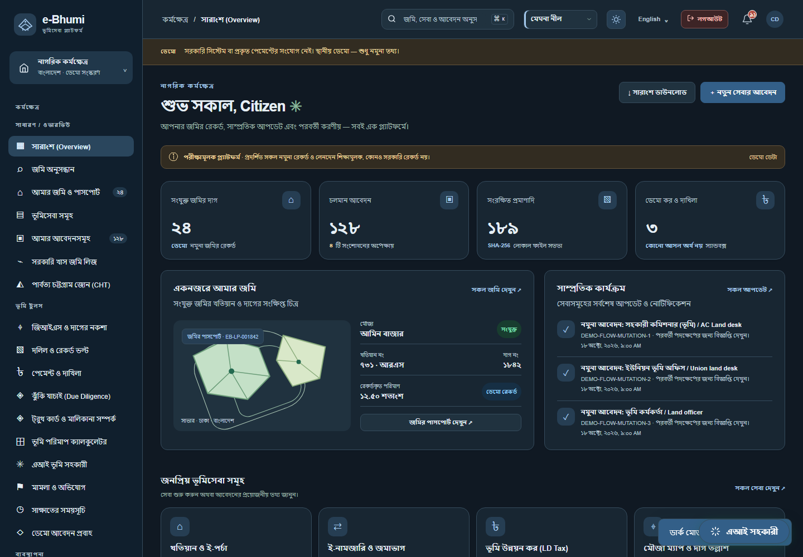
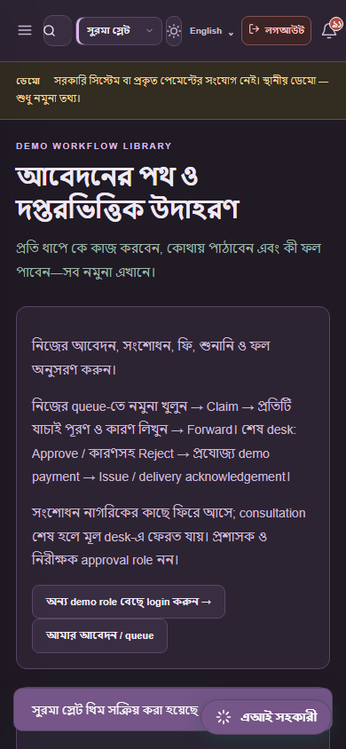
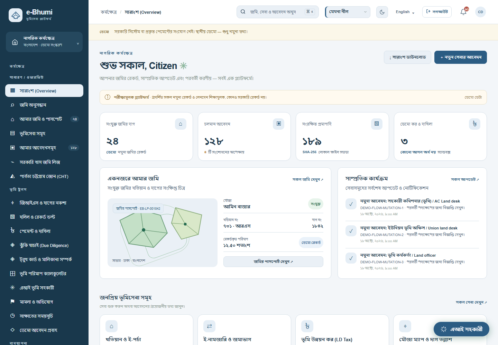
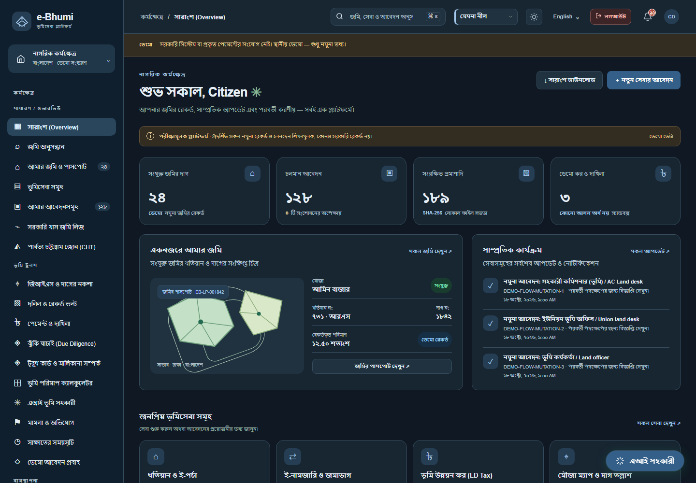
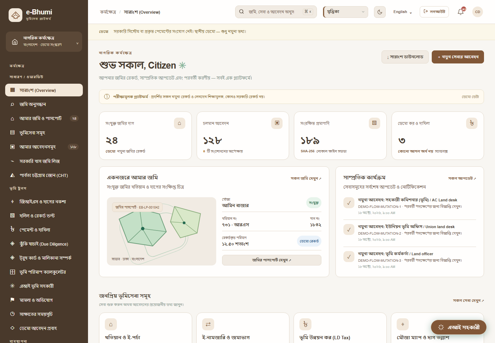
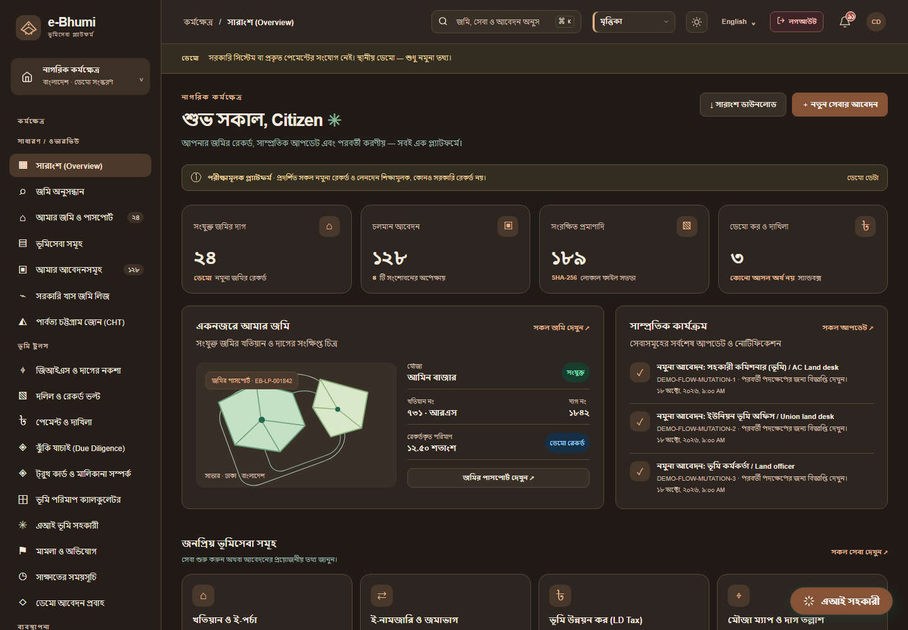

# Role demonstrations and day/night palettes — v5.9.0

Reviewed 18 October 2026. Existing fonts, layout, citizen features and saved user applications remain intact.

## How to explore

1. On the login page, choose a demo role and sign in.
2. Open **ডেমো আবেদন প্রবাহ / Demo workflows & examples**, available in every role's sidebar. The dashboard also links to this library and role-appropriate cases.
3. Find a service. Its ordered desks, expected outputs, source link and role-visible examples are shown together.
4. Open an active example, claim it as the current desk, record all required checks and a reason, then forward. Only the final desk can approve or reject. Applicable demo payment precedes issue/delivery.
5. Choose the next demo role on the login page to continue. The citizen/representative can track the same application's desk and history. Completed examples provide downloadable artifacts and hash verification.

There are **104 v2 application examples**: 69 regular desk-stage examples, two bounded consultations and 33 completed examples, plus **four separate vested-property preparation cases**. The previous compact examples remain. Initial sample counts can change as people operate the demo.

| Role family | Example work |
| --- | --- |
| Citizen / representative | Own requests, schedules, sample evidence, corrections, payments and completed outcomes |
| AC Land / union / officer | Initial mutation order, local enquiry, technical review, return to final AC Land desk |
| Records / registrar / surveyor / kanungo / settlement | Copy requests, deed preparation, survey evidence and appropriate handoffs |
| Lease committee / UNO / DC | Notice-specific eligibility, evidence, recommendation and competent local decision stages |
| Acquisition / legal / appeals | Claim or objection evidence, reasons, scoped consultation and return handoffs |
| Ministry / divisional consultation | A routed acquisition example that returns to the referring LA desk after checks |
| Finance | Holding demands, tax-correction example and reconciliation; citizen tax payment generates the demo Dakhila without an invented manual approval |
| Support | Service grievance and appointment examples |
| VP desk | Separate evidence-preparation cases through VP → legal → DC → records, with external-authority references explicitly unverified |
| Administrator / auditor | Read-only application examples, outcomes and history; admin manages accounts/settings, auditor inspects; neither receives service approval powers |

## Research and workflow boundaries

The official [mutation stages](https://mutation.land.gov.bd/namjari-steps) describe the AC Land initial order before union enquiry. New mutation/inheritance examples and applications therefore start at AC Land, proceed to union and technical review, and return to AC Land for final disposition. Partition/consolidation use the same initial-order distinction. Existing applications retain their stored desk sequence and history; they are not silently rerouted. Technical review and consultations are local demonstration mappings, not universal statutory mandates. Hearing, evidence, authority and service-specific current requirements must be confirmed case by case.

The [official tax manuals](https://ldtax.gov.bd/manual) and [published fee reference](https://land.gov.bd/vumisheba-fee?lang=bn) remain linked from service guidance. Samples do not submit to government portals or take real payments. A completed report proves only the integrity of the local payload.

## Data preservation

The one-time `roleDemoEdition` migration adds deterministic IDs without resetting existing applications, edited examples, accounts or uploaded documents. Example content is generated independently; it never copies a user's edited request or uploaded evidence. New citizen registrations remain empty and private. Demo cases respect ownership, current desk, prior handoff and oversight permissions. Old v1-only configurations retain the compact v1 seed rather than receiving v2 workflows.

## Appearance collection

The original Padma green/white colours and existing green night mode remain unchanged. The three alternative palettes have coordinated daylight and nightfall shades: Meghna Blue, Earth Clay and Surma Slate. Muted surfaces, readable text, matching sidebars and restrained primary buttons replace the previous mix of green controls and differently coloured sidebars. Warning, error and status colours remain semantic. Map artwork remains illustrative.

A compact native dropdown in the topbar selects the palette; the existing moon/sun button switches night/day mode. The large preview dialog and descriptive cards have been removed. Meghna remains river blue, while Surma uses a clearly different muted plum-slate family. The native control supports keyboard use without covering the workspace. Palette and mode are saved locally and synchronized across tabs; an unset display preference respects the operating system. Labels follow the English/Bangla platform language.

| Compact desktop selector | Compact mobile selector |
| --- | --- |
|  |  |

| Blue day | Blue night |
| --- | --- |
|  |  |
| Clay day | Clay night |
|  |  |

## Verification

- 139 automated test cases passed: prior lifecycle/security regressions plus all 33 new service examples resolved using actual APIs, consultations returned to LA, VP handoff, outcome hashes, owner isolation and idempotent restart.
- All 24 roles passed the 33-service example-library and mobile checks.
- The browser regression checks 192 role/theme/mode combinations, original green/white computed colours, coordinated alternate sidebars and selected normal-text contrast targets (4.5:1). These are targeted checks, not a complete accessibility certification. The compact selector, persistence, bilingual labels, mobile control bounds and a separate blue/slate hue family are also checked.
- Screenshot renders are in `docs/screenshots-role-themes/`. Browser automation relays actual local responses when loopback is isolated; no fake API results are substituted.

```powershell
npm run check
npm run build
npm test
# With Playwright/Chromium installed or configured:
node ebhumi-platform/tests/role-themes-browser.cjs
```
